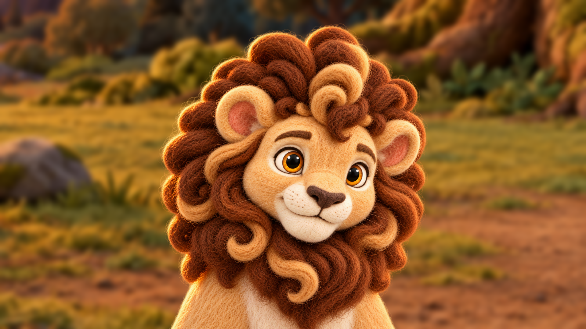
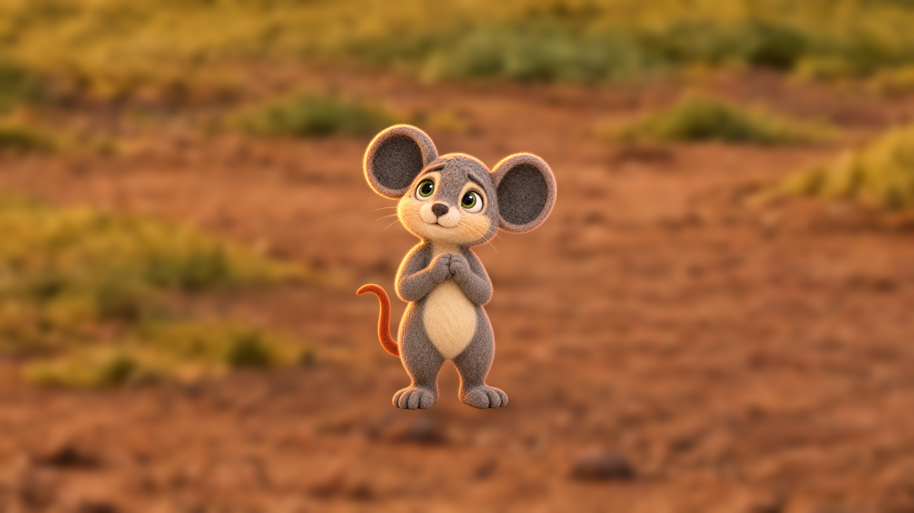
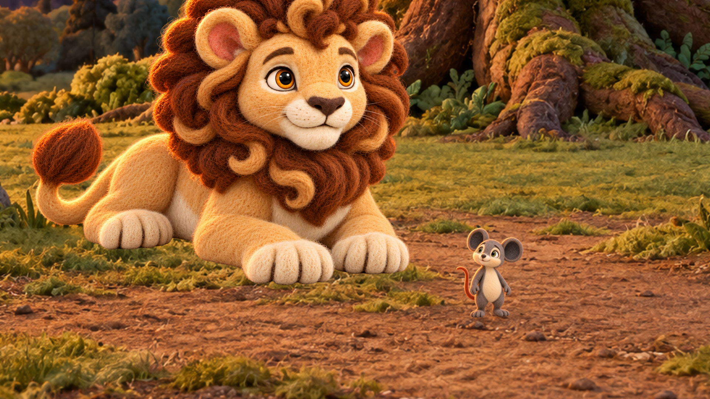
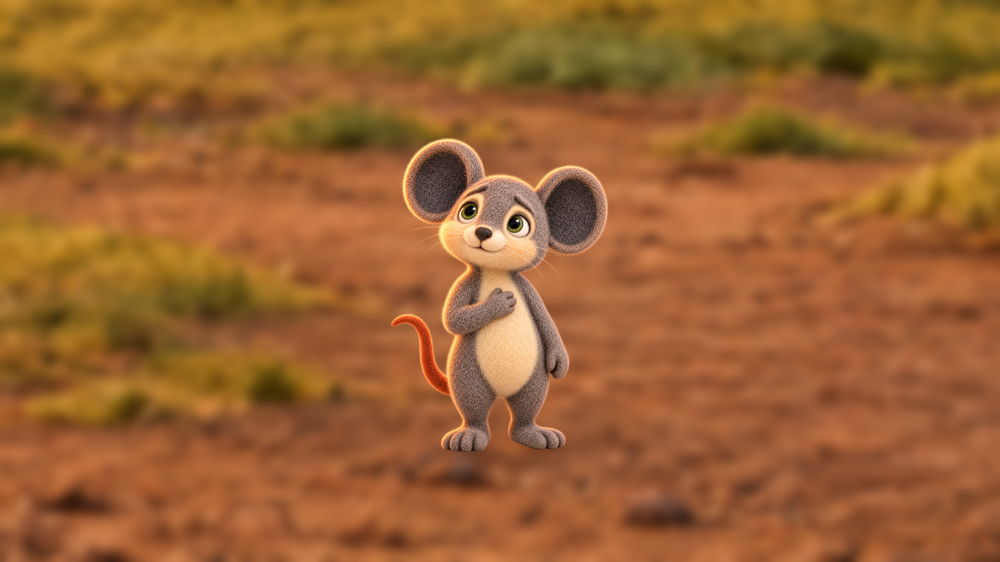
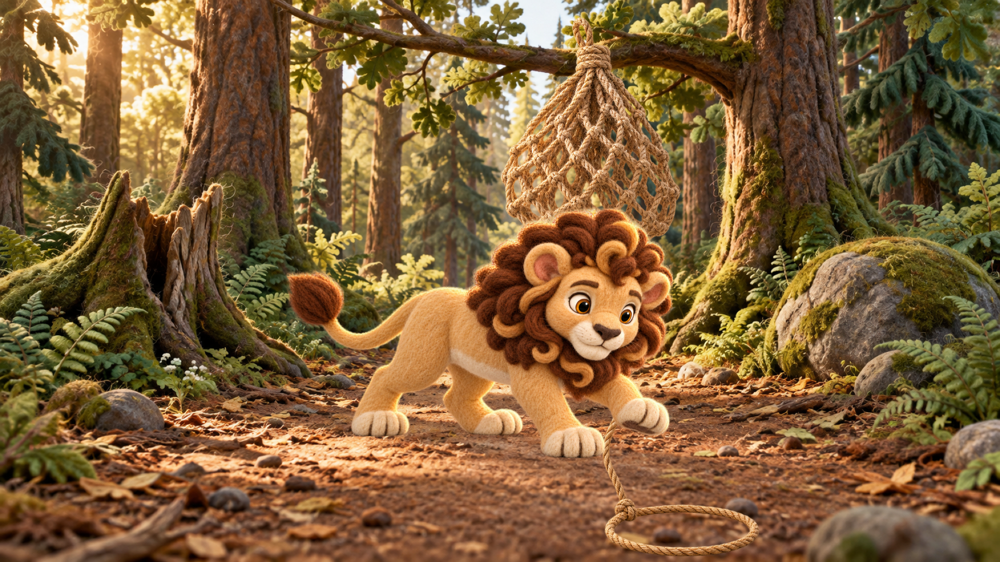
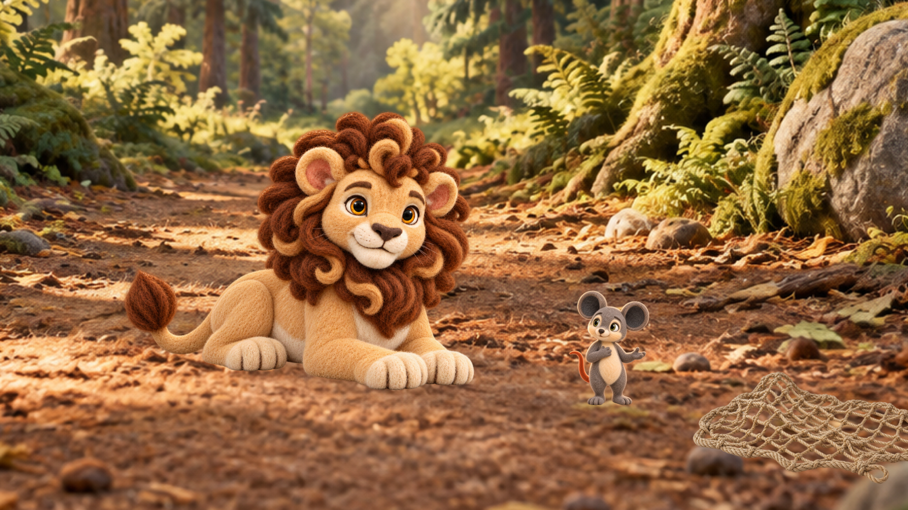
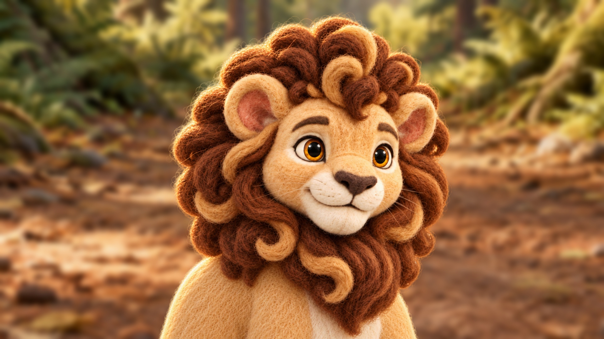
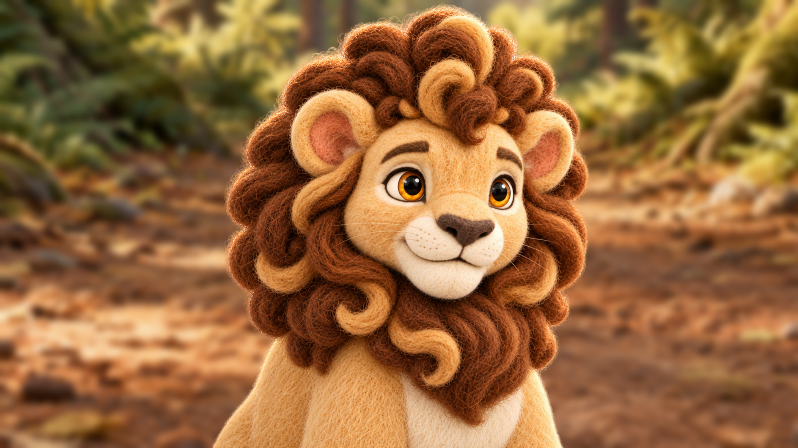
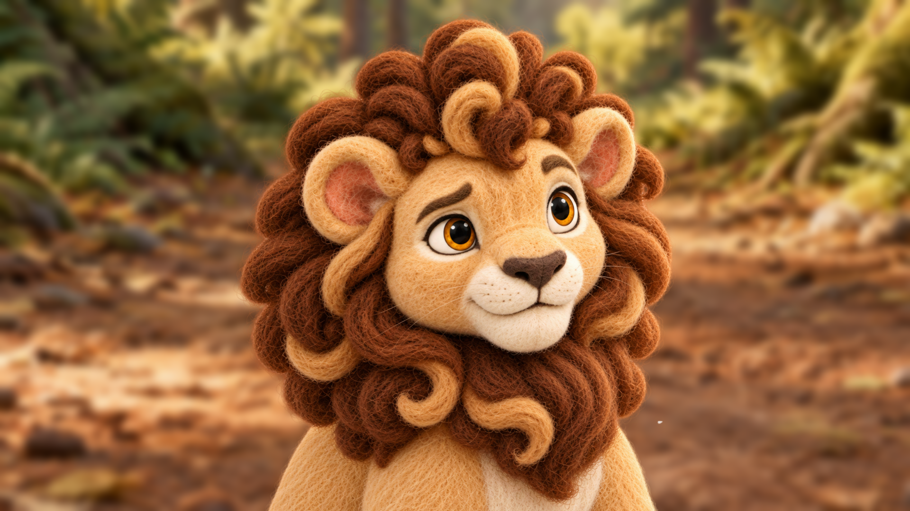

# Lion and Mouse v6 generated frame review

**Date:** 13 October 2026
**Branch:** `working-cloud-branch`
**Starting commit:** `ce821fc1573c05215fae84ae6672ccf0d32f4645`

Nine new hash-bound keyframe candidates are staged. Four Scene 8 frames and five Scene 10/15 frames were rebuilt from approved location plates, owner-approved character canonicals and hash-approved setup anchors. The original plate pixels remain the background authority; character and prop layers were composited locally. Superseded versions are byte-preserved under `keyframes/.review/history/`. All nine candidates remain pending owner visual review; none is approved for video.

| Frame | Candidate preview | SHA-256 | Registered view |
|---|---|---|---|
| `s08_p02` |  | `6897037efcb63903e98e7d5d7a87ffdd6267a1932cd5fec4a5f746e8faba7b55` | Tree dusk close-solo Leo |
| `s08_p03` |  | `92310192480c53b3107a0541958fa3c96bf1e2ab63a5f5277f18a44ee8073f51` | Tree dusk Milo portrait |
| `s08_p04` |  | `859b4f14f9f48749cc44afec73a9a8440568f685e4a41cd74fcb6edfd2e33e4a` | Tree dusk medium two-shot |
| `s08_p05` |  | `5760c002310bea3a96ce8686b6c5718d744f03523dc04076216162dec11bec32` | Tree dusk Milo portrait |
| `s10_p02` |  | `c241a6b3e7a90884422a066249dfbd007a0079a3ab36473de95adf0e3e72c606` | Trap morning wide; folded net, continuous rope and grounded loop |
| `s15_p04` |  | `bf36806e7441bba98793a68a1a845ce30765ead3ea28d50dc6081e6891a84549` | Trap morning medium two-shot; released net behind pair |
| `s15x_p01` |  | `59e0ee3763a036ae62ac5115b9daffe41881a9db14ac4b33c3c6765422936b0f` | Trap morning close-solo Leo |
| `s15x_p03` |  | `b397a3ace66f2a8300406b3e51fb7a416d7ed33456a89d0a5e48778d5f8ffa10` | Trap morning close-solo Leo |
| `s15x_p05` |  | `5810119e9fdaeac98410e3ba63294c9864bf3b9ad1270a18cdd46fb620146a36` | Trap morning close-solo Leo |

The three calibration anchors below are separate review items. They remain pending and are not used by these nine candidates. Five other replacement targets remain dependent on these exact anchor approvals: `s12_p02`, `s14_p06`, `s15x_p02`, `s15x_p04`, and `s15x_p06`.

| Setup family | Candidate | SHA-256 |
|---|---|---|
| `trap_morning:wide` Leo + Milo | [trap_morning_wide_leomilo_calibration_r01_candidate.png](../../character/locations/lion_and_mouse_v6/size_anchors/.review/trap_morning_wide_leomilo_calibration_r01_candidate.png) | `78f0d5ff6e867a894f32a708444ac925e5f88f21a2e671dd49b7f4fc61545103` |
| `run_morning:portrait_milo` | [run_morning_portrait_milo_calibration_r01_candidate.png](../../character/locations/lion_and_mouse_v6/size_anchors/.review/run_morning_portrait_milo_calibration_r01_candidate.png) | `22d37f8726ff0f0b437e6eac760e1ddd650a41a430729cc26b5b5a829a0f590e` |
| `trap_morning:portrait_milo` | [trap_morning_portrait_milo_calibration_r01_candidate.png](../../character/locations/lion_and_mouse_v6/size_anchors/.review/trap_morning_portrait_milo_calibration_r01_candidate.png) | `f6e3a9d338d3746470ad54144a0ea41bfc9bdd80b3e974d08ff65b887016211d` |

Exact prompts, source hashes, authority paths, registered crop receipts, layer hashes and compositor placements are in [`s08_generated_composites_r01.json`](../../character/characters/lion_and_mouse_v6/interactions/keyframes/.review/s08_generated_composites_r01.json) and [`s10_s15_generated_composites_r01.json`](../../character/characters/lion_and_mouse_v6/interactions/keyframes/.review/s10_s15_generated_composites_r01.json). The deterministic compositor is [`compose_transparent_keyframe.swift`](../../production/compose_transparent_keyframe.swift). Current Scene 10 and Scene 15 contact sheets are [Scene 10](../../character/characters/lion_and_mouse_v6/interactions/keyframes/.review/contact_sheets/current/scene10_keyframes.png) and [Scene 15](../../character/characters/lion_and_mouse_v6/interactions/keyframes/.review/contact_sheets/current/scene15_keyframes.png).

Please review each candidate at full resolution and return `approve` or `reject` with the exact SHA-256 for each. Do the same for each calibration anchor before the five dependent frames are generated. General approval without naming the image hash does not change candidate status.
