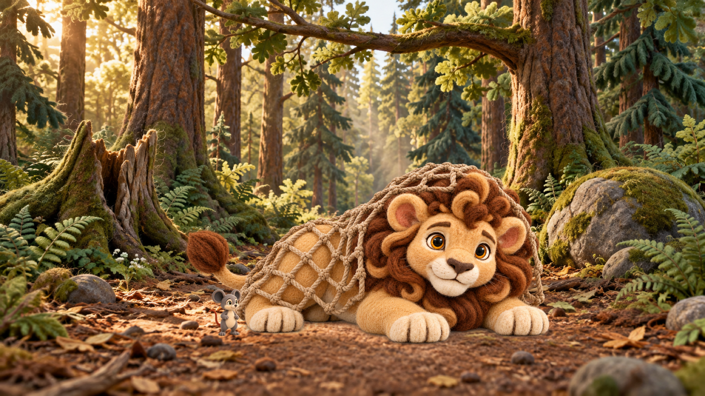
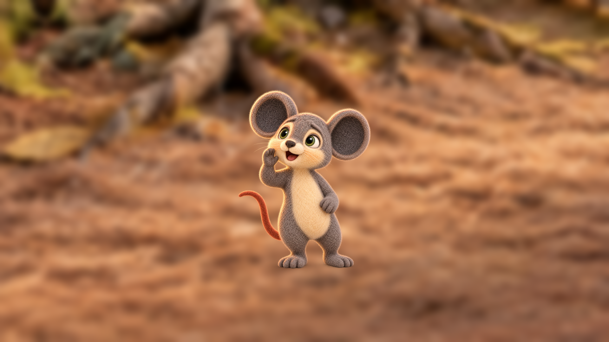
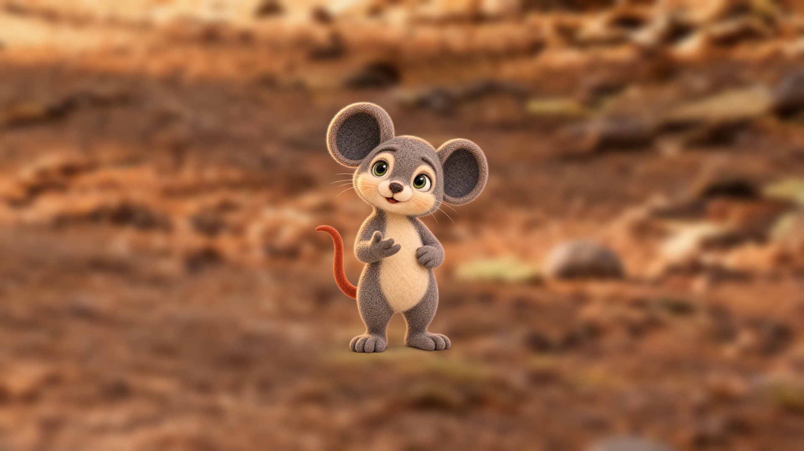

# Lion and Mouse v6 — Setup-anchor owner selection packet

**Status:** six of the nine anchors needed for the 14 replacement candidates are owner-approved and hash-bound; three new calibration candidates are generated and await hash-bound owner review; the other setup anchors remain pending. This packet records owner decisions for the exact input hashes and setup anchors below. Anchor approval authorizes use as a scale reference; it does not approve that candidate for final video.

Six selected families are recorded as hash-bound authorities in `staging_plan.json`; the three declined target families now have candidate images in `character/locations/lion_and_mouse_v6/size_anchors/.review/` and remain unapproved. Other unselected families remain pending. Do not select a rejected or stale candidate. The same-depth Milo:Leo standing-height target is **0.25**, review range **0.22–0.28**, from `visual_bible.json`; staging metadata remains the source of frame-specific target geometry.

The owner approved the current Milo canonical and hunter-net prop hashes for v6 replacement-image generation on 2026-10-13. Six setup-anchor selections are recorded below and in `staging_plan.json`; three fresh calibration candidates are recorded below with hashes, source layers, and registered geometry. Milo and Leo consolidated atlases and the acorn reference remain pending owner review. Approved Leo canonicals and location masters are preserved.

## Owner decision form

| Setup anchor | Owner-selected candidate or new calibration | Exact selected SHA-256 | Owner reviewer/date | Result |
|---|---|---|---|---|
| `stream_afternoon_wide_milo` |  |  |  |  |
| `stream_afternoon_medium_solo_milo` |  |  |  |  |
| `stream_sunset_wide_milo` |  |  |  |  |
| `stream_sunset_medium_solo_milo` |  |  |  |  |
| `fork_sunset_wide_empty` |  |  |  |  |
| `fork_sunset_medium_solo_milo` |  |  |  |  |
| `shortcut_dusk_wide_milo` |  |  |  |  |
| `tree_dusk_wide_leo` |  |  |  |  |
| `tree_dusk_medium_two_leo,milo` | `s05_p04_r03_candidate.png` | `7b5b1e0dcae0969458e1768eccc4ae0f1b372047a7d64c8a7a51fdda7bb44657` | project_owner / 2026-10-13 | `approved_owner_hash_bound` |
| `tree_dusk_close_two_leo,milo` |  |  |  |  |
| `tree_dusk_wide_leo,milo` |  |  |  |  |
| `tree_dusk_close_solo_leo` | `s07x_p01_r01_candidate.png` | `b94460063f02a834cfdf575bb4d0f508bc364f889b5c63896bc4da449435e827` | project_owner / 2026-10-13 | `approved_owner_hash_bound` |
| `tree_dusk_portrait_milo_milo` | `s07x_p02_r01_candidate.png` | `b0f96a63971bab2baed44b0b95a0d91a68a3a88fdb5747c021de414ab7829034` | project_owner / 2026-10-13 | `approved_owner_hash_bound` |
| `home_night_wide_milo` |  |  |  |  |
| `shortcut_dusk_wide_empty` |  |  |  |  |
| `trap_morning_wide_leo` | `s10_p03_r02_candidate.png` | `c8f382e3ef0a32b56a62e58a6d6d4503ff799fef61107d1be01f7203f63519a1` | project_owner / 2026-10-13 | `approved_owner_hash_bound` |
| `trap_morning_medium_solo_leo` |  |  |  |  |
| `trap_morning_close_solo_leo` | `s15_p05_r01_candidate.png` | `39e9563baf98a94576f4cd231e766cfde6d1657152f1219c880d6543286e0b4b` | project_owner / 2026-10-13 | `approved_owner_hash_bound` |
| `run_morning_medium_solo_milo` |  |  |  |  |
| `run_morning_portrait_milo_milo` | [calibration candidate](../../character/locations/lion_and_mouse_v6/size_anchors/.review/run_morning_portrait_milo_calibration_r01_candidate.png) | `22d37f8726ff0f0b437e6eac760e1ddd650a41a430729cc26b5b5a829a0f590e` | not yet reviewed | `candidate_generated_pending_owner_review` |
| `run_morning_wide_milo` |  |  |  |  |
| `trap_morning_wide_leo,milo` | [calibration candidate](../../character/locations/lion_and_mouse_v6/size_anchors/.review/trap_morning_wide_leomilo_calibration_r01_candidate.png) | `78f0d5ff6e867a894f32a708444ac925e5f88f21a2e671dd49b7f4fc61545103` | not yet reviewed | `candidate_generated_pending_owner_review` |
| `trap_morning_medium_two_leo,milo` | `s13_p03_r03_candidate.png` | `68f87262eca56d3d2483e9fd0a963ce615d534a097f9b95e707458acae09dc81` | project_owner / 2026-10-13 | `approved_owner_hash_bound` |
| `trap_morning_detail_insert_milo` |  |  |  |  |
| `tree_day_wide_leo,milo` |  |  |  |  |
| `tree_day_medium_two_leo,milo` |  |  |  |  |
| `shortcut_dusk_medium_solo_milo` |  |  |  |  |
| `tree_dusk_detail_insert_leo` |  |  |  |  |
| `trap_morning_portrait_milo_milo` | [calibration candidate](../../character/locations/lion_and_mouse_v6/size_anchors/.review/trap_morning_portrait_milo_calibration_r01_candidate.png) | `f6e3a9d338d3746470ad54144a0ea41bfc9bdd80b3e974d08ff65b887016211d` | not yet reviewed | `candidate_generated_pending_owner_review` |

## New calibration candidates awaiting owner review

These are review-only candidate images. Their approved source plates remain the exact story masters, and registered character heights/contacts are recorded in `staging_plan.json` under `candidate_review`. No candidate below is an approved scale anchor yet.

### `trap_morning_wide_leo,milo`

SHA-256 `78f0d5ff6e867a894f32a708444ac925e5f88f21a2e671dd49b7f4fc61545103`; Leo height 0.462, Milo height 0.119 (25.8%); contacts Leo [0.52, 0.83], Milo [0.32, 0.85].

### `run_morning_portrait_milo_milo`

SHA-256 `22d37f8726ff0f0b437e6eac760e1ddd650a41a430729cc26b5b5a829a0f590e`; height 0.524; contact [0.4999765, 0.7999718] in the registered crop.

### `trap_morning_portrait_milo_milo`

SHA-256 `f6e3a9d338d3746470ad54144a0ea41bfc9bdd80b3e974d08ff65b887016211d`; height 0.56; contact [0.4999765, 0.7999718] in the registered crop.

Generation provenance, plate/character source hashes, and transparent source layers are recorded in [calibration_candidates_r01.json](../../character/locations/lion_and_mouse_v6/size_anchors/.review/calibration_candidates_r01.json).

## Owner-approved and outstanding inputs for the 14 replacement candidates

The rejected and stale frames need nine distinct anchor families. Six have exact owner selections below. The other three target families now have calibration candidates; their target frames remain blocked until an owner approves the exact candidate hashes below.

`Milo canonical` and `hunter_net` are direct required inputs, approved for this replacement-generation batch by exact hash on 2026-10-13. The combined atlases remain pending owner review and are not attached as direct inputs by the v6 regeneration contract.

| Input | Current status | File | SHA-256 |
|---|---|---|---|
| Milo canonical | `approved_owner_hash_bound` for replacement generation | [full-body_milo_neutral_pose_r01.png](../../character/characters/lion_and_mouse_v6/Milo/canonical/full-body_milo_neutral_pose_r01.png) | `bb2cef3739b00fedf6cfd8561f27614a7910b39604da3995a794c550928b258e` |
| Leo canonical | `owner_approved_foundation` | [full-body_leo_neutral_pose_r01.png](../../character/characters/lion_and_mouse_v6/Leo/canonical/full-body_leo_neutral_pose_r01.png) | `6b587c8ee2739767bb7af056ee3176ec3d2e698a5bed0e013263814ee8059545` |
| Hunter net | `approved_owner_hash_bound` for replacement generation | [hunter_net_prop_r01_candidate.png](../../character/locations/lion_and_mouse_v6/props/.review/hunter_net_prop_r01_candidate.png) | `666d29ec6e0f323bf10450d4abd5125bf6c3bdf12e56bffdab6cffeede9666d3` |
| Milo combined atlas | `pending_owner_review` | [m_complete_reference_r01_candidate.png](../../character/characters/lion_and_mouse_v6/Milo/references/m_complete_reference_r01_candidate.png) | `41007e1332165b70595622e99a2d1f56a3ea3b5d1da01de71c94d1dcd203fce2` |
| Leo combined atlas | `pending_owner_review` | [l_complete_reference_r01_candidate.png](../../character/characters/lion_and_mouse_v6/Leo/references/l_complete_reference_r01_candidate.png) | `73aa4429cc91cd28060ca3b4fcfd42464974429a328d5ab53c3779fc1485048c` |

The nine required anchor IDs are `tree_dusk_close_solo_leo`, `tree_dusk_portrait_milo_milo`, `tree_dusk_medium_two_leo,milo`, `trap_morning_wide_leo`, `trap_morning_wide_leo,milo`, `trap_morning_medium_two_leo,milo`, `trap_morning_close_solo_leo`, `trap_morning_portrait_milo_milo`, and `run_morning_portrait_milo_milo`. The acorn reference is not required by these 14 frames.

## Setup families and candidate evidence

### `stream_afternoon_wide_milo`

- Camera family: `stream_afternoon:wide`; location: `stream_afternoon`; view: `wide`; actors: `milo`.
- Anchor status: `pending_owner_selection_and_hash_bound_review`. Existing anchor image: `not selected`; anchor SHA-256: `not selected`.
- Plate: `character/locations/lion_and_mouse_v6/stream_bank/stream_afternoon_r01.png` (SHA-256 `16b4ebe134236f243b44f278fec85904698f062baa6a11b5bc0aa358858b4f24`).
- Frames in family: `s01_p01`, `s01_p03`.

| Frame | Current candidate | Current SHA-256 | Disposition / freshness | Staged target |
|---|---|---|---|---|
| `s01_p01` | [s01_p01_r03_candidate.png](../../character/characters/lion_and_mouse_v6/interactions/keyframes/s01_p01_r03_candidate.png) | `6d51bad2cc8bf0c906a78f0569d8038551b5071e5378b9c367bdf863fb11da0e` | `pending_review` / `current` | milo: depth 0.583, height 0.107, contact [0.32, 0.82] |
| `s01_p03` | [s01_p03_r07_candidate.png](../../character/characters/lion_and_mouse_v6/interactions/keyframes/s01_p03_r07_candidate.png) | `bd263f472822c1c25bb89cd4342ea16b43d723c1d67394d2a3a1443af177551d` | `pending_review` / `current` | milo: depth 0.458, height 0.099, contact [0.49, 0.79] |

**Owner review:** select one clean candidate or request a new calibration image; record the selection, final file hash, reviewer, date, and review result above and in the authoritative data. No selection has been made in this packet.

### `stream_afternoon_medium_solo_milo`

- Camera family: `stream_afternoon:medium_solo`; location: `stream_afternoon`; view: `medium_solo`; actors: `milo`.
- Anchor status: `pending_owner_selection_and_hash_bound_review`. Existing anchor image: `not selected`; anchor SHA-256: `not selected`.
- Plate: `character/locations/lion_and_mouse_v6/stream_bank/stream_afternoon_r01.png` (SHA-256 `16b4ebe134236f243b44f278fec85904698f062baa6a11b5bc0aa358858b4f24`).
- Frames in family: `s01_p02`, `s01_p04`, `s01x_p01`, `s01x_p02`, `s01x_p03`.

| Frame | Current candidate | Current SHA-256 | Disposition / freshness | Staged target |
|---|---|---|---|---|
| `s01_p02` | [s01_p02_r02_candidate.png](../../character/characters/lion_and_mouse_v6/interactions/keyframes/s01_p02_r02_candidate.png) | `ef6a1c389e1b7f915d3707a98cc9c86d03c3ed4b8345da92146e8b36c9d9d372` | `pending_review` / `current` | milo: depth 0.625, height 0.175, contact [0.29, 0.83] |
| `s01_p04` | [s01_p04_r02_candidate.png](../../character/characters/lion_and_mouse_v6/interactions/keyframes/s01_p04_r02_candidate.png) | `bdbd5175e4cd86ca2313290dd727da794a924b2215c10dfeb95338b94e94581f` | `pending_review` / `current` | milo: depth 0.75, height 0.186, contact [0.59, 0.86] |
| `s01x_p01` | [s01x_p01_r02_candidate.png](../../character/characters/lion_and_mouse_v6/interactions/keyframes/s01x_p01_r02_candidate.png) | `47412d1463a362f79de00134865840d2c3ff1f60355219a9f8bef9e611306207` | `pending_review` / `current` | milo: depth 0.75, height 0.186, contact [0.37, 0.86] |
| `s01x_p02` | [s01x_p02_r01_candidate.png](../../character/characters/lion_and_mouse_v6/interactions/keyframes/s01x_p02_r01_candidate.png) | `1188dfc2e42f3b90671141ae2e9e8d88c05bfa64e0a2fd0a8983fc728a87250b` | `pending_review` / `current` | milo: depth 0.708, height 0.182, contact [0.47, 0.85] |
| `s01x_p03` | [s01x_p03_r01_candidate.png](../../character/characters/lion_and_mouse_v6/interactions/keyframes/s01x_p03_r01_candidate.png) | `880c498038eac6f3546c55100aad041a32839f01050b3e0c23dc67d20b33d982` | `pending_review` / `current` | milo: depth 0.75, height 0.186, contact [0.59, 0.86] |

**Owner review:** select one clean candidate or request a new calibration image; record the selection, final file hash, reviewer, date, and review result above and in the authoritative data. No selection has been made in this packet.

### `stream_sunset_wide_milo`

- Camera family: `stream_sunset:wide`; location: `stream_sunset`; view: `wide`; actors: `milo`.
- Anchor status: `pending_owner_selection_and_hash_bound_review`. Existing anchor image: `not selected`; anchor SHA-256: `not selected`.
- Plate: `character/locations/lion_and_mouse_v6/stream_bank/stream_sunset_r01.png` (SHA-256 `b0a7a91fab619ca2f112bd8c9535322ca62a7a81fed92e7d0b74beda914d3d1d`).
- Frames in family: `s02_p01`.

| Frame | Current candidate | Current SHA-256 | Disposition / freshness | Staged target |
|---|---|---|---|---|
| `s02_p01` | [s02_p01_r02_candidate.png](../../character/characters/lion_and_mouse_v6/interactions/keyframes/s02_p01_r02_candidate.png) | `492df6934222464468a4f697b449c78f74868bcde05e73b1e0dbce9bafbf9186` | `pending_review` / `current` | milo: depth 0.667, height 0.112, contact [0.59, 0.84] |

**Owner review:** select one clean candidate or request a new calibration image; record the selection, final file hash, reviewer, date, and review result above and in the authoritative data. No selection has been made in this packet.

### `stream_sunset_medium_solo_milo`

- Camera family: `stream_sunset:medium_solo`; location: `stream_sunset`; view: `medium_solo`; actors: `milo`.
- Anchor status: `pending_owner_selection_and_hash_bound_review`. Existing anchor image: `not selected`; anchor SHA-256: `not selected`.
- Plate: `character/locations/lion_and_mouse_v6/stream_bank/stream_sunset_r01.png` (SHA-256 `b0a7a91fab619ca2f112bd8c9535322ca62a7a81fed92e7d0b74beda914d3d1d`).
- Frames in family: `s02_p02`, `s02_p03`.

| Frame | Current candidate | Current SHA-256 | Disposition / freshness | Staged target |
|---|---|---|---|---|
| `s02_p02` | [s02_p02_r01_candidate.png](../../character/characters/lion_and_mouse_v6/interactions/keyframes/s02_p02_r01_candidate.png) | `e890692698af2e5ecd60b4728862dcee6872ce8ab8bd02a9250556be4e45cac7` | `pending_review` / `current` | milo: depth 0.667, height 0.179, contact [0.56, 0.84] |
| `s02_p03` | [s02_p03_r01_candidate.png](../../character/characters/lion_and_mouse_v6/interactions/keyframes/s02_p03_r01_candidate.png) | `6cf9f93e8ed9b713555f54f6a5f6c2d22ad1655a09ae0144b6b1e82a821c333b` | `pending_review` / `current` | milo: depth 0.667, height 0.179, contact [0.63, 0.84] |

**Owner review:** select one clean candidate or request a new calibration image; record the selection, final file hash, reviewer, date, and review result above and in the authoritative data. No selection has been made in this packet.

### `fork_sunset_wide_empty`

- Camera family: `fork_sunset:wide`; location: `fork_sunset`; view: `wide`; actors: ``.
- Anchor status: `pending_owner_selection_and_hash_bound_review`. Existing anchor image: `not selected`; anchor SHA-256: `not selected`.
- Plate: `character/locations/lion_and_mouse_v6/fork/fork_sunset_r01.png` (SHA-256 `01951471934ab4ea1876b7851140bcc86fcc126ea5ac89290cbd47a9e163b9d5`).
- Frames in family: `s03_p01`.

| Frame | Current candidate | Current SHA-256 | Disposition / freshness | Staged target |
|---|---|---|---|---|
| `s03_p01` | [s03_p01_r01_candidate.png](../../character/characters/lion_and_mouse_v6/interactions/keyframes/s03_p01_r01_candidate.png) | `82f23e9edd68eab25286f0a109bf96741079009ac1c5af1493df01b94f183fe2` | `pending_review` / `current` | no actor geometry |

**Owner review:** select one clean candidate or request a new calibration image; record the selection, final file hash, reviewer, date, and review result above and in the authoritative data. No selection has been made in this packet.

### `fork_sunset_medium_solo_milo`

- Camera family: `fork_sunset:medium_solo`; location: `fork_sunset`; view: `medium_solo`; actors: `milo`.
- Anchor status: `pending_owner_selection_and_hash_bound_review`. Existing anchor image: `not selected`; anchor SHA-256: `not selected`.
- Plate: `character/locations/lion_and_mouse_v6/fork/fork_sunset_r01.png` (SHA-256 `01951471934ab4ea1876b7851140bcc86fcc126ea5ac89290cbd47a9e163b9d5`).
- Frames in family: `s03_p02`, `s03_p03`, `s03_p04`.

| Frame | Current candidate | Current SHA-256 | Disposition / freshness | Staged target |
|---|---|---|---|---|
| `s03_p02` | [s03_p02_r01_candidate.png](../../character/characters/lion_and_mouse_v6/interactions/keyframes/s03_p02_r01_candidate.png) | `24d7b5a3ccc49a7eee53cdf109b72013f0d8222944f5b62f24d449b4ae7cd53b` | `pending_review` / `current` | milo: depth 0.737, height 0.185, contact [0.45, 0.82] |
| `s03_p03` | [s03_p03_r01_candidate.png](../../character/characters/lion_and_mouse_v6/interactions/keyframes/s03_p03_r01_candidate.png) | `7cb12ef07cb04ef2f2fe7a700abe3d297cff09c8c8a6251631527eb846de7357` | `pending_review` / `current` | milo: depth 0.711, height 0.183, contact [0.53, 0.81] |
| `s03_p04` | [s03_p04_r01_candidate.png](../../character/characters/lion_and_mouse_v6/interactions/keyframes/s03_p04_r01_candidate.png) | `527ec61eb3afcb9838612d3f9532a7457cd6e90ca7169df7d508ad31ef2046f2` | `pending_review` / `current` | milo: depth 0.632, height 0.175, contact [0.64, 0.78] |

**Owner review:** select one clean candidate or request a new calibration image; record the selection, final file hash, reviewer, date, and review result above and in the authoritative data. No selection has been made in this packet.

### `shortcut_dusk_wide_milo`

- Camera family: `shortcut_dusk:wide`; location: `shortcut_dusk`; view: `wide`; actors: `milo`.
- Anchor status: `pending_owner_selection_and_hash_bound_review`. Existing anchor image: `not selected`; anchor SHA-256: `not selected`.
- Plate: `character/locations/lion_and_mouse_v6/shortcut/shortcut_dusk_r01.png` (SHA-256 `16d9f06537c6913d21e71f3d00614fb0e587679cca27b302167c0d766278e4e3`).
- Frames in family: `s04_p01`, `s04_p02`, `s04_p03`, `s04_p04`, `s09_p01`.

| Frame | Current candidate | Current SHA-256 | Disposition / freshness | Staged target |
|---|---|---|---|---|
| `s04_p01` | [s04_p01_r04_candidate.png](../../character/characters/lion_and_mouse_v6/interactions/keyframes/s04_p01_r04_candidate.png) | `2457b0ec290bc87beb512adb8cb9d2d94bce637908728ad0f88bd696f0680695` | `pending_review` / `current` | milo: depth 0.682, height 0.112, contact [0.25, 0.81] |
| `s04_p02` | [s04_p02_r07_candidate.png](../../character/characters/lion_and_mouse_v6/interactions/keyframes/s04_p02_r07_candidate.png) | `ed00c0774149038c8f8b60013632a2f23a79209ddcde7e12bca649500800072b` | `pending_review` / `current` | milo: depth 0.545, height 0.104, contact [0.42, 0.78] |
| `s04_p03` | [s04_p03_r08_candidate.png](../../character/characters/lion_and_mouse_v6/interactions/keyframes/s04_p03_r08_candidate.png) | `a1ab23ebd695c7666957e327fbb400b814aca24bbddb2749011929c75b0c7414` | `pending_review` / `current` | milo: depth 0.545, height 0.104, contact [0.64, 0.78] |
| `s04_p04` | [s04_p04_r11_candidate.png](../../character/characters/lion_and_mouse_v6/interactions/keyframes/s04_p04_r11_candidate.png) | `f1be68117caeac38915ba96b4985afec0ef2f5a8ab15a9391a762bb3156defa2` | `pending_review` / `current` | milo: depth 0.409, height 0.096, contact [0.78, 0.75] |
| `s09_p01` | [s09_p01_r02_candidate.png](../../character/characters/lion_and_mouse_v6/interactions/keyframes/s09_p01_r02_candidate.png) | `c256b2517af3ff12b168d88ebbce58ca37f4faae9a28e9dbf9f1844148239dd2` | `pending_review` / `current` | milo: depth 0.364, height 0.094, contact [0.69, 0.74] |

**Owner review:** select one clean candidate or request a new calibration image; record the selection, final file hash, reviewer, date, and review result above and in the authoritative data. No selection has been made in this packet.

### `tree_dusk_wide_leo`

- Camera family: `tree_dusk:wide`; location: `tree_dusk`; view: `wide`; actors: `leo`.
- Anchor status: `pending_owner_selection_and_hash_bound_review`. Existing anchor image: `not selected`; anchor SHA-256: `not selected`.
- Plate: `character/locations/lion_and_mouse_v6/great_tree/tree_dusk_r01.png` (SHA-256 `6d47f7459c741335c95ccb240a4c784c93d393b840dafdf8d6cbd50c5431f3f6`).
- Frames in family: `s05_p01`, `s09_p03`.

| Frame | Current candidate | Current SHA-256 | Disposition / freshness | Staged target |
|---|---|---|---|---|
| `s05_p01` | [s05_p01_r01_candidate.png](../../character/characters/lion_and_mouse_v6/interactions/keyframes/s05_p01_r01_candidate.png) | `0009c8ce44fb26cb9f67a87b30346d740612a495bbfa6ef469b01783d67f27d6` | `pending_review` / `current` | leo: depth 0.56, height 0.421, contact [0.48, 0.79] |
| `s09_p03` | [s09_p03_r01_candidate.png](../../character/characters/lion_and_mouse_v6/interactions/keyframes/s09_p03_r01_candidate.png) | `9704f3940833d8edbcd8e695a50ca241702c52abee7263d2099dcb917b141442` | `pending_review` / `current` | leo: depth 0.56, height 0.421, contact [0.47, 0.79] |

**Owner review:** select one clean candidate or request a new calibration image; record the selection, final file hash, reviewer, date, and review result above and in the authoritative data. No selection has been made in this packet.

### `tree_dusk_medium_two_leo,milo`

- Camera family: `tree_dusk:medium_two`; location: `tree_dusk`; view: `medium_two`; actors: `leo, milo`.
- Anchor status: `approved_owner_hash_bound`. Owner-selected source: `character/characters/lion_and_mouse_v6/interactions/keyframes/s05_p04_r03_candidate.png`; hash-identical anchor snapshot: `character/locations/lion_and_mouse_v6/size_anchors/tree_dusk_medium_two_leomilo_owner_selected_r01.png`; SHA-256: `7b5b1e0dcae0969458e1768eccc4ae0f1b372047a7d64c8a7a51fdda7bb44657`.
- Plate: `character/locations/lion_and_mouse_v6/great_tree/tree_dusk_r01.png` (SHA-256 `6d47f7459c741335c95ccb240a4c784c93d393b840dafdf8d6cbd50c5431f3f6`).
- Frames in family: `s05_p02`, `s05_p04`, `s06_p02`, `s07_p01`, `s07_p02`, `s07_p03`, `s07_p04`, `s08_p01`, `s08_p04`, `s05x_p05`.

| Frame | Current candidate | Current SHA-256 | Disposition / freshness | Staged target |
|---|---|---|---|---|
| `s05_p02` | [s05_p02_r02_candidate.png](../../character/characters/lion_and_mouse_v6/interactions/keyframes/s05_p02_r02_candidate.png) | `1b05ac5a975a4d6b0e52c467810cefa9e5d7ab2836bb6aec6fa68eb5c9f63684` | `pending_review` / `current` | leo: depth 0.56, height 0.8, contact [0.48, 0.79]; milo: depth 0.72, height 0.218, contact [0.29, 0.83] |
| `s05_p04` | [s05_p04_r03_candidate.png](../../character/characters/lion_and_mouse_v6/interactions/keyframes/s05_p04_r03_candidate.png) | `7b5b1e0dcae0969458e1768eccc4ae0f1b372047a7d64c8a7a51fdda7bb44657` | `pending_review` / `current` | leo: depth 0.56, height 0.8, contact [0.48, 0.79]; milo: depth 0.76, height 0.222, contact [0.62, 0.84] |
| `s06_p02` | [s06_p02_r05_candidate.png](../../character/characters/lion_and_mouse_v6/interactions/keyframes/s06_p02_r05_candidate.png) | `4ee2c6bba346cdf83d1c390fdc8f6101ffe6546ec24b410a6e6fed43b23d6115` | `pending_review` / `current` | leo: depth 0.64, height 0.836, contact [0.46, 0.81]; milo: depth 0.8, height 0.227, contact [0.67, 0.85] |
| `s07_p01` | [s07_p01_r02_candidate.png](../../character/characters/lion_and_mouse_v6/interactions/keyframes/s07_p01_r02_candidate.png) | `3c92a374460695e5e0d5de20a54406252f5e3bbc816bdb52a58da7ee456271bc` | `pending_review` / `current` | leo: depth 0.64, height 0.836, contact [0.46, 0.81]; milo: depth 0.8, height 0.227, contact [0.66, 0.85] |
| `s07_p02` | [s07_p02_r03_candidate.png](../../character/characters/lion_and_mouse_v6/interactions/keyframes/s07_p02_r03_candidate.png) | `204c3464bc51fcace6af28037d068b3fc0845236efc8763fc0b9d2f1e608f039` | `pending_review` / `current` | leo: depth 0.64, height 0.836, contact [0.46, 0.81]; milo: depth 0.8, height 0.227, contact [0.66, 0.85] |
| `s07_p03` | [s07_p03_r02_candidate.png](../../character/characters/lion_and_mouse_v6/interactions/keyframes/s07_p03_r02_candidate.png) | `cb331f9cf4464acd8811be8b566c6fb1058b081fd68165bd4e1ea3842fa8e240` | `pending_review` / `current` | leo: depth 0.64, height 0.836, contact [0.46, 0.81]; milo: depth 0.8, height 0.227, contact [0.66, 0.85] |
| `s07_p04` | [s07_p04_r02_candidate.png](../../character/characters/lion_and_mouse_v6/interactions/keyframes/s07_p04_r02_candidate.png) | `ec98c425d417d86a252e0daa3f5d660ac7af516ad9f5c843b9ff959a20b62c7d` | `pending_review` / `current` | leo: depth 0.64, height 0.836, contact [0.46, 0.81]; milo: depth 0.8, height 0.227, contact [0.66, 0.85] |
| `s08_p01` | [s08_p01_r02_candidate.png](../../character/characters/lion_and_mouse_v6/interactions/keyframes/s08_p01_r02_candidate.png) | `add1e8fd434aacb94f5f79ed7a3a4a737a62ae440d148d96877e8cb1f8cce925` | `pending_review` / `current` | leo: depth 0.64, height 0.836, contact [0.46, 0.81]; milo: depth 0.8, height 0.227, contact [0.66, 0.85] |
| `s08_p04` | [s08_p04_r03_candidate.png](../../character/characters/lion_and_mouse_v6/interactions/keyframes/s08_p04_r03_candidate.png) | `859b4f14f9f48749cc44afec73a9a8440568f685e4a41cd74fcb6edfd2e33e4a` | `pending_review` / `current` | leo: depth 0.64, height 0.836, contact [0.46, 0.81]; milo: depth 0.8, height 0.227, contact [0.66, 0.85] |
| `s05x_p05` | [s05x_p05_r01_candidate.png](../../character/characters/lion_and_mouse_v6/interactions/keyframes/s05x_p05_r01_candidate.png) | `9194731d9f5f6a27444f4f44ff6f2b51348cdb2b9577ff5c0741f16d1ef95783` | `pending_review` / `current` | leo: depth 0.56, height 0.8, contact [0.48, 0.79]; milo: depth 0.72, height 0.218, contact [0.62, 0.83] |

**Owner decision recorded:** selected `s05_p04_r03_candidate.png` with SHA-256 `7b5b1e0dcae0969458e1768eccc4ae0f1b372047a7d64c8a7a51fdda7bb44657` on 2026-10-13. Staging binds the hash-identical snapshot at `character/locations/lion_and_mouse_v6/size_anchors/tree_dusk_medium_two_leomilo_owner_selected_r01.png`; the selected source remains preserved at `character/characters/lion_and_mouse_v6/interactions/keyframes/s05_p04_r03_candidate.png`.

### `tree_dusk_close_two_leo,milo`

- Camera family: `tree_dusk:close_two`; location: `tree_dusk`; view: `close_two`; actors: `leo, milo`.
- Anchor status: `pending_owner_selection_and_hash_bound_review`. Existing anchor image: `not selected`; anchor SHA-256: `not selected`.
- Plate: `character/locations/lion_and_mouse_v6/great_tree/tree_dusk_r01.png` (SHA-256 `6d47f7459c741335c95ccb240a4c784c93d393b840dafdf8d6cbd50c5431f3f6`).
- Frames in family: `s05_p03`, `s06_p03`.

| Frame | Current candidate | Current SHA-256 | Disposition / freshness | Staged target |
|---|---|---|---|---|
| `s05_p03` | [s05_p03_r02_candidate.png](../../character/characters/lion_and_mouse_v6/interactions/keyframes/s05_p03_r02_candidate.png) | `b2e5744a0e4c6ce5fb4a6ec0e9916109cbece0026e9f27fccfce6bb8885a272e` | `pending_review` / `current` | leo: depth 0.56, height 0.926, contact [0.48, 0.79]; milo: depth 0.68, height 0.247, contact [0.53, 0.82] |
| `s06_p03` | [s06_p03_r03_candidate.png](../../character/characters/lion_and_mouse_v6/interactions/keyframes/s06_p03_r03_candidate.png) | `41567d053a3298bd6201785e27b25dbe04e7172306b3077e8fb07ddfdc353f24` | `pending_review` / `current` | leo: depth 0.64, height 0.968, contact [0.46, 0.81]; milo: depth 0.8, height 0.263, contact [0.65, 0.85] |

**Owner review:** select one clean candidate or request a new calibration image; record the selection, final file hash, reviewer, date, and review result above and in the authoritative data. No selection has been made in this packet.

### `tree_dusk_wide_leo,milo`

- Camera family: `tree_dusk:wide`; location: `tree_dusk`; view: `wide`; actors: `leo, milo`.
- Anchor status: `pending_owner_selection_and_hash_bound_review`. Existing anchor image: `not selected`; anchor SHA-256: `not selected`.
- Plate: `character/locations/lion_and_mouse_v6/great_tree/tree_dusk_r01.png` (SHA-256 `6d47f7459c741335c95ccb240a4c784c93d393b840dafdf8d6cbd50c5431f3f6`).
- Frames in family: `s06_p01`, `s08_p06`, `s06x_p01`.

| Frame | Current candidate | Current SHA-256 | Disposition / freshness | Staged target |
|---|---|---|---|---|
| `s06_p01` | [s06_p01_r04_candidate.png](../../character/characters/lion_and_mouse_v6/interactions/keyframes/s06_p01_r04_candidate.png) | `294084f831ab4a4538e262f7e7938f3959e064868ba75b453ea56fa53cac946d` | `pending_review` / `current` | leo: depth 0.6, height 0.431, contact [0.47, 0.8]; milo: depth 0.76, height 0.117, contact [0.6, 0.84] |
| `s08_p06` | [s08_p06_r02_candidate.png](../../character/characters/lion_and_mouse_v6/interactions/keyframes/s08_p06_r02_candidate.png) | `1a0e23c896c9da566eacfd13660a073207a8e9527c01a0138efaf2014190173a` | `pending_review` / `current` | leo: depth 0.64, height 0.44, contact [0.46, 0.81]; milo: depth 0.72, height 0.115, contact [0.68, 0.83] |
| `s06x_p01` | [s06x_p01_r01_candidate.png](../../character/characters/lion_and_mouse_v6/interactions/keyframes/s06x_p01_r01_candidate.png) | `e1ae4959f017a16266c9d049a03a7df6ce9d182f699069f998a29e89cf508ca6` | `pending_review` / `current` | leo: depth 0.6, height 0.431, contact [0.47, 0.8]; milo: depth 0.76, height 0.117, contact [0.67, 0.84] |

**Owner review:** select one clean candidate or request a new calibration image; record the selection, final file hash, reviewer, date, and review result above and in the authoritative data. No selection has been made in this packet.

### `tree_dusk_close_solo_leo`

- Camera family: `tree_dusk:close_solo`; location: `tree_dusk`; view: `close_solo`; actors: `leo`.
- Anchor status: `approved_owner_hash_bound`. Owner-selected source: `character/characters/lion_and_mouse_v6/interactions/keyframes/s07x_p01_r01_candidate.png`; hash-identical anchor snapshot: `character/locations/lion_and_mouse_v6/size_anchors/tree_dusk_close_solo_leo_owner_selected_r01.png`; SHA-256: `b94460063f02a834cfdf575bb4d0f508bc364f889b5c63896bc4da449435e827`.
- Plate: `character/locations/lion_and_mouse_v6/great_tree/tree_dusk_r01.png` (SHA-256 `6d47f7459c741335c95ccb240a4c784c93d393b840dafdf8d6cbd50c5431f3f6`).
- Frames in family: `s08_p02`, `s05x_p04`, `s07x_p01`.

| Frame | Current candidate | Current SHA-256 | Disposition / freshness | Staged target |
|---|---|---|---|---|
| `s08_p02` | [s08_p02_r04_candidate.png](../../character/characters/lion_and_mouse_v6/interactions/keyframes/s08_p02_r04_candidate.png) | `6897037efcb63903e98e7d5d7a87ffdd6267a1932cd5fec4a5f746e8faba7b55` | `pending_review` / `current` | leo: depth 0.64, height 0.968, contact [0.46, 0.81] |
| `s05x_p04` | [s05x_p04_r03_candidate.png](../../character/characters/lion_and_mouse_v6/interactions/keyframes/s05x_p04_r03_candidate.png) | `ec424d43dc523fdcb744ca0bb67abca2b9ab7dfa4e67dadeb5cc1a141ed46aa3` | `pending_review` / `current` | leo: depth 0.56, height 0.926, contact [0.48, 0.79] |
| `s07x_p01` | [s07x_p01_r01_candidate.png](../../character/characters/lion_and_mouse_v6/interactions/keyframes/s07x_p01_r01_candidate.png) | `b94460063f02a834cfdf575bb4d0f508bc364f889b5c63896bc4da449435e827` | `pending_review` / `current` | leo: depth 0.64, height 0.968, contact [0.46, 0.81] |

**Owner decision recorded:** selected `s07x_p01_r01_candidate.png` with SHA-256 `b94460063f02a834cfdf575bb4d0f508bc364f889b5c63896bc4da449435e827` on 2026-10-13. Staging binds the hash-identical snapshot at `character/locations/lion_and_mouse_v6/size_anchors/tree_dusk_close_solo_leo_owner_selected_r01.png`; the selected source remains preserved at `character/characters/lion_and_mouse_v6/interactions/keyframes/s07x_p01_r01_candidate.png`.

### `tree_dusk_portrait_milo_milo`

- Camera family: `tree_dusk:portrait_milo`; location: `tree_dusk`; view: `portrait_milo`; actors: `milo`.
- Anchor status: `approved_owner_hash_bound`. Owner-selected source: `character/characters/lion_and_mouse_v6/interactions/keyframes/s07x_p02_r01_candidate.png`; hash-identical anchor snapshot: `character/locations/lion_and_mouse_v6/size_anchors/tree_dusk_portrait_milo_milo_owner_selected_r01.png`; SHA-256: `b0f96a63971bab2baed44b0b95a0d91a68a3a88fdb5747c021de414ab7829034`.
- Plate: `character/locations/lion_and_mouse_v6/great_tree/tree_dusk_r01.png` (SHA-256 `6d47f7459c741335c95ccb240a4c784c93d393b840dafdf8d6cbd50c5431f3f6`).
- Frames in family: `s08_p03`, `s08_p05`, `s07x_p02`.

| Frame | Current candidate | Current SHA-256 | Disposition / freshness | Staged target |
|---|---|---|---|---|
| `s08_p03` | [s08_p03_r03_candidate.png](../../character/characters/lion_and_mouse_v6/interactions/keyframes/s08_p03_r03_candidate.png) | `92310192480c53b3107a0541958fa3c96bf1e2ab63a5f5277f18a44ee8073f51` | `pending_review` / `current` | milo: depth 0.8, height 0.561, contact [0.66, 0.85] |
| `s08_p05` | [s08_p05_r04_candidate.png](../../character/characters/lion_and_mouse_v6/interactions/keyframes/s08_p05_r04_candidate.png) | `5760c002310bea3a96ce8686b6c5718d744f03523dc04076216162dec11bec32` | `pending_review` / `current` | milo: depth 0.8, height 0.561, contact [0.66, 0.85] |
| `s07x_p02` | [s07x_p02_r01_candidate.png](../../character/characters/lion_and_mouse_v6/interactions/keyframes/s07x_p02_r01_candidate.png) | `b0f96a63971bab2baed44b0b95a0d91a68a3a88fdb5747c021de414ab7829034` | `pending_review` / `current` | milo: depth 0.8, height 0.561, contact [0.66, 0.85] |

**Owner decision recorded:** selected `s07x_p02_r01_candidate.png` with SHA-256 `b0f96a63971bab2baed44b0b95a0d91a68a3a88fdb5747c021de414ab7829034` on 2026-10-13. Staging binds the hash-identical snapshot at `character/locations/lion_and_mouse_v6/size_anchors/tree_dusk_portrait_milo_milo_owner_selected_r01.png`; the selected source remains preserved at `character/characters/lion_and_mouse_v6/interactions/keyframes/s07x_p02_r01_candidate.png`.

### `home_night_wide_milo`

- Camera family: `home_night:wide`; location: `home_night`; view: `wide`; actors: `milo`.
- Anchor status: `pending_owner_selection_and_hash_bound_review`. Existing anchor image: `not selected`; anchor SHA-256: `not selected`.
- Plate: `character/locations/lion_and_mouse_v6/milo_home/home_night_r01.png` (SHA-256 `d88bbe2cd41408390778227141baaa964027f82f0d66185640f5f22f9162980a`).
- Frames in family: `s09_p02`.

| Frame | Current candidate | Current SHA-256 | Disposition / freshness | Staged target |
|---|---|---|---|---|
| `s09_p02` | [s09_p02_r02_candidate.png](../../character/characters/lion_and_mouse_v6/interactions/keyframes/s09_p02_r02_candidate.png) | `d390b4a09af028e928833e7eafff63fbbe2b36120a2f861f2a9be3e8d78dc610` | `pending_review` / `current` | milo: depth 0.519, height 0.103, contact [0.72, 0.78] |

**Owner review:** select one clean candidate or request a new calibration image; record the selection, final file hash, reviewer, date, and review result above and in the authoritative data. No selection has been made in this packet.

### `shortcut_dusk_wide_empty`

- Camera family: `shortcut_dusk:wide`; location: `shortcut_dusk`; view: `wide`; actors: ``.
- Anchor status: `pending_owner_selection_and_hash_bound_review`. Existing anchor image: `not selected`; anchor SHA-256: `not selected`.
- Plate: `character/locations/lion_and_mouse_v6/shortcut/shortcut_dusk_r01.png` (SHA-256 `16d9f06537c6913d21e71f3d00614fb0e587679cca27b302167c0d766278e4e3`).
- Frames in family: `s09_p04`.

| Frame | Current candidate | Current SHA-256 | Disposition / freshness | Staged target |
|---|---|---|---|---|
| `s09_p04` | [s09_p04_r01_candidate.png](../../character/characters/lion_and_mouse_v6/interactions/keyframes/s09_p04_r01_candidate.png) | `f374683976a52e0d0a4135e1417ceb78a763fcc34ecb70b194cb87fe10ef7d4f` | `pending_review` / `current` | no actor geometry |

**Owner review:** select one clean candidate or request a new calibration image; record the selection, final file hash, reviewer, date, and review result above and in the authoritative data. No selection has been made in this packet.

### `trap_morning_wide_leo`

- Camera family: `trap_morning:wide`; location: `trap_morning`; view: `wide`; actors: `leo`.
- Anchor status: `approved_owner_hash_bound`. Owner-selected source: `character/characters/lion_and_mouse_v6/interactions/keyframes/s10_p03_r02_candidate.png`; hash-identical anchor snapshot: `character/locations/lion_and_mouse_v6/size_anchors/trap_morning_wide_leo_owner_selected_r01.png`; SHA-256: `c8f382e3ef0a32b56a62e58a6d6d4503ff799fef61107d1be01f7203f63519a1`.
- Plate: `character/locations/lion_and_mouse_v6/trap_path/trap_morning_r01.png` (SHA-256 `42303af203057e25f894ca01726168e59aa848554adbb4a3fe5e3645891c4f08`).
- Frames in family: `s10_p01`, `s10_p02`, `s10_p03`.

| Frame | Current candidate | Current SHA-256 | Disposition / freshness | Staged target |
|---|---|---|---|---|
| `s10_p01` | [s10_p01_r02_candidate.png](../../character/characters/lion_and_mouse_v6/interactions/keyframes/s10_p01_r02_candidate.png) | `90748469654d581229463e18f722866f95f8a458cbfd998526419903b91b6290` | `pending_review` / `current` | leo: depth 0.588, height 0.428, contact [0.42, 0.78] |
| `s10_p02` | [s10_p02_r03_candidate.png](../../character/characters/lion_and_mouse_v6/interactions/keyframes/s10_p02_r03_candidate.png) | `c241a6b3e7a90884422a066249dfbd007a0079a3ab36473de95adf0e3e72c606` | `pending_review` / `current` | leo: depth 0.676, height 0.448, contact [0.48, 0.81] |
| `s10_p03` | [s10_p03_r02_candidate.png](../../character/characters/lion_and_mouse_v6/interactions/keyframes/s10_p03_r02_candidate.png) | `c8f382e3ef0a32b56a62e58a6d6d4503ff799fef61107d1be01f7203f63519a1` | `pending_review` / `current` | leo: depth 0.735, height 0.462, contact [0.52, 0.83] |

**Owner decision recorded:** selected `s10_p03_r02_candidate.png` with SHA-256 `c8f382e3ef0a32b56a62e58a6d6d4503ff799fef61107d1be01f7203f63519a1` on 2026-10-13. Staging binds the hash-identical snapshot at `character/locations/lion_and_mouse_v6/size_anchors/trap_morning_wide_leo_owner_selected_r01.png`; the selected source remains preserved at `character/characters/lion_and_mouse_v6/interactions/keyframes/s10_p03_r02_candidate.png`.

### `trap_morning_medium_solo_leo`

- Camera family: `trap_morning:medium_solo`; location: `trap_morning`; view: `medium_solo`; actors: `leo`.
- Anchor status: `pending_owner_selection_and_hash_bound_review`. Existing anchor image: `not selected`; anchor SHA-256: `not selected`.
- Plate: `character/locations/lion_and_mouse_v6/trap_path/trap_morning_r01.png` (SHA-256 `42303af203057e25f894ca01726168e59aa848554adbb4a3fe5e3645891c4f08`).
- Frames in family: `s11_p01`, `s11_p02`, `s11_p03`.

| Frame | Current candidate | Current SHA-256 | Disposition / freshness | Staged target |
|---|---|---|---|---|
| `s11_p01` | [s11_p01_r02_candidate.png](../../character/characters/lion_and_mouse_v6/interactions/keyframes/s11_p01_r02_candidate.png) | `63a4de7ea19a3ff1ceac99e42163bc57020cb4e60e2294a9f25b6b927ff4d43e` | `pending_review` / `current` | leo: depth 0.735, height 0.74, contact [0.52, 0.83] |
| `s11_p02` | [s11_p02_r01_candidate.png](../../character/characters/lion_and_mouse_v6/interactions/keyframes/s11_p02_r01_candidate.png) | `cce4f43fbe82578e24c9458d0c6716812d0c745030a6aebffdbc3085993d526b` | `pending_review` / `current` | leo: depth 0.735, height 0.74, contact [0.52, 0.83] |
| `s11_p03` | [s11_p03_r01_candidate.png](../../character/characters/lion_and_mouse_v6/interactions/keyframes/s11_p03_r01_candidate.png) | `e1fbfb5b8f92fa861e58bb1f0dc8ce3bb795b1c77910d8b818953cae4d12f7fc` | `pending_review` / `current` | leo: depth 0.735, height 0.74, contact [0.52, 0.83] |

**Owner review:** select one clean candidate or request a new calibration image; record the selection, final file hash, reviewer, date, and review result above and in the authoritative data. No selection has been made in this packet.

### `trap_morning_close_solo_leo`

- Camera family: `trap_morning:close_solo`; location: `trap_morning`; view: `close_solo`; actors: `leo`.
- Anchor status: `approved_owner_hash_bound`. Owner-selected source: `character/characters/lion_and_mouse_v6/interactions/keyframes/s15_p05_r01_candidate.png`; hash-identical anchor snapshot: `character/locations/lion_and_mouse_v6/size_anchors/trap_morning_close_solo_leo_owner_selected_r01.png`; SHA-256: `39e9563baf98a94576f4cd231e766cfde6d1657152f1219c880d6543286e0b4b`.
- Plate: `character/locations/lion_and_mouse_v6/trap_path/trap_morning_r01.png` (SHA-256 `42303af203057e25f894ca01726168e59aa848554adbb4a3fe5e3645891c4f08`).
- Frames in family: `s11_p04`, `s15_p05`, `s15x_p01`, `s15x_p03`, `s15x_p05`.

| Frame | Current candidate | Current SHA-256 | Disposition / freshness | Staged target |
|---|---|---|---|---|
| `s11_p04` | [s11_p04_r02_candidate.png](../../character/characters/lion_and_mouse_v6/interactions/keyframes/s11_p04_r02_candidate.png) | `8df10cd86d2b5b5331bf9ab77220cddc978105cb01d5694ab51a880a00aebe6a` | `pending_review` / `current` | leo: depth 0.735, height 1.017, contact [0.52, 0.83] |
| `s15_p05` | [s15_p05_r01_candidate.png](../../character/characters/lion_and_mouse_v6/interactions/keyframes/s15_p05_r01_candidate.png) | `39e9563baf98a94576f4cd231e766cfde6d1657152f1219c880d6543286e0b4b` | `pending_review` / `current` | leo: depth 0.735, height 1.017, contact [0.5, 0.83] |
| `s15x_p01` | [s15x_p01_r03_candidate.png](../../character/characters/lion_and_mouse_v6/interactions/keyframes/s15x_p01_r03_candidate.png) | `59e0ee3763a036ae62ac5115b9daffe41881a9db14ac4b33c3c6765422936b0f` | `pending_review` / `current` | leo: depth 0.735, height 1.017, contact [0.5, 0.83] |
| `s15x_p03` | [s15x_p03_r03_candidate.png](../../character/characters/lion_and_mouse_v6/interactions/keyframes/s15x_p03_r03_candidate.png) | `b397a3ace66f2a8300406b3e51fb7a416d7ed33456a89d0a5e48778d5f8ffa10` | `pending_review` / `current` | leo: depth 0.735, height 1.017, contact [0.5, 0.83] |
| `s15x_p05` | [s15x_p05_r03_candidate.png](../../character/characters/lion_and_mouse_v6/interactions/keyframes/s15x_p05_r03_candidate.png) | `5810119e9fdaeac98410e3ba63294c9864bf3b9ad1270a18cdd46fb620146a36` | `pending_review` / `current` | leo: depth 0.735, height 1.017, contact [0.5, 0.83] |

**Owner decision recorded:** selected `s15_p05_r01_candidate.png` with SHA-256 `39e9563baf98a94576f4cd231e766cfde6d1657152f1219c880d6543286e0b4b` on 2026-10-13. Staging binds the hash-identical snapshot at `character/locations/lion_and_mouse_v6/size_anchors/trap_morning_close_solo_leo_owner_selected_r01.png`; the selected source remains preserved at `character/characters/lion_and_mouse_v6/interactions/keyframes/s15_p05_r01_candidate.png`.

### `run_morning_medium_solo_milo`

- Camera family: `run_morning:medium_solo`; location: `run_morning`; view: `medium_solo`; actors: `milo`.
- Anchor status: `pending_owner_selection_and_hash_bound_review`. Existing anchor image: `not selected`; anchor SHA-256: `not selected`.
- Plate: `character/locations/lion_and_mouse_v6/forest_run/run_morning_r01.png` (SHA-256 `f9a0d38565d8a83fe3f160f61766f1da1214b6d394512a58e1c9fbb3f39a1b1d`).
- Frames in family: `s12_p01`, `s12x_p01`, `s12x_p02`, `s12x_p03`.

| Frame | Current candidate | Current SHA-256 | Disposition / freshness | Staged target |
|---|---|---|---|---|
| `s12_p01` | [s12_p01_r02_candidate.png](../../character/characters/lion_and_mouse_v6/interactions/keyframes/s12_p01_r02_candidate.png) | `0c550226c6631fc6706fa9b28a06fc637fbfb98bafff8a41d30b182ca4d15ded` | `pending_review` / `current` | milo: depth 0.667, height 0.179, contact [0.44, 0.8] |
| `s12x_p01` | [s12x_p01_r02_candidate.png](../../character/characters/lion_and_mouse_v6/interactions/keyframes/s12x_p01_r02_candidate.png) | `cdb37b208825a4dbc28bddeabfe06596bde3c084f088bca59300282e03892f89` | `pending_review` / `current` | milo: depth 0.636, height 0.176, contact [0.53, 0.79] |
| `s12x_p02` | [s12x_p02_r02_candidate.png](../../character/characters/lion_and_mouse_v6/interactions/keyframes/s12x_p02_r02_candidate.png) | `a86f73be02ee4b7d1ea7392538160be22c0af788b09b17b041fbf00092613ad3` | `pending_review` / `current` | milo: depth 0.545, height 0.167, contact [0.58, 0.76] |
| `s12x_p03` | [s12x_p03_r02_candidate.png](../../character/characters/lion_and_mouse_v6/interactions/keyframes/s12x_p03_r02_candidate.png) | `56c09fa6bb963a1b4dbb9c9db3d0d7740fdc00d34625716d61f378ee3c6707ab` | `pending_review` / `current` | milo: depth 0.455, height 0.158, contact [0.62, 0.73] |

**Owner review:** select one clean candidate or request a new calibration image; record the selection, final file hash, reviewer, date, and review result above and in the authoritative data. No selection has been made in this packet.

### `run_morning_portrait_milo_milo`

- Camera family: `run_morning:portrait_milo`; location: `run_morning`; view: `portrait_milo`; actors: `milo`.
- Anchor status: candidate generated; owner review is pending. Candidate: [run_morning_portrait_milo_calibration_r01_candidate.png](../../character/locations/lion_and_mouse_v6/size_anchors/.review/run_morning_portrait_milo_calibration_r01_candidate.png); SHA-256: `22d37f8726ff0f0b437e6eac760e1ddd650a41a430729cc26b5b5a829a0f590e`. The top-level anchor remains unapproved in `staging_plan.json`.
- Plate: `character/locations/lion_and_mouse_v6/forest_run/run_morning_r01.png` (SHA-256 `f9a0d38565d8a83fe3f160f61766f1da1214b6d394512a58e1c9fbb3f39a1b1d`).
- Frames in family: `s12_p02`.

| Frame | Current candidate | Current SHA-256 | Disposition / freshness | Staged target |
|---|---|---|---|---|
| `s12_p02` | [s12_p02_r02_candidate.png](../../character/characters/lion_and_mouse_v6/interactions/keyframes/s12_p02_r02_candidate.png) | `c84a102886b105e4aa96bef7e9d1987e85af2b3198c6edea04c6672525e17566` | `supersede_for_camera_plan` / `stale` | milo: depth 0.667, height 0.524, contact [0.44, 0.8] |

**Owner decision recorded:** existing candidates were declined and a new calibration candidate was requested (project_owner, 2026-10-13). Candidate generated for review: [trap_morning_portrait_milo_calibration_r01_candidate.png](../../character/locations/lion_and_mouse_v6/size_anchors/.review/trap_morning_portrait_milo_calibration_r01_candidate.png), SHA-256 `f6e3a9d338d3746470ad54144a0ea41bfc9bdd80b3e974d08ff65b887016211d`; height 0.56, contact [0.4999765, 0.7999718] in the registered crop. It remains unapproved.

### `run_morning_wide_milo`

- Camera family: `run_morning:wide`; location: `run_morning`; view: `wide`; actors: `milo`.
- Anchor status: `pending_owner_selection_and_hash_bound_review`. Existing anchor image: `not selected`; anchor SHA-256: `not selected`.
- Plate: `character/locations/lion_and_mouse_v6/forest_run/run_morning_r01.png` (SHA-256 `f9a0d38565d8a83fe3f160f61766f1da1214b6d394512a58e1c9fbb3f39a1b1d`).
- Frames in family: `s12_p03`, `s12_p04`.

| Frame | Current candidate | Current SHA-256 | Disposition / freshness | Staged target |
|---|---|---|---|---|
| `s12_p03` | [s12_p03_r02_candidate.png](../../character/characters/lion_and_mouse_v6/interactions/keyframes/s12_p03_r02_candidate.png) | `fa222dd7257c6d7a2975bb12eba0014be3a9b7ecf2123ace30a75a529c07aef3` | `pending_review` / `current` | milo: depth 0.636, height 0.11, contact [0.53, 0.79] |
| `s12_p04` | [s12_p04_r02_candidate.png](../../character/characters/lion_and_mouse_v6/interactions/keyframes/s12_p04_r02_candidate.png) | `32a83222c248b6265b10c0d1ce53c7fcc9ae278594a70545d47b3963fce43ed7` | `pending_review` / `current` | milo: depth 0.273, height 0.088, contact [0.67, 0.67] |

**Owner review:** select one clean candidate or request a new calibration image; record the selection, final file hash, reviewer, date, and review result above and in the authoritative data. No selection has been made in this packet.

### `trap_morning_wide_leo,milo`

- Camera family: `trap_morning:wide`; location: `trap_morning`; view: `wide`; actors: `leo, milo`.
- Anchor status: candidate generated; owner review is pending. Candidate: [trap_morning_wide_leomilo_calibration_r01_candidate.png](../../character/locations/lion_and_mouse_v6/size_anchors/.review/trap_morning_wide_leomilo_calibration_r01_candidate.png); SHA-256: `78f0d5ff6e867a894f32a708444ac925e5f88f21a2e671dd49b7f4fc61545103`. The top-level anchor remains unapproved in `staging_plan.json`.
- Plate: `character/locations/lion_and_mouse_v6/trap_path/trap_morning_r01.png` (SHA-256 `42303af203057e25f894ca01726168e59aa848554adbb4a3fe5e3645891c4f08`).
- Frames in family: `s13_p01`, `s14_p06`, `s15_p06`.

| Frame | Current candidate | Current SHA-256 | Disposition / freshness | Staged target |
|---|---|---|---|---|
| `s13_p01` | [s13_p01_r03_candidate.png](../../character/characters/lion_and_mouse_v6/interactions/keyframes/s13_p01_r03_candidate.png) | `ca92c68e425b0ed7c5ccf16b198e7ba11461146c6031ae4d89bd730513f10be3` | `pending_review` / `current` | leo: depth 0.735, height 0.462, contact [0.52, 0.83]; milo: depth 0.794, height 0.119, contact [0.32, 0.85] |
| `s14_p06` | [s14_p06_r02_candidate.png](../../character/characters/lion_and_mouse_v6/interactions/keyframes/s14_p06_r02_candidate.png) | `f6e6b1503858a1aa4ca5475e4cbcdecc224038ba68f749a092addbefba627680` | `rejected` / `current` | leo: depth 0.765, height 0.469, contact [0.58, 0.84]; milo: depth 0.794, height 0.119, contact [0.68, 0.85] |
| `s15_p06` | [s15_p06_r02_candidate.png](../../character/characters/lion_and_mouse_v6/interactions/keyframes/s15_p06_r02_candidate.png) | `4a766e4a2396a29a60eafd034462290eaad624740f508c2acdd680e8293f6dc5` | `pending_review` / `current` | leo: depth 0.735, height 0.462, contact [0.5, 0.83]; milo: depth 0.794, height 0.119, contact [0.68, 0.85] |

**Owner decision recorded:** existing candidates were declined and a new calibration candidate was requested (project_owner, 2026-10-13). Candidate generated for review: [trap_morning_wide_leomilo_calibration_r01_candidate.png](../../character/locations/lion_and_mouse_v6/size_anchors/.review/trap_morning_wide_leomilo_calibration_r01_candidate.png), SHA-256 `78f0d5ff6e867a894f32a708444ac925e5f88f21a2e671dd49b7f4fc61545103`; height Leo 0.462; Milo 0.119 (25.8% of Leo), contact Leo [0.52, 0.83], Milo [0.32, 0.85]. It remains unapproved.

### `trap_morning_medium_two_leo,milo`

- Camera family: `trap_morning:medium_two`; location: `trap_morning`; view: `medium_two`; actors: `leo, milo`.
- Anchor status: `approved_owner_hash_bound`. Owner-selected source: `character/characters/lion_and_mouse_v6/interactions/keyframes/s13_p03_r03_candidate.png`; hash-identical anchor snapshot: `character/locations/lion_and_mouse_v6/size_anchors/trap_morning_medium_two_leomilo_owner_selected_r01.png`; SHA-256: `68f87262eca56d3d2483e9fd0a963ce615d534a097f9b95e707458acae09dc81`.
- Plate: `character/locations/lion_and_mouse_v6/trap_path/trap_morning_r01.png` (SHA-256 `42303af203057e25f894ca01726168e59aa848554adbb4a3fe5e3645891c4f08`).
- Frames in family: `s13_p02`, `s13_p03`, `s13_p04`, `s13_p05`, `s13_p06`, `s14_p01`, `s14_p03`, `s15_p01`, `s15_p02`, `s15_p03`, `s15_p04`.

| Frame | Current candidate | Current SHA-256 | Disposition / freshness | Staged target |
|---|---|---|---|---|
| `s13_p02` | [s13_p02_r04_candidate.png](../../character/characters/lion_and_mouse_v6/interactions/keyframes/s13_p02_r04_candidate.png) | `2081e3b199b91dd44802102eccc823062f212bbc4ad03316ea84d00d831c6857` | `pending_review` / `current` | leo: depth 0.735, height 0.879, contact [0.52, 0.83]; milo: depth 0.794, height 0.226, contact [0.37, 0.85] |
| `s13_p03` | [s13_p03_r03_candidate.png](../../character/characters/lion_and_mouse_v6/interactions/keyframes/s13_p03_r03_candidate.png) | `68f87262eca56d3d2483e9fd0a963ce615d534a097f9b95e707458acae09dc81` | `pending_review` / `current` | leo: depth 0.735, height 0.879, contact [0.52, 0.83]; milo: depth 0.794, height 0.226, contact [0.58, 0.85] |
| `s13_p04` | [s13_p04_r03_candidate.png](../../character/characters/lion_and_mouse_v6/interactions/keyframes/s13_p04_r03_candidate.png) | `152c2de6fed9a89872aab9c477f487eefad7c1a7a86df2152d5ee53840b1319b` | `pending_review` / `current` | leo: depth 0.735, height 0.879, contact [0.52, 0.83]; milo: depth 0.794, height 0.226, contact [0.6, 0.85] |
| `s13_p05` | [s13_p05_r03_candidate.png](../../character/characters/lion_and_mouse_v6/interactions/keyframes/s13_p05_r03_candidate.png) | `1cfaca7d5d8f07d13c40d7c6afa5fc7600ce0e692f7e86a06ae11c1722925584` | `pending_review` / `current` | leo: depth 0.735, height 0.879, contact [0.52, 0.83]; milo: depth 0.794, height 0.226, contact [0.6, 0.85] |
| `s13_p06` | [s13_p06_r01_candidate.png](../../character/characters/lion_and_mouse_v6/interactions/keyframes/s13_p06_r01_candidate.png) | `4d4df233dd9c140810313d986d9e7eb62b53d78e19f15f0e1072255a87f95e7d` | `pending_review` / `current` | leo: depth 0.735, height 0.879, contact [0.52, 0.83]; milo: depth 0.794, height 0.226, contact [0.6, 0.85] |
| `s14_p01` | [s14_p01_r02_candidate.png](../../character/characters/lion_and_mouse_v6/interactions/keyframes/s14_p01_r02_candidate.png) | `47f71cdc18ef74539bea0f2fcd178b203b4a3d652830579d343a15ff375198a3` | `pending_review` / `current` | leo: depth 0.735, height 0.879, contact [0.52, 0.83]; milo: depth 0.794, height 0.226, contact [0.6, 0.85] |
| `s14_p03` | [s14_p03_r02_candidate.png](../../character/characters/lion_and_mouse_v6/interactions/keyframes/s14_p03_r02_candidate.png) | `2a9a948ef6b56a43896eb604700d033c7b193241ce61431896055f1b3c548ec5` | `pending_review` / `current` | leo: depth 0.735, height 0.879, contact [0.52, 0.83]; milo: depth 0.794, height 0.226, contact [0.6, 0.85] |
| `s15_p01` | [s15_p01_r02_candidate.png](../../character/characters/lion_and_mouse_v6/interactions/keyframes/s15_p01_r02_candidate.png) | `5a0dc89bc2c02864e8f3a4de4d14133eca7f39cf53383a5c97cf28d2fe47a649` | `pending_review` / `current` | leo: depth 0.735, height 0.879, contact [0.5, 0.83]; milo: depth 0.794, height 0.226, contact [0.68, 0.85] |
| `s15_p02` | [s15_p02_r02_candidate.png](../../character/characters/lion_and_mouse_v6/interactions/keyframes/s15_p02_r02_candidate.png) | `80cf3a4a4879ae7143ff63b1f33499bcec2ef26b0c92f24475659980f56d8358` | `pending_review` / `current` | leo: depth 0.735, height 0.879, contact [0.5, 0.83]; milo: depth 0.794, height 0.226, contact [0.68, 0.85] |
| `s15_p03` | [s15_p03_r02_candidate.png](../../character/characters/lion_and_mouse_v6/interactions/keyframes/s15_p03_r02_candidate.png) | `8da43b2f1462f98f6af91d1fe95da8a1333dfd60c3920763ce10a1a22841af96` | `pending_review` / `current` | leo: depth 0.735, height 0.879, contact [0.5, 0.83]; milo: depth 0.794, height 0.226, contact [0.68, 0.85] |
| `s15_p04` | [s15_p04_r03_candidate.png](../../character/characters/lion_and_mouse_v6/interactions/keyframes/s15_p04_r03_candidate.png) | `bf36806e7441bba98793a68a1a845ce30765ead3ea28d50dc6081e6891a84549` | `pending_review` / `current` | leo: depth 0.735, height 0.879, contact [0.5, 0.83]; milo: depth 0.794, height 0.226, contact [0.68, 0.85] |

**Owner decision recorded:** selected `s13_p03_r03_candidate.png` with SHA-256 `68f87262eca56d3d2483e9fd0a963ce615d534a097f9b95e707458acae09dc81` on 2026-10-13. Staging binds the hash-identical snapshot at `character/locations/lion_and_mouse_v6/size_anchors/trap_morning_medium_two_leomilo_owner_selected_r01.png`; the selected source remains preserved at `character/characters/lion_and_mouse_v6/interactions/keyframes/s13_p03_r03_candidate.png`.

### `trap_morning_detail_insert_milo`

- Camera family: `trap_morning:detail_insert`; location: `trap_morning`; view: `detail_insert`; actors: `milo`.
- Anchor status: `pending_owner_selection_and_hash_bound_review`. Existing anchor image: `not selected`; anchor SHA-256: `not selected`.
- Plate: `character/locations/lion_and_mouse_v6/trap_path/trap_morning_r01.png` (SHA-256 `42303af203057e25f894ca01726168e59aa848554adbb4a3fe5e3645891c4f08`).
- Frames in family: `s14_p02`, `s14_p04`, `s14_p05`.

| Frame | Current candidate | Current SHA-256 | Disposition / freshness | Staged target |
|---|---|---|---|---|
| `s14_p02` | [s14_p02_r01_candidate.png](../../character/characters/lion_and_mouse_v6/interactions/keyframes/s14_p02_r01_candidate.png) | `819044f9f0801830b4ef7071f575f60ca1c143f760a34705afe4ca587257517b` | `pending_review` / `current` | milo: depth 0.794, height 0.298, contact [0.6, 0.85] |
| `s14_p04` | [s14_p04_r02_candidate.png](../../character/characters/lion_and_mouse_v6/interactions/keyframes/s14_p04_r02_candidate.png) | `92066afa75a3ba884ece2e567bded4415e689d0406fa031141057e17f67deff8` | `pending_review` / `current` | milo: depth 0.794, height 0.298, contact [0.6, 0.85] |
| `s14_p05` | [s14_p05_r02_candidate.png](../../character/characters/lion_and_mouse_v6/interactions/keyframes/s14_p05_r02_candidate.png) | `5361b04c1f6dc1748afb07ad0eb267c0f99c21e762c044594ad4b7d786045f08` | `pending_review` / `current` | milo: depth 0.794, height 0.298, contact [0.6, 0.85] |

**Owner review:** select one clean candidate or request a new calibration image; record the selection, final file hash, reviewer, date, and review result above and in the authoritative data. No selection has been made in this packet.

### `tree_day_wide_leo,milo`

- Camera family: `tree_day:wide`; location: `tree_day`; view: `wide`; actors: `leo, milo`.
- Anchor status: `pending_owner_selection_and_hash_bound_review`. Existing anchor image: `not selected`; anchor SHA-256: `not selected`.
- Plate: `character/locations/lion_and_mouse_v6/great_tree/tree_day_r01.png` (SHA-256 `a140eae8a4c752c8832a60a543f3f4b6d86e0574cf3f5e448710957dd9288235`).
- Frames in family: `s16_p01`, `s16_p05`, `s16x_p01`, `s16x_p03`.

| Frame | Current candidate | Current SHA-256 | Disposition / freshness | Staged target |
|---|---|---|---|---|
| `s16_p01` | [s16_p01_r02_candidate.png](../../character/characters/lion_and_mouse_v6/interactions/keyframes/s16_p01_r02_candidate.png) | `1ecb933c000c970cf9c3e639d736784223dcc4fc5b6e45486352014766020887` | `pending_review` / `current` | leo: depth 0.56, height 0.421, contact [0.45, 0.79]; milo: depth 0.72, height 0.115, contact [0.67, 0.83] |
| `s16_p05` | [s16_p05_r02_candidate.png](../../character/characters/lion_and_mouse_v6/interactions/keyframes/s16_p05_r02_candidate.png) | `04420f7b89b2add2b2fa88c7de3a39188757d0f0c26709f351feb13f0a434984` | `pending_review` / `current` | leo: depth 0.56, height 0.421, contact [0.45, 0.79]; milo: depth 0.72, height 0.115, contact [0.67, 0.83] |
| `s16x_p01` | [s16x_p01_r02_candidate.png](../../character/characters/lion_and_mouse_v6/interactions/keyframes/s16x_p01_r02_candidate.png) | `62ebb26270520b9afd3cfffebf725a035f90c63d2fa4b1d4f4902027c0572669` | `pending_review` / `current` | leo: depth 0.56, height 0.421, contact [0.45, 0.79]; milo: depth 0.72, height 0.115, contact [0.67, 0.83] |
| `s16x_p03` | [s16x_p03_r02_candidate.png](../../character/characters/lion_and_mouse_v6/interactions/keyframes/s16x_p03_r02_candidate.png) | `93f5858883350b2bcb4eb2f776ff77e148bc342cae11b64c47cba073d1dd04c1` | `pending_review` / `current` | leo: depth 0.56, height 0.421, contact [0.45, 0.79]; milo: depth 0.72, height 0.115, contact [0.67, 0.83] |

**Owner review:** select one clean candidate or request a new calibration image; record the selection, final file hash, reviewer, date, and review result above and in the authoritative data. No selection has been made in this packet.

### `tree_day_medium_two_leo,milo`

- Camera family: `tree_day:medium_two`; location: `tree_day`; view: `medium_two`; actors: `leo, milo`.
- Anchor status: `pending_owner_selection_and_hash_bound_review`. Existing anchor image: `not selected`; anchor SHA-256: `not selected`.
- Plate: `character/locations/lion_and_mouse_v6/great_tree/tree_day_r01.png` (SHA-256 `a140eae8a4c752c8832a60a543f3f4b6d86e0574cf3f5e448710957dd9288235`).
- Frames in family: `s16_p02`, `s16_p03`, `s16_p04`, `s16x_p02`.

| Frame | Current candidate | Current SHA-256 | Disposition / freshness | Staged target |
|---|---|---|---|---|
| `s16_p02` | [s16_p02_r02_candidate.png](../../character/characters/lion_and_mouse_v6/interactions/keyframes/s16_p02_r02_candidate.png) | `ffbeb30e4e624a462fd255deadd531b65fa54031b76cc079ecb7cb24258d2c00` | `pending_review` / `current` | leo: depth 0.56, height 0.8, contact [0.45, 0.79]; milo: depth 0.72, height 0.218, contact [0.67, 0.83] |
| `s16_p03` | [s16_p03_r02_candidate.png](../../character/characters/lion_and_mouse_v6/interactions/keyframes/s16_p03_r02_candidate.png) | `73a7031bf0163007f6a9ae535034df5145c31610295230b04b7b3842924f37ac` | `pending_review` / `current` | leo: depth 0.56, height 0.8, contact [0.45, 0.79]; milo: depth 0.72, height 0.218, contact [0.67, 0.83] |
| `s16_p04` | [s16_p04_r02_candidate.png](../../character/characters/lion_and_mouse_v6/interactions/keyframes/s16_p04_r02_candidate.png) | `5ba1c460a5e1685ab02fe24af76f3b8652dcec3bb3f2ed27fd67ca9644cc1db3` | `pending_review` / `current` | leo: depth 0.56, height 0.8, contact [0.45, 0.79]; milo: depth 0.72, height 0.218, contact [0.67, 0.83] |
| `s16x_p02` | [s16x_p02_r02_candidate.png](../../character/characters/lion_and_mouse_v6/interactions/keyframes/s16x_p02_r02_candidate.png) | `5a6465a898fc95fc52861358873f8dc694b6a134b773a4120f13fb0c8aa26214` | `pending_review` / `current` | leo: depth 0.56, height 0.8, contact [0.45, 0.79]; milo: depth 0.72, height 0.218, contact [0.67, 0.83] |

**Owner review:** select one clean candidate or request a new calibration image; record the selection, final file hash, reviewer, date, and review result above and in the authoritative data. No selection has been made in this packet.

### `shortcut_dusk_medium_solo_milo`

- Camera family: `shortcut_dusk:medium_solo`; location: `shortcut_dusk`; view: `medium_solo`; actors: `milo`.
- Anchor status: `pending_owner_selection_and_hash_bound_review`. Existing anchor image: `not selected`; anchor SHA-256: `not selected`.
- Plate: `character/locations/lion_and_mouse_v6/shortcut/shortcut_dusk_r01.png` (SHA-256 `16d9f06537c6913d21e71f3d00614fb0e587679cca27b302167c0d766278e4e3`).
- Frames in family: `s04x_p01`, `s04x_p02`, `s04x_p03`.

| Frame | Current candidate | Current SHA-256 | Disposition / freshness | Staged target |
|---|---|---|---|---|
| `s04x_p01` | [s04x_p01_r01_candidate.png](../../character/characters/lion_and_mouse_v6/interactions/keyframes/s04x_p01_r01_candidate.png) | `e18ec1720d3b38f0063d3a74c6f12cf276a0449df1beb0c3ea6a3b2b5357f689` | `pending_review` / `current` | milo: depth 0.682, height 0.18, contact [0.25, 0.81] |
| `s04x_p02` | [s04x_p02_r03_candidate.png](../../character/characters/lion_and_mouse_v6/interactions/keyframes/s04x_p02_r03_candidate.png) | `5c628905e2bbfbffd6ba86f0e63b3aa8a47d2d641cefc7cfbe441f048ab570d3` | `pending_review` / `current` | milo: depth 0.545, height 0.167, contact [0.42, 0.78] |
| `s04x_p03` | [s04x_p03_r01_candidate.png](../../character/characters/lion_and_mouse_v6/interactions/keyframes/s04x_p03_r01_candidate.png) | `8c8aaa628a1c0b77d93424acd118dfed1083639b10f26b713746156f8a10b909` | `pending_review` / `current` | milo: depth 0.545, height 0.167, contact [0.64, 0.78] |

**Owner review:** select one clean candidate or request a new calibration image; record the selection, final file hash, reviewer, date, and review result above and in the authoritative data. No selection has been made in this packet.

### `tree_dusk_detail_insert_leo`

- Camera family: `tree_dusk:detail_insert`; location: `tree_dusk`; view: `detail_insert`; actors: `leo`.
- Anchor status: `pending_owner_selection_and_hash_bound_review`. Existing anchor image: `not selected`; anchor SHA-256: `not selected`.
- Plate: `character/locations/lion_and_mouse_v6/great_tree/tree_dusk_r01.png` (SHA-256 `6d47f7459c741335c95ccb240a4c784c93d393b840dafdf8d6cbd50c5431f3f6`).
- Frames in family: `s05x_p01`, `s05x_p02`, `s05x_p03`.

| Frame | Current candidate | Current SHA-256 | Disposition / freshness | Staged target |
|---|---|---|---|---|
| `s05x_p01` | [s05x_p01_r02_candidate.png](../../character/characters/lion_and_mouse_v6/interactions/keyframes/s05x_p01_r02_candidate.png) | `b93713aec61e69dcb5d0289955bb9bd87e5876393492595e654e86e04b9d8978` | `pending_review` / `current` | leo: depth 0.56, height 1.053, contact [0.48, 0.79] |
| `s05x_p02` | [s05x_p02_r02_candidate.png](../../character/characters/lion_and_mouse_v6/interactions/keyframes/s05x_p02_r02_candidate.png) | `37a3e46df80f7919a6c7f0b3273d8f7ab3d28dabf363753d4fa93b8fcf3ffb28` | `pending_review` / `current` | leo: depth 0.56, height 1.053, contact [0.48, 0.79] |
| `s05x_p03` | [s05x_p03_r02_candidate.png](../../character/characters/lion_and_mouse_v6/interactions/keyframes/s05x_p03_r02_candidate.png) | `c039b93adc92c28820b67f76a9ed518c207acbde1584cbb1ad787424fe36e208` | `pending_review` / `current` | leo: depth 0.56, height 1.053, contact [0.48, 0.79] |

**Owner review:** select one clean candidate or request a new calibration image; record the selection, final file hash, reviewer, date, and review result above and in the authoritative data. No selection has been made in this packet.

### `trap_morning_portrait_milo_milo`

- Camera family: `trap_morning:portrait_milo`; location: `trap_morning`; view: `portrait_milo`; actors: `milo`.
- Anchor status: candidate generated; owner review is pending. Candidate: [trap_morning_portrait_milo_calibration_r01_candidate.png](../../character/locations/lion_and_mouse_v6/size_anchors/.review/trap_morning_portrait_milo_calibration_r01_candidate.png); SHA-256: `f6e3a9d338d3746470ad54144a0ea41bfc9bdd80b3e974d08ff65b887016211d`. The top-level anchor remains unapproved in `staging_plan.json`.
- Plate: `character/locations/lion_and_mouse_v6/trap_path/trap_morning_r01.png` (SHA-256 `42303af203057e25f894ca01726168e59aa848554adbb4a3fe5e3645891c4f08`).
- Frames in family: `s15x_p02`, `s15x_p04`, `s15x_p06`.

| Frame | Current candidate | Current SHA-256 | Disposition / freshness | Staged target |
|---|---|---|---|---|
| `s15x_p02` | [s15x_p02_r02_candidate.png](../../character/characters/lion_and_mouse_v6/interactions/keyframes/s15x_p02_r02_candidate.png) | `f063e0009509d5b407533f4311f193eab251da6435e9a0feb788b195088ea75d` | `supersede_for_camera_plan` / `stale` | milo: depth 0.794, height 0.56, contact [0.68, 0.85] |
| `s15x_p04` | [s15x_p04_r02_candidate.png](../../character/characters/lion_and_mouse_v6/interactions/keyframes/s15x_p04_r02_candidate.png) | `d0c9e7ddde3913d6f6a435053021c0c13e3447e35f603e60e66a61ca64817d04` | `supersede_for_camera_plan` / `stale` | milo: depth 0.794, height 0.56, contact [0.68, 0.85] |
| `s15x_p06` | [s15x_p06_r02_candidate.png](../../character/characters/lion_and_mouse_v6/interactions/keyframes/s15x_p06_r02_candidate.png) | `bfd423453230e8253a408c0ea0d07d3305299c8df4f54c81bf6deb767899400d` | `supersede_for_camera_plan` / `stale` | milo: depth 0.794, height 0.56, contact [0.68, 0.85] |

**Owner decision recorded:** existing candidates were declined and a new calibration candidate was requested (project_owner, 2026-10-13). Candidate generated for review: [trap_morning_portrait_milo_calibration_r01_candidate.png](../../character/locations/lion_and_mouse_v6/size_anchors/.review/trap_morning_portrait_milo_calibration_r01_candidate.png), SHA-256 `f6e3a9d338d3746470ad54144a0ea41bfc9bdd80b3e974d08ff65b887016211d`; height 0.56, contact [0.4999765, 0.7999718] in the registered crop. It remains unapproved.
