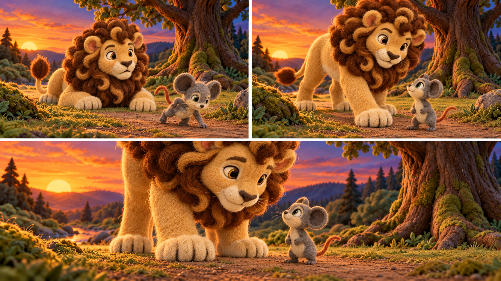

# v6 character scale and staging

**Status:** design targets used for 92 individual keyframe candidates, pending owner review. These targets use the visual balance of Scene 06's upper-right and lower panels as the direction. Those panels crop Leo, so their apparent pixel heights cannot establish a measured anatomical ratio by themselves. The generated images require visual comparison to a neutral same-ground-plane lineup and to the approved two-character pose before the ratio becomes a measured size anchor. [The keyframe continuity audit](KEYFRAME_CONSISTENCY_AUDIT.md) records specific unresolved scale and face failures; numeric plan validation alone does not certify the rendered PNGs.

## Cast scale

At the **same depth and camera**, Milo's upright ear-tip-to-foot height is targeted at **0.40 of Leo's quadrupedal mane-top-to-front-paw height**, with a review range of **0.34–0.46**. This keeps Milo visibly small while his face and gestures remain readable beside Leo. In a full-plate wide foreground view the planning heights are Milo **0.21** and Leo **0.525** of frame height. These are standing-equivalent anatomical references: lying down, sitting, reaching, or running changes the visible pose height without resizing the head, mane, torso or paws.

The Scene 06 upper-right panel is the **medium two-shot** reference: Leo stays left on four paws, Milo stands to his right, and Leo's paw is beside Milo rather than on him. The lower panel is the **closer two-shot** reference. Its larger apparent characters come from a camera crop of the same great-tree plate; the physical ratio does not change. Milo's ears stay visible in full-character dialogue frames. Tight rope/teeth inserts in Scene 14 are prop details and must not become character size or identity anchors.

## Position, depth and movement

Every panel's planned character contact point is recorded as normalized `x,y` on its **full approved location plate** in [`staging_plan.json`](staging_plan.json), along with its walkable zone, depth, camera view and apparent standing-equivalent frame height. The source plate remains the geometry authority when a shot uses a closer crop. The per-panel story action and audio line IDs remain in [`scene_plan.json`](scene_plan.json).

A fixed camera uses one depth rule: `apparent height = foreground height × (0.55 + 0.45 × depth_t) × camera magnification`, where `depth_t = 1` is near foreground and `0` is the far end of the named walkable path. Moving a little in depth changes size a little. For example, Leo's small approach on the trap path from `s10_p01` to `s10_p02` changes his planned frame height from **0.428 to 0.449** (about 5%). Milo's longer run toward the distant opening from `s12_p03` to `s12_p04` changes from **0.176 to 0.141** (about 20%). Movement between key poses must interpolate both position and size smoothly. A camera crop is recorded as a different view, not disguised as actor movement.

These are **standing-equivalent planning fractions**, not automatically measured visible silhouette heights. Sitting or lying compresses a pose box without changing head, mane, ear, torso or paw anatomy. At the same crop and near-identical depth, compare those anatomical dimensions and at least one landmark on the **same ground plane**. A crop enlarges the character and landmark together; it cannot make Milo physically taller than a nearby branch or tree base. A different crop is a camera cut unless a zoom path is explicitly designed and checked. No keyframe should become a video endpoint until its actual pixel size and landmark ratio are reviewed.

A character's contact point must stay in the named walkable zone with a plausible support shadow and correct overlap with roots, stones, vegetation and props. Water, bush crowns, stump roofs, decorative rocks and disconnected net strands cannot support a standing character. The approved plate supplies the exact landmarks and ground; generated storyboard backgrounds may drift and are not final placement anchors.

## Scene placement map

| Scene(s) | Placement and relationship | Camera/size intent |
|---|---|---|
| 01–02 | Milo alone on the stream bank's open grass lane. He explores left to right, then stops beside the feeding stone to leave the acorn. The stream stays behind him. | Wide views establish the bank; medium solo views make his expression and acorn readable. Sunset uses the approved light variant at the same physical spot. |
| 03 | Milo alone on the dirt junction around the mossy boulder. He weighs the left safe branch, then turns onto the right shortcut branch without standing on the rock. | Establishing wide, then medium solo views; no unexplained size jump at the decision. |
| 04 | Milo runs along the clear dirt lane beneath the raised branch, past the mossy stone and stump. As he moves toward the distant opening he becomes gradually smaller. | Fixed wide plate with depth-driven size; branch stays overhead. |
| 05–08 | Leo rests left of the great-tree trunk on open clearing ground. Milo approaches along the path, reaches Leo's nose, then stands to Leo's right beside the blocking paw. Preserve this left/right relationship during their dialogue. | Begin wide, then use the Scene 06 medium and closer two-shot crops. Leo remains quadrupedal or intentionally lying; both share the same approved tree-dusk geometry. |
| 09 | Montage: Milo on the established shortcut, then on the path to his burrow; Leo at the established great tree; final empty shortcut path foreshadows a future meeting. | Each beat names its existing plate. This is a sequence of location/time changes, not a new forest background. |
| 10–11 | Leo alone on the center dirt lane under the branch. He walks only a little toward the trap trigger; the net settles around his body while his paws stay grounded and his face stays clear. | Wide to medium/close solo crops of the same trap plate. A small step changes size only slightly. |
| 12 | Milo alone on the continuous morning run path. He listens, calls out, then runs toward the distant opening, becoming gradually smaller on the same plate. | Medium solo listening/speaking views, then fixed wide run views with visible depth progression. |
| 13–14 | Leo stays in the same trap position. Milo enters from frame left, crosses the clear path toward the single closure strand at Leo's flank, and gnaws there. He steps clear before Leo exits to the right. | Keep the same trap plate and Leo scale. Medium two-shots alternate with explicitly registered rope detail inserts; no rope crosses Leo's face. |
| 15 | The freed Leo stands left, Milo right, both on the same dirt path and at nearly unchanged depth during their conversation. Leo may lower his head or lie down without changing his anatomical size. | Stable medium two-shots and a reflective Leo close-up; final wide view re-establishes both on the trap path. |
| 16 | Later, Leo rests left and Milo right beneath the same great tree in daylight, both supported on the clearing path. | Day variant of the tree plate; wide opening/closing and medium dialogue views preserve their relative scale. |

The 16 storyboard boards and six supplemental boards are composition references. The individual frames in [`KEYFRAME_REVIEW.md`](KEYFRAME_REVIEW.md) are production candidates, not size-certified images. Review a shared-cast size anchor on the approved tree plate and trap plate against these candidates before video rendering; adjust outliers if the measured ratio falls outside the range above. [`BACKGROUND_CONTINUITY.md`](BACKGROUND_CONTINUITY.md) records when the approved background must remain the same and when the story changes place or light.
