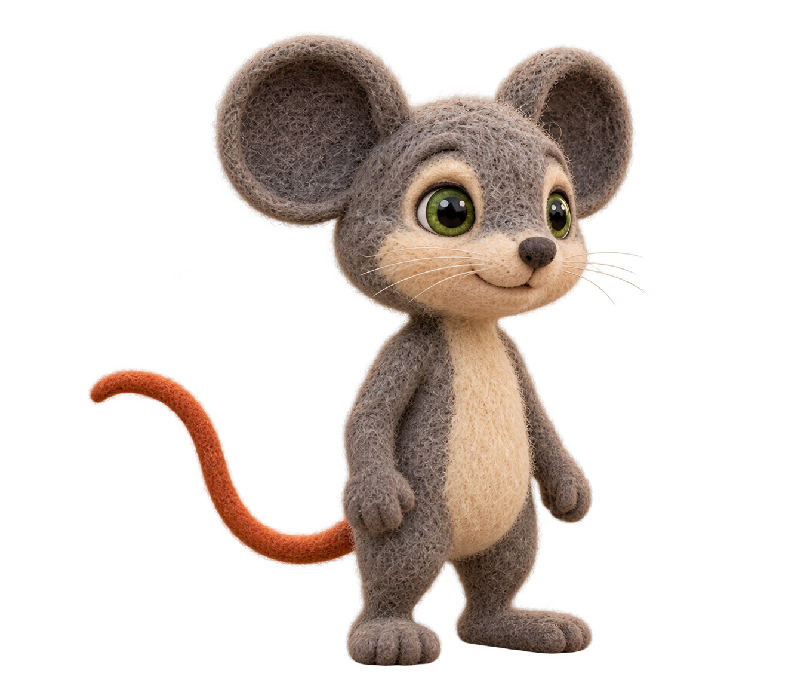

# v6 character foundations

**Reconciled 2026-10-18.** The owner explicitly approved Milo's scene-derived r03 neutral master. Exact hash, owner statement and prior approvals are in `visual_bible.json` and [the adoption receipt](image_sources/milo_r03_owner_adoption.json). Earlier Milo atlas/expression/pose approvals belong to older identity families and are pending refresh before reuse. Leo's canonical and expression board remain approved. The 96 story-image selections remain separately recorded in [owner_visual_acceptance.json](owner_visual_acceptance.json); master approval is not per-image technical approval.

The shared art direction is handmade needle-felted wool: visible fibers, matte surfaces, and softly irregular handcrafted forms. Milo’s neutral canonical pose is the authority for his body proportions; the turnaround is a supporting view reference and must not lengthen or slim his silhouette.

## Milo

Warm neutral-grey wool without a blue cast, cream muzzle and belly, charcoal inner ears, moss-green eyes, and a muted burnt-orange tail. Both ears remain fully visible throughout the expression board.

### Canonical

### Supporting family — refresh pending

The previous [16-pose atlas](../../character/characters/lion_and_mouse_v6/Milo/references/m_complete_reference_r03_candidate.png) and [expression board](../../character/characters/lion_and_mouse_v6/Milo/expressions/m_expression_board_r02_candidate.png) depict the earlier family. Native comparison shows different eye-white/muzzle treatment, body inset and felt rendering. They remain historical sources; they are not approved as supporting references for the newly selected master. Their prior approval evidence is preserved in the adoption record. New supporting views, expressions and actions must derive from r03 and pass identity comparison before reuse.

## Leo

Quadrupedal lion with a pale honey-cream body and natural tawny/golden-brown mane and tail tuft, apricot inner ears, and amber eyes. Keep him grounded on four paws in all scene compositions.

### Canonical

### Consolidated reference atlas

### Expression board

For trapped shots, use the separate [worried and strained expression reference](../../character/characters/lion_and_mouse_v6/Leo/expressions/l_trap_expression_r01_candidate.png), pending owner review.
