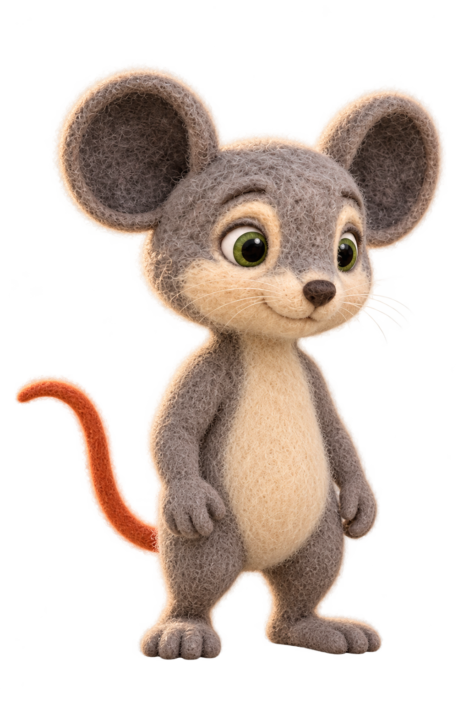
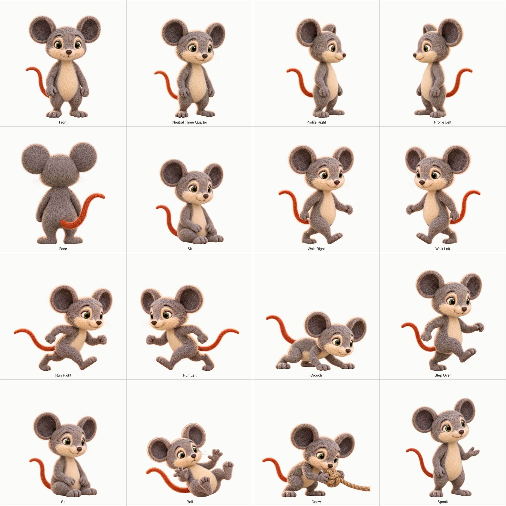
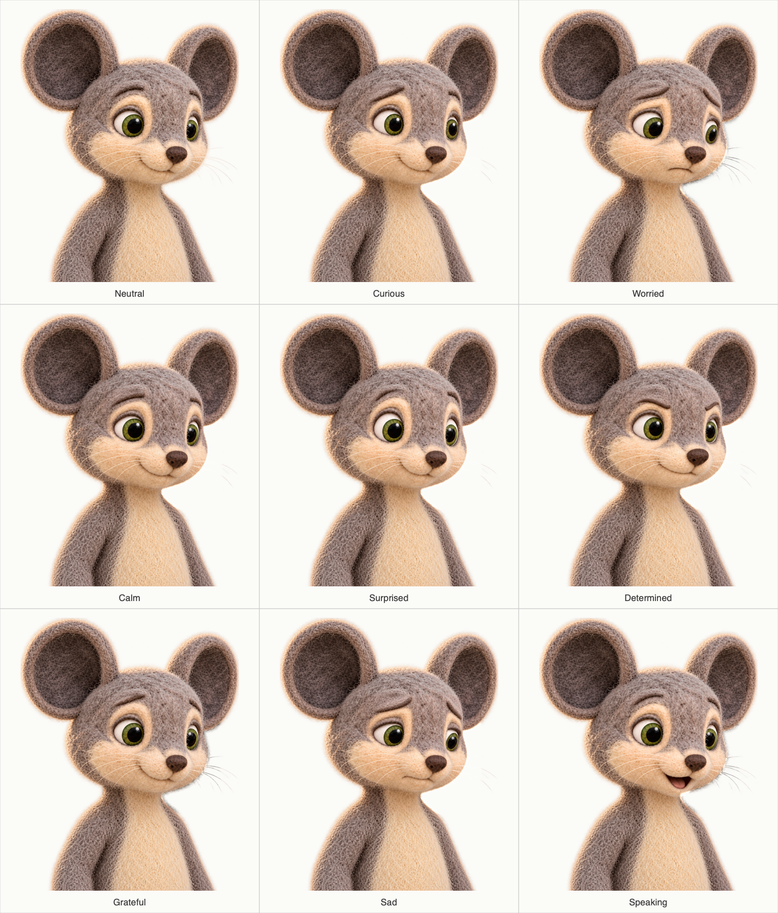

# v6 character foundations

**Reconciled 2026-10-16.** Leo's canonical and expression board are approved. The owner selected Milo's rebuilt r02 neutral master and r03 consolidated atlas for the canonical rollout; exact hashes and scope are in `visual_bible.json`. The current 96 story images are owner-selected, separately recorded in [owner_visual_acceptance.json](owner_visual_acceptance.json). Setup/prop approvals and structured technical checks remain separate; see [README.md](README.md). Dialogue mouth references and video takes remain a later stage.

The shared art direction is handmade needle-felted wool: visible fibers, matte surfaces, and softly irregular handcrafted forms. Milo’s neutral canonical pose is the authority for his body proportions; the turnaround is a supporting view reference and must not lengthen or slim his silhouette.

## Milo

Warm neutral-grey wool without a blue cast, cream muzzle and belly, charcoal inner ears, moss-green eyes, and a muted burnt-orange tail. Both ears remain fully visible throughout the expression board.

### Canonical

### Consolidated reference atlas

The owner-approved proportion-corrected r02 turnaround and previous action sheets are retained under `character/characters/lion_and_mouse_v6/reference_sources/`; the rebuilt r03 atlas above is the current owner selection. The neutral canonical remains authoritative for body shape.

### Expression board

## Leo

Quadrupedal lion with a pale honey-cream body and natural tawny/golden-brown mane and tail tuft, apricot inner ears, and amber eyes. Keep him grounded on four paws in all scene compositions.

### Canonical

### Consolidated reference atlas

### Expression board

For trapped shots, use the separate [worried and strained expression reference](../../character/characters/lion_and_mouse_v6/Leo/expressions/l_trap_expression_r01_candidate.png), pending owner review.
