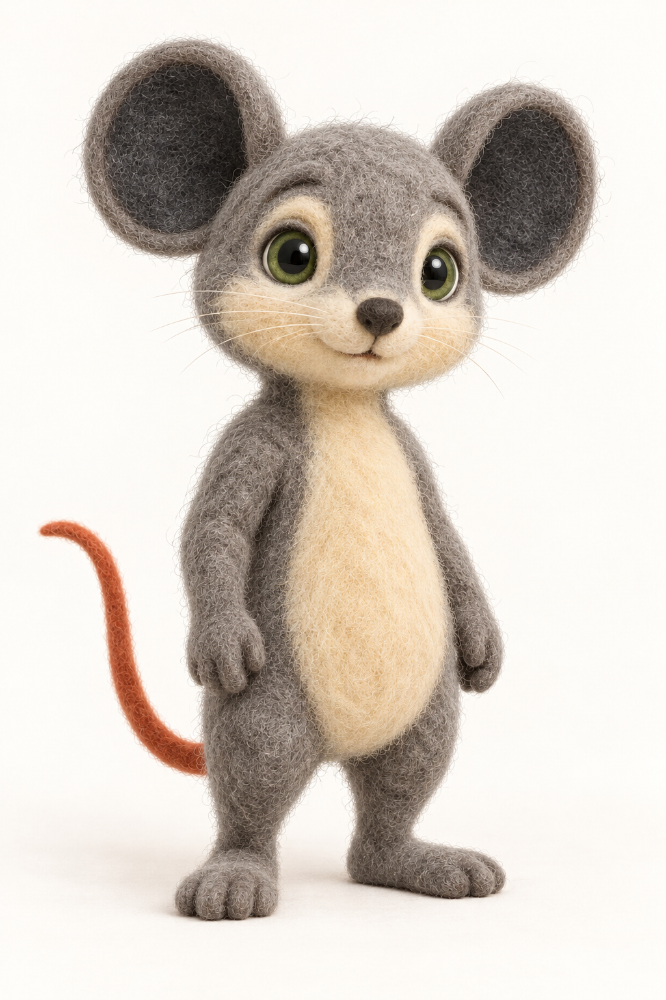
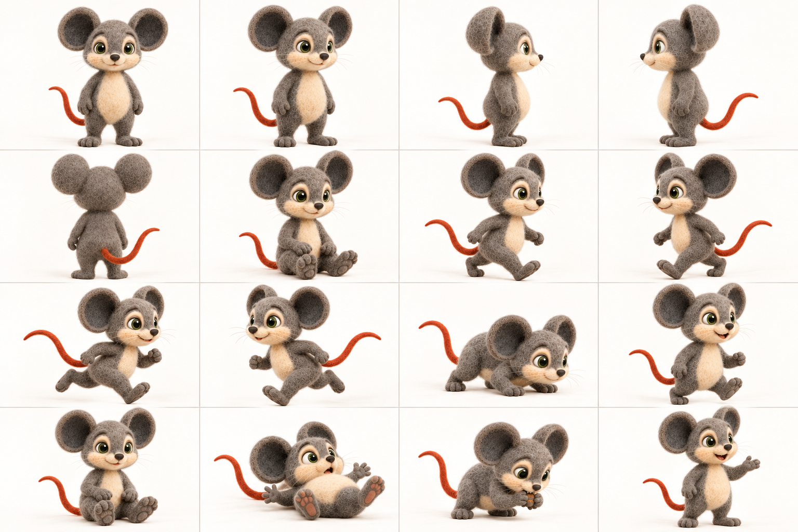
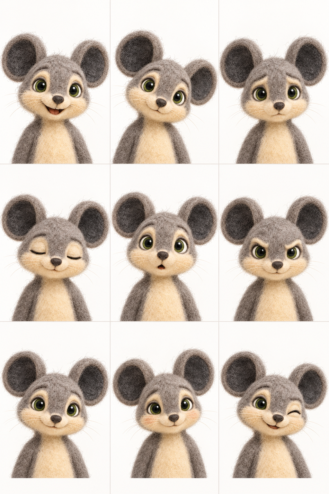
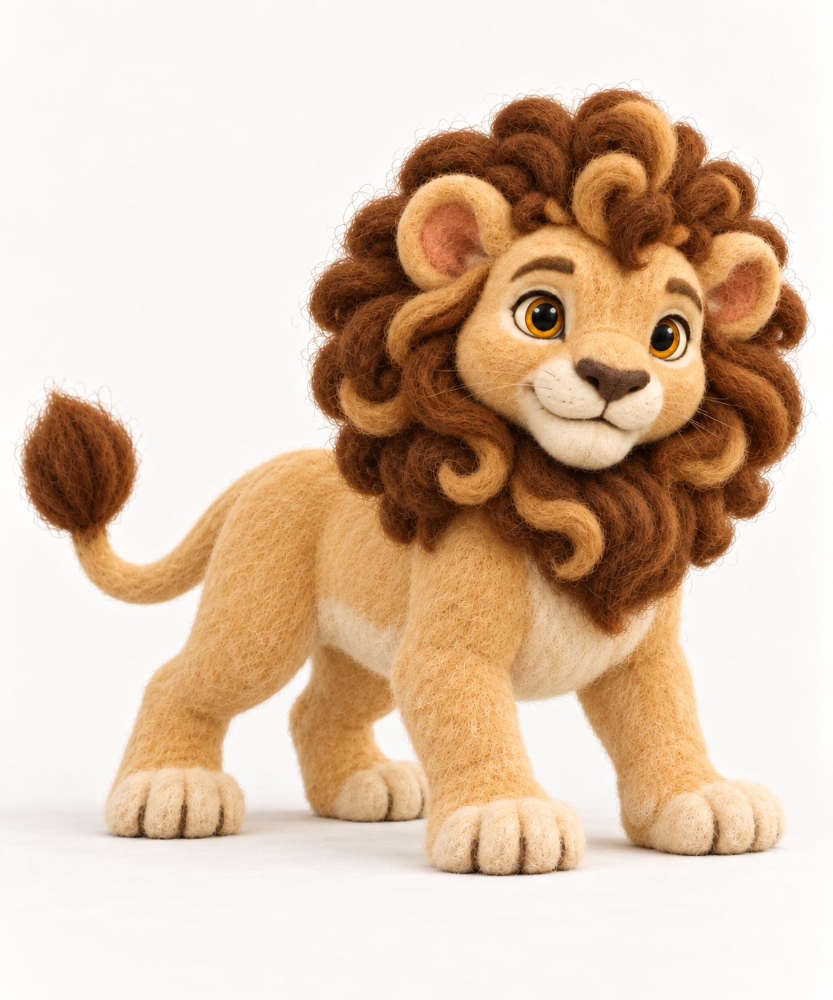
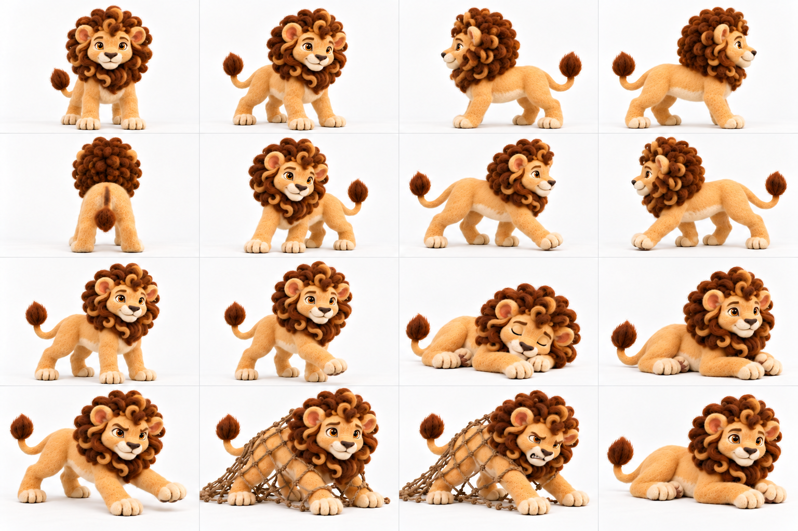
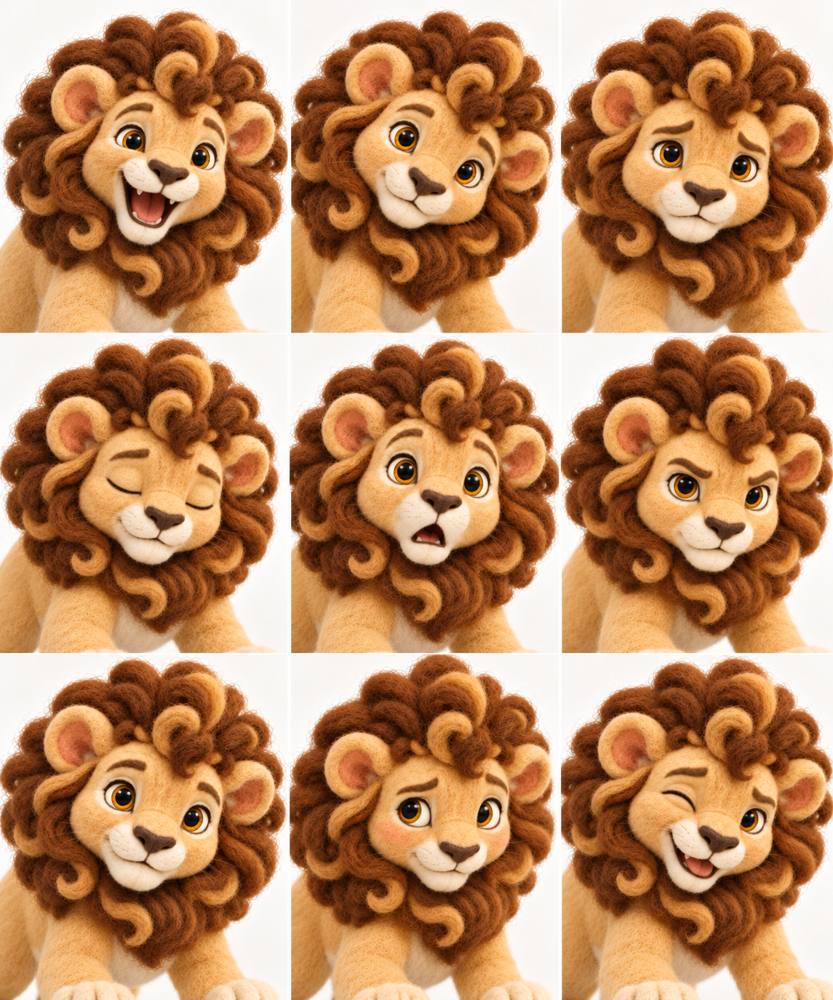

# v6 character foundations

**Character direction approved by the owner on 2026-10-10; image approvals remain asset-specific.** Leo's canonical and expression board are approved. Milo's revised neutral canonical and combined action atlas remain pending owner hash-bound review; the approved r02 turnaround remains source provenance and does not approve the revised body. Audio/text have been reconciled for v6 by owner direction; see `SCRIPT.md` and `audio_manifest.json`. The 16 overview boards and six supplemental boards are in `SCENE_REVIEW.md`; all 96 individual video keyframe candidates are ready for owner review in `KEYFRAME_REVIEW.md`. Dialogue mouth references and video takes remain a later stage.

The shared art direction is handmade needle-felted wool: visible fibers, matte surfaces, and softly irregular handcrafted forms. Milo’s neutral canonical pose is the authority for his body proportions; the turnaround is a supporting view reference and must not lengthen or slim his silhouette.

## Milo

Warm neutral-grey wool without a blue cast, cream muzzle and belly, charcoal inner ears, moss-green eyes, and a muted burnt-orange tail. Both ears remain fully visible throughout the expression board.

### Canonical

### Consolidated reference atlas

The owner-approved proportion-corrected r02 turnaround and previous action sheets are retained under `character/characters/lion_and_mouse_v6/reference_sources/`; the combined atlas above is pending owner review. The neutral canonical remains authoritative for body shape.

### Expression board

## Leo

Quadrupedal lion with a pale honey-cream body and natural tawny/golden-brown mane and tail tuft, apricot inner ears, and amber eyes. Keep him grounded on four paws in all scene compositions.

### Canonical

### Consolidated reference atlas

### Expression board

For trapped shots, use the separate [worried and strained expression reference](../../character/characters/lion_and_mouse_v6/Leo/expressions/l_trap_expression_r01_candidate.png), pending owner review.
