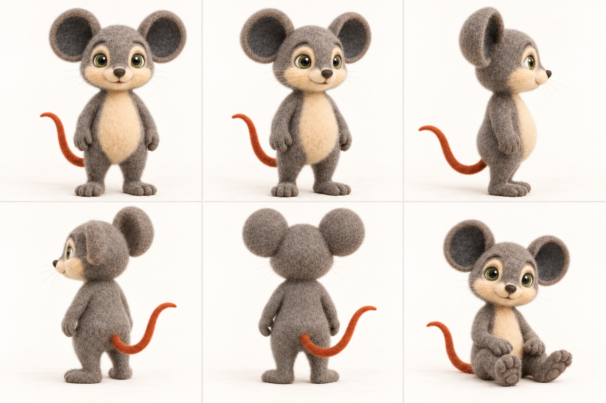
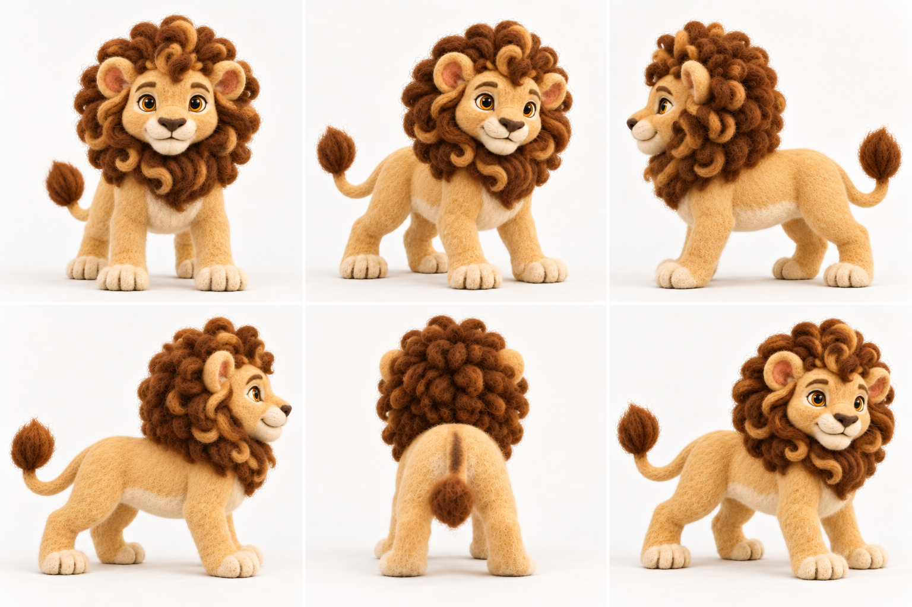

# v6 character foundations

**Character direction approved by the owner on 2026-10-10.** These six version-owned images establish the v6 visual foundation. Audio/text have been reconciled for v6 by owner direction; see `SCRIPT.md` and `audio_manifest.json`. The 16 overview boards and six supplemental boards are in `SCENE_REVIEW.md`; all 92 individual video keyframe candidates are ready for owner review in `KEYFRAME_REVIEW.md`. Dialogue mouth references and video takes remain a later stage.

The shared art direction is handmade needle-felted wool: visible fibers, matte surfaces, and softly irregular handcrafted forms. Milo’s neutral canonical pose is the authority for his body proportions; the turnaround is a supporting view reference and must not lengthen or slim his silhouette.

## Milo

Warm neutral-grey wool without a blue cast, cream muzzle and belly, charcoal inner ears, moss-green eyes, and a muted burnt-orange tail. Both ears remain fully visible throughout the expression board.

### Canonical

### Turnaround reference

The earlier turnaround is retained under `Milo/references/superseded/` because its standing views read too elongated beside the canonical pose. The owner approved this proportion-corrected r02 turnaround on 2026-10-11 as a supporting reference; the neutral canonical remains authoritative.

### Expression board

## Leo

Quadrupedal lion with a pale honey-cream body and natural tawny/golden-brown mane and tail tuft, apricot inner ears, and amber eyes. Keep him grounded on four paws in all scene compositions.

### Canonical

### Turnaround reference

### Expression board

