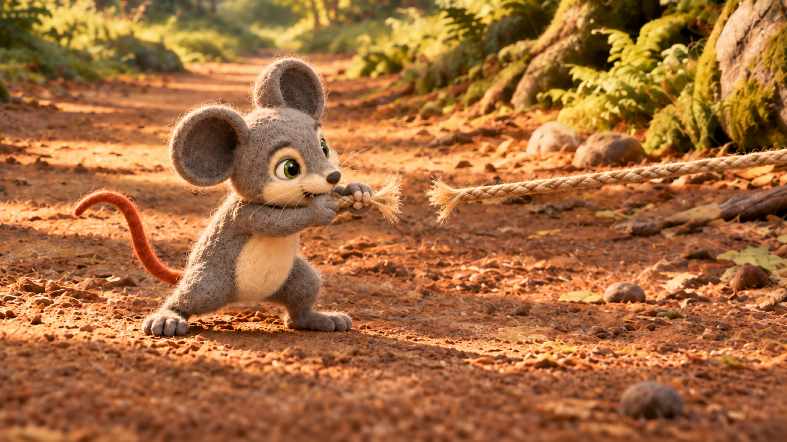

# v6 production keyframes — owner review

**Status (2026-10-15):** 96 planned slots; 58 active PNGs present and 38 intentionally missing after owner cleanup. Four clean replacement candidates have been adopted for owner review. Scenes 09 and 10 contact sheets include the latest continuity repairs; the other old contact sheets below are stale and must not be treated as the active inventory or generation references. The [current regeneration review gallery](review/missing_keyframe_regeneration/owner_review.html) shows new candidates, anchor options and remaining gaps. All new images remain pending owner visual approval; final contact-sheet/inventory gates remain blocked until the missing slots are replaced.

The 70 overview panel assignments cover all 161 voice lines exactly once. The 26 supplemental keyframes add detail views and may intentionally share a line with an overview frame. [`keyframe_plan.json`](keyframe_plan.json) records each image’s line IDs, visual units, approved plate, crop, staging target, references, prompt and SHA-256. [`VISUAL_SEQUENCE_PLAN.md`](VISUAL_SEQUENCE_PLAN.md) explains the added cuts; [`BACKGROUND_CONTINUITY.md`](BACKGROUND_CONTINUITY.md) and [`CHARACTER_STAGING.md`](CHARACTER_STAGING.md) define location and scale intent.

Contact sheets group images by record ID and may put supplemental `x` views after their overview views; they do not define playback order. Open each linked full-size PNG for character details and background continuity. The stills were generated **with** the approved plates and canonicals as references; this does not prove that their rendered landmarks, animal sizes or faces match. The [video boundary table](VIDEO_BOUNDARIES.md) and its [machine-readable plan](video_boundary_plan.json) record chronological order and proposed start/end reuse. Table actions name the **spoken beat**, not a requirement that the still show an open mouth: dialogue video boundaries use a closed mouth, and only Milo or Leo receives later word-timed mouth animation. Narrator lines remain voice-over with silent character mouths. Timing within long narrator lines still needs word-level edit placement.

**Second image-audit status (updated 14 October 2026):** `s14_p06` remains rejected; four frames (`s12_p02`, `s15x_p02`, `s15x_p04`, `s15x_p06`) remain stale against camera-plan changes. Staleness alone is not a visual rejection. Ten new revisions across Scenes 6, 8, 10 and 15 are current but pending owner review. The other 81 current candidates also await full-size review. None is approved for video. Preserve owner-liked frames `s01_p04`, `s05_p01`, `s06_p03`, `s12_p03`, `s07x_p01` and `s07x_p02` while making dependent revisions. The [generated-frame review packet](../../docs/audits/lion-and-mouse-v6-generated-frame-review-2026-10-13.md) contains the ten new hashes and previews.

The [second-audit remediation report](../../docs/audits/lion-and-mouse-v6-second-image-audit-remediation-2026-10-13.md) lists every frame disposition and exact hash. The [setup-anchor owner packet](../../docs/audits/lion-and-mouse-v6-size-anchor-review-2026-10-13.md) lists the 29 unresolved camera-family selections with candidate hashes and staged geometry. Visual review requires hash-bound checks for identity, plate, scale, anatomy, grounding, continuity, lighting and camera; record the expected and observed visible paw count and support contact for every visible actor in `keyframe_visual_reviews.json`.

## Scene 01 — The little explorer

7 keyframes · approved location: `stream_afternoon` · [open current contact sheet](../../character/characters/lion_and_mouse_v6/interactions/keyframes/.review/contact_sheets/current/scene01_keyframes.png). Compare `s01_p01` with `s01_p03` on the same plate and crop.

[Stale contact sheet — use the regeneration gallery for current replacements](../../character/characters/lion_and_mouse_v6/interactions/keyframes/.review/contact_sheets/current/scene01_keyframes.png)

| Frame | Audio lines / visual unit | View and action | Full-size image |
|---|---|---|---|
| `s01_p01` | S01-L001 · v01a | `wide` — Milo explores the continuous foreground grass lane beneath the trees; keep him small within the wide landscape. | [s01_p01_r03_candidate.png](../../character/characters/lion_and_mouse_v6/interactions/keyframes/s01_p01_r03_candidate.png) |
| `s01_p02` | S01-L002 · v01a | `medium_solo` — Milo pauses beside the far-left berry bush and hollow log, curious but standing on the grass lane. | [s01_p02_r02_candidate.png](../../character/characters/lion_and_mouse_v6/interactions/keyframes/s01_p02_r02_candidate.png) |
| `s01_p03` | S01-L003 · v01a | `wide` — Milo follows the winding bank path a little farther from the stream-side stone. | [s01_p03_r07_candidate.png](../../character/characters/lion_and_mouse_v6/interactions/keyframes/s01_p03_r07_candidate.png) |
| `s01_p04` | S01-L004 · v01b | `medium_solo` — Milo sits safely on the grass beside the path, holding and nibbling a single acorn; keep the stream behind him. | [s01_p04_r02_candidate.png](../../character/characters/lion_and_mouse_v6/interactions/keyframes/s01_p04_r02_candidate.png) |
| `s01x_p01` | S01-L004 · v01b | `medium_solo` — Seeds in grass at Milo’s feet. | [s01x_p01_r02_candidate.png](../../character/characters/lion_and_mouse_v6/interactions/keyframes/s01x_p01_r02_candidate.png) |
| `s01x_p02` | S01-L004 · v01b | `medium_solo` — Berries beside the stream, with Milo on the bank. | [s01x_p02_r01_candidate.png](../../character/characters/lion_and_mouse_v6/interactions/keyframes/s01x_p02_r01_candidate.png) |
| `s01x_p03` | S01-L004 · v01b | `medium_solo` — Milo enjoys the acorn on the grass. | [s01x_p03_r01_candidate.png](../../character/characters/lion_and_mouse_v6/interactions/keyframes/s01x_p03_r01_candidate.png) |

## Scene 02 — It’s getting late

3 keyframes · approved location: `stream_sunset` · [open current contact sheet](../../character/characters/lion_and_mouse_v6/interactions/keyframes/.review/contact_sheets/current/scene02_keyframes.png).

[Stale contact sheet — use the regeneration gallery for current replacements](../../character/characters/lion_and_mouse_v6/interactions/keyframes/.review/contact_sheets/current/scene02_keyframes.png)

| Frame | Audio lines / visual unit | View and action | Full-size image |
|---|---|---|---|
| `s02_p01` | S02-L001, S02-L002 · v02a | `wide` — Milo looks up as warm afternoon light fades and long soft shadows stretch across the bank. | [s02_p01_r02_candidate.png](../../character/characters/lion_and_mouse_v6/interactions/keyframes/s02_p01_r02_candidate.png) |
| `s02_p02` | S02-L003 · v02a | `medium_solo` — Milo stands on the grass lane, ears raised and; the acorn stays in his paws. | [s02_p02_r01_candidate.png](../../character/characters/lion_and_mouse_v6/interactions/keyframes/s02_p02_r01_candidate.png) |
| `s02_p03` | S02-L004 · v02a | `medium_solo` — Milo sets the acorn beside the flat stone, with both feet on the bank and the water clearly separate. | [s02_p03_r01_candidate.png](../../character/characters/lion_and_mouse_v6/interactions/keyframes/s02_p03_r01_candidate.png) |

## Scene 03 — Two ways home

4 keyframes · approved location: `fork_sunset` · [open contact sheet](../../character/characters/lion_and_mouse_v6/interactions/keyframes/.review/contact_sheets/current/scene03_keyframes.png)

[Stale contact sheet — use the regeneration gallery for current replacements](../../character/characters/lion_and_mouse_v6/interactions/keyframes/.review/contact_sheets/current/scene03_keyframes.png)

| Frame | Audio lines / visual unit | View and action | Full-size image |
|---|---|---|---|
| `s03_p01` | S03-L001, S03-L002 · v03a | `wide` — Wide establishing view of the fork around the central mossy boulder; both dirt branches are visible. | [s03_p01_r01_candidate.png](../../character/characters/lion_and_mouse_v6/interactions/keyframes/s03_p01_r01_candidate.png) |
| `s03_p02` | S03-L003, S03-L004, S03-L005 · v03a | `medium_solo` — Milo looks from the safe left meadow route toward the darker right shortcut, standing on the path. | [s03_p02_r01_candidate.png](../../character/characters/lion_and_mouse_v6/interactions/keyframes/s03_p02_r01_candidate.png) |
| `s03_p03` | S03-L006, S03-L007, S03-L008 · v03a | `medium_solo` — Milo pauses on the path and looks toward the darkening sky; show one still moment with the long safe path and shortcut visible behind him. | [s03_p03_r01_candidate.png](../../character/characters/lion_and_mouse_v6/interactions/keyframes/s03_p03_r01_candidate.png) |
| `s03_p04` | S03-L009, S03-L010 · v03b | `medium_solo` — Milo points his body toward the shortcut and speaks, still grounded on the path. | [s03_p04_r01_candidate.png](../../character/characters/lion_and_mouse_v6/interactions/keyframes/s03_p04_r01_candidate.png) |

## Scene 04 — The shortcut

7 keyframes · approved location: `shortcut_dusk` · [open current contact sheet](../../character/characters/lion_and_mouse_v6/interactions/keyframes/.review/contact_sheets/current/scene04_keyframes.png). Compare the wide and supplemental close views against the same branch, boulder and path landmarks. All four wide `s04_p` frames were rebuilt from the approved plate and surviving `s04x` felt references after the previous wide images were rejected. The running Milos in `s04_p01`, `s04_p03`, and `s04_p04` are at the same wide-shot depth and approximately 235 pixels ear-tip-to-foot on the 1672 × 941 generation canvas (approximately 270 pixels on the 1920 × 1080 render canvas). In `s04_p02` his crouch has a shorter visible silhouette; compare head and ear size rather than pose-box height. The `s04x` frames are registered closer camera views, so their larger on-screen Milo is an intentional crop.

[Stale contact sheet — use the regeneration gallery for current replacements](../../character/characters/lion_and_mouse_v6/interactions/keyframes/.review/contact_sheets/current/scene04_keyframes.png)

| Frame | Audio lines / visual unit | View and action | Full-size image |
|---|---|---|---|
| `s04_p01` | S04-L001, S04-L002 · v04a, v04b | `wide` — Milo hurries past the left mossy stone along the uninterrupted foreground running lane. | [s04_p01_r04_candidate.png](../../character/characters/lion_and_mouse_v6/interactions/keyframes/s04_p01_r04_candidate.png) |
| `s04x_p01` | S04-L002 · v04b | `medium_solo` — Pass the mossy stone. | [s04x_p01_r01_candidate.png](../../character/characters/lion_and_mouse_v6/interactions/keyframes/s04x_p01_r01_candidate.png) |
| `s04_p02` | S04-L003 · v04c | `wide` — Milo ducks beneath the raised fallen branch while remaining on the path; branch stays overhead. | [s04_p02_r07_candidate.png](../../character/characters/lion_and_mouse_v6/interactions/keyframes/s04_p02_r07_candidate.png) |
| `s04x_p02` | S04-L003 · v04c | `medium_solo` — Duck under the fallen branch. | [s04x_p02_r03_candidate.png](../../character/characters/lion_and_mouse_v6/interactions/keyframes/s04x_p02_r03_candidate.png) |
| `s04_p03` | S04-L004 · v04d | `wide` — Milo curves around the right stump on the clear lane; no stepping on stump or foliage. | [s04_p03_r08_candidate.png](../../character/characters/lion_and_mouse_v6/interactions/keyframes/s04_p03_r08_candidate.png) |
| `s04x_p03` | S04-L004 · v04d | `medium_solo` — Curve around the old stump. | [s04x_p03_r01_candidate.png](../../character/characters/lion_and_mouse_v6/interactions/keyframes/s04x_p03_r01_candidate.png) |
| `s04_p04` | S04-L005 · v04e | `wide` — Milo runs faster to screen right past the stump along the same foreground dirt lane; he does not reverse toward the rear opening. | [s04_p04_r11_candidate.png](../../character/characters/lion_and_mouse_v6/interactions/keyframes/s04_p04_r11_candidate.png) |

## Scene 05 — The sleeping lion

9 keyframes · approved shared location plate: `tree_dusk_r01` (the `x` views use tighter registered zoom crops) · [open current contact sheet](../../character/characters/lion_and_mouse_v6/interactions/keyframes/.review/contact_sheets/current/scene05_keyframes.png). A [rooted `tree_dusk_r02` location candidate](../../character/locations/lion_and_mouse_v6/great_tree/tree_dusk_r02_candidate.png) now carries the low diagonal foreground root already visible in later Scene 05 frames; it awaits owner review before promotion as the shared plate for Scenes 05–08. The accident plays once: `s05_p02` is the root stumble, `s05x_p05` is the pitch past Leo's paw, and `s05_p03` is the only nose-contact landing. The intervening roll is part of the motion between these beats, with no separate selected mid-roll still. Compare Milo's size against Leo's paw and muzzle across the camera change. **Scene 05 style standard:** owner-liked `s05_p01_r01_candidate.png` (SHA-256 `0009c8ce44fb26cb9f67a87b30346d740612a495bbfa6ef469b01783d67f27d6`) remains preserved and sets the brightness, golden sunset rendering, contrast, and felt-fiber finish. The new `s05_p01_r02` candidate adds the foreground root; compare its Leo pose and composition directly against r01 before approval. The cropped style swatch in `.review/history/s05_p01_style_texture_swatch_r03.png` carries only those tonal/material cues; registered character canonicals, the tree-dusk plate, and each frame's camera/crop still govern identity, geography, and composition. The current `s05_p01_r02`, `s05_p03_r10`, `s05_p04_r08`, and `s05x_p04_r08` candidates remain pending owner review. The lower-left root landmark continues through p01 → p02 → p03 → p04; the r08 reaction shots address the reported four-toe paw counts.

[Stale contact sheet — use the regeneration gallery for current replacements](../../character/characters/lion_and_mouse_v6/interactions/keyframes/.review/contact_sheets/current/scene05_keyframes.png)

| Frame | Audio lines / visual unit | View and action | Full-size image |
|---|---|---|---|
| `s05_p01` | S05-L001, S05-L002, S05-L003, S05-L004 · v05a | `wide` — Leo sleeps on his side beneath the great oak, all four paws/body supported by the clearing; one large paw rests across the path. | [s05_p01_r02_candidate.png](../../character/characters/lion_and_mouse_v6/interactions/keyframes/s05_p01_r02_candidate.png) |
| `s05_p02` | S05-L005, S05-L006, S05-L007 · v05b | `medium_two` — Milo rounds a visible root, catches his balance, and exclaims in a startled open-mouth beat before tumbling beside the paw. | [s05_p02_r02_candidate.png](../../character/characters/lion_and_mouse_v6/interactions/keyframes/s05_p02_r02_candidate.png) |
| `s05_p03` | S05-L008, S05-L009 · v05c | `close_two` — Milo completes one small roll and lands safely against Leo’s nose; maintain gentle contact and keep Leo asleep. | [s05_p03_r13_candidate.png](../../character/characters/lion_and_mouse_v6/interactions/keyframes/s05_p03_r13_candidate.png) |
| `s05_p04` | S05-L010, S05-L011 · v05d | `medium_two` — Leo opens his eyes and lifts his head; in the last beat he asks what happened, Milo remains silent. | [s05_p04_r09_candidate.png](../../character/characters/lion_and_mouse_v6/interactions/keyframes/s05_p04_r09_candidate.png) |
| `s05x_p01` | S05-L002 · v05a | `detail_insert` — Leo’s mane rests against grass. | [s05x_p01_r02_candidate.png](../../character/characters/lion_and_mouse_v6/interactions/keyframes/s05x_p01_r02_candidate.png) |
| `s05x_p02` | S05-L003 · v05a | `detail_insert` — Leo’s closed eyes, with the same tree visible. | [s05x_p02_r02_candidate.png](../../character/characters/lion_and_mouse_v6/interactions/keyframes/s05x_p02_r02_candidate.png) |
| `s05x_p03` | S05-L004 · v05a | `detail_insert` — Leo’s grounded paw across the path. | [s05x_p03_r02_candidate.png](../../character/characters/lion_and_mouse_v6/interactions/keyframes/s05x_p03_r02_candidate.png) |
| `s05x_p04` | S05-L010, S05-L011 · v05d | `close_solo` — Leo wakes and speaks in a close view. | [s05x_p04_r11_candidate.png](../../character/characters/lion_and_mouse_v6/interactions/keyframes/s05x_p04_r11_candidate.png) |
| `s05x_p05` | S05-L008 · v05c | `medium_two` — Milo reaches Leo’s outstretched front paw and pitches forward as he trips; Leo remains asleep. | [s05x_p05_r03_candidate.png](../../character/characters/lion_and_mouse_v6/interactions/keyframes/s05x_p05_r03_candidate.png) |

## Scene 06 — A paw across the path

Chronological order: `s06_p01` is the start of Leo waking with Milo on the path; `s06x_p01` is the same-camera end of Leo rising and Milo scrambling a short distance right. They are a start/end motion pair, not duplicate shots. Then the camera cuts to `s06_p02` and `s06_p03`.

4 keyframes · approved location: `tree_dusk_r01`; [rooted r02 location candidate](../../character/locations/lion_and_mouse_v6/great_tree/tree_dusk_r02_candidate.png) guides the new continuity edits · [open current contact sheet](../../character/characters/lion_and_mouse_v6/interactions/keyframes/.review/contact_sheets/current/scene06_keyframes.png). The low root enters from the left foreground in the two wide shots and only as a cropped edge in the tighter views. The earlier owner-liked `s06_p03_r03` is preserved [for comparison](../../character/characters/lion_and_mouse_v6/interactions/keyframes/.review/history/s06_p03_r03_candidate.png). All four revisions await owner review.

[Stale contact sheet — use the regeneration gallery for current replacements](../../character/characters/lion_and_mouse_v6/interactions/keyframes/.review/contact_sheets/current/scene06_keyframes.png)

| Frame | Audio lines / visual unit | View and action | Full-size image |
|---|---|---|---|
| `s06_p01` | S06-L001 · v06a | `wide` — Leo lifts his head in surprise while Milo scrambles down to the clear dirt-and-grass path. | [s06_p01_r05_candidate.png](../../character/characters/lion_and_mouse_v6/interactions/keyframes/s06_p01_r05_candidate.png) |
| `s06x_p01` | S06-L001 · v06a | `wide` — Leo pushes from lying toward a grounded four-paw stand while Milo continues a short scramble right on the same wide view. | [s06x_p01_r02_candidate.png](../../character/characters/lion_and_mouse_v6/interactions/keyframes/s06x_p01_r02_candidate.png) |
| `s06_p02` | S06-L002 · v06a | `medium_two` — Leo places a paw beside Milo on the path, blocking the exit without pinning or touching him. | [s06_p02_r07_candidate.png](../../character/characters/lion_and_mouse_v6/interactions/keyframes/s06_p02_r07_candidate.png) |
| `s06_p03` | S06-L003, S06-L004, S06-L005 · v06b | `close_two` — Milo freezes beneath Leo’s calm but imposing presence; keep visible ground under both characters and emphasize the scale difference. | [s06_p03_r04_candidate.png](../../character/characters/lion_and_mouse_v6/interactions/keyframes/s06_p03_r04_candidate.png) |

## Scene 07 — Milo explains

6 keyframes · approved location: `tree_dusk` · [open contact sheet](../../character/characters/lion_and_mouse_v6/interactions/keyframes/.review/contact_sheets/current/scene07_keyframes.png)

[Stale contact sheet — use the regeneration gallery for current replacements](../../character/characters/lion_and_mouse_v6/interactions/keyframes/.review/contact_sheets/current/scene07_keyframes.png)

| Frame | Audio lines / visual unit | View and action | Full-size image |
|---|---|---|---|
| `s07_p01` | S07-L001, S07-L002 · v07a | `medium_two` — Leo asks why Milo raced through, Leo is the dialogue speaker; his boundary mouth stays closed; Milo looks up from the path. | [s07_p01_r03_candidate.png](../../character/characters/lion_and_mouse_v6/interactions/keyframes/s07_p01_r03_candidate.png) |
| `s07_p02` | S07-L003 · v07b | `medium_two` — Milo apologizes and explains he was eating by the stream; Milo is the dialogue speaker; his boundary mouth stays closed, Leo listens silently. | [s07_p02_r04_candidate.png](../../character/characters/lion_and_mouse_v6/interactions/keyframes/s07_p02_r04_candidate.png) |
| `s07_p03` | S07-L004 · v07b | `medium_two` — Milo explains he took a shortcut to get home before dark; keep his feet planted. | [s07_p03_r03_candidate.png](../../character/characters/lion_and_mouse_v6/interactions/keyframes/s07_p03_r03_candidate.png) |
| `s07_p04` | S07-L005 · v07b | `medium_two` — Milo promises he did not mean to disturb Leo; Leo’s paw remains beside, not on, Milo. | [s07_p04_r03_candidate.png](../../character/characters/lion_and_mouse_v6/interactions/keyframes/s07_p04_r03_candidate.png) |
| `s07x_p01` | S07-L001, S07-L002 · v07a | `close_solo` — Leo asks Milo why he raced through; close dialogue portrait on the same dusk Great Tree, closed mouth and softly blurred plate. | [s07x_p01_r01_candidate.png](../../character/characters/lion_and_mouse_v6/interactions/keyframes/s07x_p01_r01_candidate.png) |
| `s07x_p02` | S07-L003 · v07b | `portrait_milo` — Milo apologizes; close dialogue portrait on the same dusk Great Tree, closed mouth, full ears, softly blurred plate. | [s07x_p02_r01_candidate.png](../../character/characters/lion_and_mouse_v6/interactions/keyframes/s07x_p02_r01_candidate.png) |

## Scene 08 — The lion chooses kindness

6 keyframes · approved location: `tree_dusk` · [open contact sheet](../../character/characters/lion_and_mouse_v6/interactions/keyframes/.review/contact_sheets/current/scene08_keyframes.png)

[Stale contact sheet — use the regeneration gallery for current replacements](../../character/characters/lion_and_mouse_v6/interactions/keyframes/.review/contact_sheets/current/scene08_keyframes.png)

| Frame | Audio lines / visual unit | View and action | Full-size image |
|---|---|---|---|
| `s08_p01` | S08-L001, S08-L002, S08-L003, S08-L004, S08-L005, S08-L006, S08-L007 · v08a | `medium_two` — Milo trembles on the path as Leo looks down; Leo’s expression gradually softens, no narrator-driven mouth movement. | [s08_p01_r03_candidate.png](../../character/characters/lion_and_mouse_v6/interactions/keyframes/s08_p01_r03_candidate.png) |
| `s08_p02` | S08-L008, S08-L009, S08-L010, S08-L011 · v08b | `close_solo` — Leo speaks gently and gives Milo permission to go; Leo is the dialogue speaker; his boundary mouth stays closed. | [s08_p02_r04_candidate.png](../../character/characters/lion_and_mouse_v6/interactions/keyframes/s08_p02_r04_candidate.png) |
| `s08_p03` | S08-L012 · v08c | `portrait_milo` — Milo looks up in surprised relief and asks if Leo is letting him go; Milo is the dialogue speaker; his boundary mouth stays closed. | [s08_p03_r03_candidate.png](../../character/characters/lion_and_mouse_v6/interactions/keyframes/s08_p03_r03_candidate.png) |
| `s08_p04` | S08-L013, S08-L014, S08-L015, S08-L016, S08-L017, S08-L018 · v08d | `medium_two` — Leo reassures him, then Milo’s expression shifts from fear to gratitude; dialogue mouths stay silent during narration. | [s08_p04_r03_candidate.png](../../character/characters/lion_and_mouse_v6/interactions/keyframes/s08_p04_r03_candidate.png) |
| `s08_p05` | S08-L019, S08-L020, S08-L021 · v08e | `portrait_milo` — Milo thanks Leo and promises to pass kindness on; Milo speaks, Leo listens. | [s08_p05_r04_candidate.png](../../character/characters/lion_and_mouse_v6/interactions/keyframes/s08_p05_r04_candidate.png) |
| `s08_p06` | S08-L022, S08-L023, S08-L024 · v08f | `wide` — Leo answers, then gently sends Milo home before the stars; show the open path and evening sky. | [s08_p06_r02_candidate.png](../../character/characters/lion_and_mouse_v6/interactions/keyframes/s08_p06_r02_candidate.png) |

## Scene 09 — Days pass

4 keyframes · approved location: `multi` · [open current contact sheet](../../character/characters/lion_and_mouse_v6/interactions/keyframes/.review/contact_sheets/current/scene09_keyframes.png). Review `s09_p01` against the shortcut plate and `s09_p02` against the home plate; Milo must fit through his doorway.

[Current Scene 09 contact sheet — left-root correction included](../../character/characters/lion_and_mouse_v6/interactions/keyframes/.review/contact_sheets/current/scene09_keyframes.png)

| Frame | Audio lines / visual unit | View and action | Full-size image |
|---|---|---|---|
| `s09_p01` | S09-L001, S09-L002, S09-L003 · v09a | `wide` — Milo hurries toward home but now chooses careful steps along a grounded path. | [s09_p01_r02_candidate.png](../../character/characters/lion_and_mouse_v6/interactions/keyframes/s09_p01_r02_candidate.png) |
| `s09_p02` | S09-L004, S09-L005 · v09b | `wide` — A gentle passage-of-days visual: same forest route in changing light, Milo resumes ordinary routines. | [s09_p02_r02_candidate.png](../../character/characters/lion_and_mouse_v6/interactions/keyframes/s09_p02_r02_candidate.png) |
| `s09_p03` | S09-L006 · v09c | `wide` — Leo rests beneath the same great tree, four paws supported by ground. | [s09_p03_r02_candidate.png](../../character/characters/lion_and_mouse_v6/interactions/keyframes/s09_p03_r02_candidate.png) |
| `s09_p04` | S09-L007 · v09d | `wide` — Empty established shortcut path recedes into the dim opening, foreshadowing the friends meeting again; no new forest location or characters. | [s09_p04_r01_candidate.png](../../character/characters/lion_and_mouse_v6/interactions/keyframes/s09_p04_r01_candidate.png) |

## Scene 10 — A hidden trap

3 keyframes · approved location: `trap_morning` · [open contact sheet](../../character/characters/lion_and_mouse_v6/interactions/keyframes/.review/contact_sheets/current/scene10_keyframes.png)

[Current Scene 10 contact sheet — matched Leo and color continuity](../../character/characters/lion_and_mouse_v6/interactions/keyframes/.review/contact_sheets/current/scene10_keyframes.png)

| Frame | Audio lines / visual unit | View and action | Full-size image |
|---|---|---|---|
| `s10_p01` | S10-L001 · v10a | `wide` — Leo walks along the trap path. Ahead of him, a leaf-covered flax-rope trigger loop lies flat on the ground and connects to a folded net suspended from the overhead branch. | [s10_p01_r02_candidate.png](../../character/characters/lion_and_mouse_v6/interactions/keyframes/s10_p01_r02_candidate.png) |
| `s10_p02` | S10-L002 · v10a | `wide` — The same Leo from p01 takes one short step and touches the existing rope trigger with a front paw; the folded net is still overhead. | [s10_p02_r06_candidate.png](../../character/characters/lion_and_mouse_v6/interactions/keyframes/s10_p02_r06_candidate.png) |
| `s10_p03` | S10-L003, S10-L004 · v10b | `wide` — The triggered net drops from the overhead branch and settles loosely around Leo’s back, shoulders, flanks and legs; Leo looks surprised. Preserve a clear opening around his entire face and keep all four paws on the path. | [s10_p03_r03_candidate.png](../../character/characters/lion_and_mouse_v6/interactions/keyframes/s10_p03_r03_candidate.png) |

## Scene 11 — Strength cannot break the ropes

4 keyframes · approved location: `trap_morning` · [open contact sheet](../../character/characters/lion_and_mouse_v6/interactions/keyframes/.review/contact_sheets/current/scene11_keyframes.png)

[Current contact sheet — revised stable net and upper-body close-up](../../character/characters/lion_and_mouse_v6/interactions/keyframes/.review/contact_sheets/current/scene11_keyframes.png)

| Frame | Audio lines / visual unit | View and action | Full-size image |
|---|---|---|---|
| `s11_p01` | S11-L001, S11-L002 · v11a | `medium_solo` — Leo makes one careful tug against the net; open diamond mesh supports around his body but leaves his face entirely clear and all paws on the path. | [s11_p01_r02_candidate.png](../../character/characters/lion_and_mouse_v6/interactions/keyframes/s11_p01_r02_candidate.png) |
| `s11_p02` | S11-L003, S11-L004, S11-L005 · v11a | `medium_solo` — Leo shows frustration after an unsuccessful tug. Keep the p01 body/net layout unchanged and vary only brows, eyelids and gaze; closed mouth, four supported paws. | [s11_p02_r02_candidate.png](../../character/characters/lion_and_mouse_v6/interactions/keyframes/s11_p02_r02_candidate.png) |
| `s11_p03` | S11-L006, S11-L007 · v11a | `medium_solo` — Leo pauses exhausted after the careful tug; maintain p01 body pose and net topology, knots and ground contacts, changing only tired facial expression. Four paws remain supported on dirt path, closed mouth. | [s11_p03_r02_candidate.png](../../character/characters/lion_and_mouse_v6/interactions/keyframes/s11_p03_r02_candidate.png) |
| `s11_p04` | S11-L008, S11-L009 · v11b | `upper_body_close` — Upper-body close-up: Leo raises his worried gaze just before calling for help. Same intact net supported over crown, outer mane and shoulders; face clear. Closed-mouth boundary; four paws supported on dirt path below crop. | [s11_p04_r04_candidate.png](../../character/characters/lion_and_mouse_v6/interactions/keyframes/s11_p04_r04_candidate.png) |

## Scene 12 — Milo hears the call

7 keyframes · approved location: `run_morning` · [open contact sheet](../../character/characters/lion_and_mouse_v6/interactions/keyframes/.review/contact_sheets/current/scene12_keyframes.png)

[Stale contact sheet — use the regeneration gallery for current replacements](../../character/characters/lion_and_mouse_v6/interactions/keyframes/.review/contact_sheets/current/scene12_keyframes.png)

| Frame | Audio lines / visual unit | View and action | Full-size image |
|---|---|---|---|
| `s12_p01` | S12-L001, S12-L002 · v12a | `medium_solo` — Milo’s ears lift at the distant call; he recognizes it and turns toward the sound. | [s12_p01_r02_candidate.png](../../character/characters/lion_and_mouse_v6/interactions/keyframes/s12_p01_r02_candidate.png) |
| `s12_p02` | S12-L003 · v12a | `portrait_milo` — Milo calls “The lion!” while standing on the path; Milo is the dialogue speaker; his boundary mouth stays closed. | [s12_p02_r02_candidate.png](../../character/characters/lion_and_mouse_v6/interactions/keyframes/s12_p02_r02_candidate.png) |
| `s12_p03` | S12-L004, S12-L005, S12-L006, S12-L007 · v12b | `wide` — Milo runs along the continuous lane, stepping over a low root and passing between bushes without leaving the path. | [s12_p03_r02_candidate.png](../../character/characters/lion_and_mouse_v6/interactions/keyframes/s12_p03_r02_candidate.png) |
| `s12_p04` | S12-L008, S12-L009, S12-L010 · v12c | `wide` — Milo runs with purpose toward the bright opening; show stable scale progression into depth. | [s12_p04_r02_candidate.png](../../character/characters/lion_and_mouse_v6/interactions/keyframes/s12_p04_r02_candidate.png) |
| `s12x_p01` | S12-L005 · v12b | `medium_solo` — Milo steps over low roots. | [s12x_p01_r02_candidate.png](../../character/characters/lion_and_mouse_v6/interactions/keyframes/s12x_p01_r02_candidate.png) |
| `s12x_p02` | S12-L006 · v12b | `medium_solo` — Milo runs between bushes. | [s12x_p02_r02_candidate.png](../../character/characters/lion_and_mouse_v6/interactions/keyframes/s12x_p02_r02_candidate.png) |
| `s12x_p03` | S12-L007 · v12b | `medium_solo` — Milo passes under the overhead branch. | [s12x_p03_r02_candidate.png](../../character/characters/lion_and_mouse_v6/interactions/keyframes/s12x_p03_r02_candidate.png) |

## Scene 13 — A small plan

6 keyframe slots · approved location: `trap_morning`. The full contact sheet is stale while other active frames are missing; [review current upper-body replacements](review/missing_keyframe_regeneration/owner_review.html#upper-body-net).

[Stale contact sheet — use the regeneration gallery for current replacements](../../character/characters/lion_and_mouse_v6/interactions/keyframes/.review/contact_sheets/current/scene13_keyframes.png)

| Frame | Audio lines / visual unit | View and action | Full-size image |
|---|---|---|---|
| `s13_p01` | S13-L001, S13-L002 · v13a | `wide` — Milo arrives on the clear path and sees Leo beneath the net; keep net and all landmarks readable. | [s13_p01_r03_candidate.png](../../character/characters/lion_and_mouse_v6/interactions/keyframes/s13_p01_r03_candidate.png) |
| `s13_p02` | S13-L003, S13-L004, S13-L005 · v13b | `upper_body_close` — Upper-body close-up: Leo looks toward offscreen Milo with concerned brows before warning that the ropes are too strong. Same frozen net layout and clear face opening. Closed-mouth boundary; ground support below crop. | [s13_p02_r06_candidate.png](../../character/characters/lion_and_mouse_v6/interactions/keyframes/s13_p02_r06_candidate.png) |
| `s13_p03` | S13-L006, S13-L007, S13-L008, S13-L009 · v13c | `medium_two` — Milo carefully studies the mesh and steps toward the single closure loop; he stays outside tangled strands. | [s13_p03_r03_candidate.png](../../character/characters/lion_and_mouse_v6/interactions/keyframes/s13_p03_r03_candidate.png) |
| `s13_p04` | S13-L010, S13-L011 · v13d | `portrait_milo` — Milo explains that his teeth may help; Milo is the dialogue speaker; his boundary mouth stays closed, paws reach the net edge. | [s13_p04_r03_candidate.png](../../character/characters/lion_and_mouse_v6/interactions/keyframes/s13_p04_r03_candidate.png) |
| `s13_p05` | S13-L012 · v13e | `upper_body_close` — Upper-body close-up: Leo raises his brows in surprised curiosity about Milo’s teeth. Same frozen net layout and clear face opening. Closed-mouth boundary; ground support below crop. | [s13_p05_r05_candidate.png](../../character/characters/lion_and_mouse_v6/interactions/keyframes/s13_p05_r05_candidate.png) |
| `s13_p06` | S13-L013, S13-L014 · v13f | `medium_two` — Milo answers playfully; his teeth remain small and natural, and no rope has been cut yet. | [s13_p06_r02_candidate.png](../../character/characters/lion_and_mouse_v6/interactions/keyframes/s13_p06_r02_candidate.png) |

## Scene 14 — One bite at a time

6 active keyframes · approved location: `trap_morning` · [open current contact sheet](../../character/characters/lion_and_mouse_v6/interactions/keyframes/.review/contact_sheets/current/scene14_keyframes.png). Review the linked full-size files, especially the revised `s14_p04` and `s14_p05` inserts, against `s14_p03` and the crop plate.

| Frame | Audio lines / visual unit | View and action | Full-size image |
|---|---|---|---|
| `s14_p01` | S14-L001 · v14a | `medium_two` — Milo steadies a single net closure strand at Leo’s flank and begins to gnaw; keep all rope entirely behind Leo’s shoulder and body, with a completely clear head and muzzle. | [s14_p01_r03_candidate.png](../../character/characters/lion_and_mouse_v6/interactions/keyframes/s14_p01_r03_candidate.png) |
| `s14_p02` | S14-L002, S14-L003, S14-L004 · v14a | `detail_insert` — Close detail of Milo holding the closure strand with both paws and taking small bites; show only Milo and rope, not Leo’s face. | [s14_p02_r01_candidate.png](../../character/characters/lion_and_mouse_v6/interactions/keyframes/s14_p02_r01_candidate.png) |
| `s14_p03` | S14-L005, S14-L006, S14-L007, S14-L008 · v14a | `medium_two` — Wider view: Milo bites the same closure loop beside Leo’s flank; Leo watches with his entire face free of every strand and all four paws grounded. | [s14_p03_r02_candidate.png](../../character/characters/lion_and_mouse_v6/interactions/keyframes/s14_p03_r02_candidate.png) |
| `s14_p04` | S14-L009 · v14b | `detail_insert` — Extreme close detail of fibers fraying on the exact strand at Milo’s teeth; do not show rope crossing Leo’s head. | [s14_p04_r02_candidate.png](../../character/characters/lion_and_mouse_v6/interactions/keyframes/s14_p04_r02_candidate.png) |
| `s14_p05` | S14-L010 · v14b | `detail_insert` — The same closure strand parts at its frayed point; the rest of the net remains intact and no rope touches Leo’s face. | [s14_p05_r02_candidate.png](../../character/characters/lion_and_mouse_v6/interactions/keyframes/s14_p05_r02_candidate.png) |
| `s14_p06` | S14-L011, S14-L012, S14-L013, S14-L014 · v14c | `wide` — Milo steps clear, the opening widens, and Leo carefully steps out; net slips behind his body and stays off his face, paws touch the path. | [s14_p06_r02_candidate.png](../../character/characters/lion_and_mouse_v6/interactions/keyframes/s14_p06_r02_candidate.png) |

## Scene 15 — Kindness is not a debt

12 keyframes · approved location: `trap_morning` · [open contact sheet](../../character/characters/lion_and_mouse_v6/interactions/keyframes/.review/contact_sheets/current/scene15_keyframes.png)

[Stale contact sheet — use the regeneration gallery for current replacements](../../character/characters/lion_and_mouse_v6/interactions/keyframes/.review/contact_sheets/current/scene15_keyframes.png)

| Frame | Audio lines / visual unit | View and action | Full-size image |
|---|---|---|---|
| `s15_p01` | S15-L001, S15-L002, S15-L003, S15-L004, S15-L005 · v15a | `medium_two` — Leo thanks Milo; Milo answers playfully; a two-shot shows the great lion looking at the tiny mouse with gratitude. | [s15_p01_r02_candidate.png](../../character/characters/lion_and_mouse_v6/interactions/keyframes/s15_p01_r02_candidate.png) |
| `s15_p02` | S15-L006, S15-L007, S15-L008 · v15b | `medium_two` — Leo asks about repaying kindness and Milo replies; speaker and emotion are metadata; boundary mouths stay closed. | [s15_p02_r02_candidate.png](../../character/characters/lion_and_mouse_v6/interactions/keyframes/s15_p02_r02_candidate.png) |
| `s15_p03` | S15-L009, S15-L010, S15-L011, S15-L012 · v15c, v15d | `medium_two` — Milo explains that kindness is not a debt; Leo listens, then asks what Milo means. | [s15_p03_r02_candidate.png](../../character/characters/lion_and_mouse_v6/interactions/keyframes/s15_p03_r02_candidate.png) |
| `s15_p04` | S15-L013, S15-L014, S15-L015 · v15d | `medium_two` — Milo says he helped someone in need and hopes kindness will pass on; use a warm medium two-shot. | [s15_p04_r03_candidate.png](../../character/characters/lion_and_mouse_v6/interactions/keyframes/s15_p04_r03_candidate.png) |
| `s15_p05` | S15-L016, S15-L017, S15-L018, S15-L019 · v15e | `close_solo` — Leo falls quiet as he reconsiders strength; close on his reflective face with mouth closed during narration. | [s15_p05_r01_candidate.png](../../character/characters/lion_and_mouse_v6/interactions/keyframes/s15_p05_r01_candidate.png) |
| `s15_p06` | S15-L020, S15-L021, S15-L022, S15-L023 · v15e | `wide` — Leo understands gentleness as strength and smiles; Milo remains beside him, both supported on the path. | [s15_p06_r02_candidate.png](../../character/characters/lion_and_mouse_v6/interactions/keyframes/s15_p06_r02_candidate.png) |
| `s15x_p01` | S15-L006 · v15b | `close_solo` — Leo speaks; Milo listens. | [s15x_p01_r04_candidate.png](../../character/characters/lion_and_mouse_v6/interactions/keyframes/s15x_p01_r04_candidate.png) |
| `s15x_p02` | S15-L007 · v15b | `portrait_milo` — Milo replies; Leo listens. | [s15x_p02_r02_candidate.png](../../character/characters/lion_and_mouse_v6/interactions/keyframes/s15x_p02_r02_candidate.png) |
| `s15x_p03` | S15-L008 · v15b | `close_solo` — Leo suggests repayment. | [s15x_p03_r03_candidate.png](../../character/characters/lion_and_mouse_v6/interactions/keyframes/s15x_p03_r03_candidate.png) |
| `s15x_p04` | S15-L009 · v15c | `portrait_milo` — Milo says kindness is not a debt. | [s15x_p04_r02_candidate.png](../../character/characters/lion_and_mouse_v6/interactions/keyframes/s15x_p04_r02_candidate.png) |
| `s15x_p05` | S15-L010 · v15c | `close_solo` — Leo asks what Milo means. | [s15x_p05_r04_candidate.png](../../character/characters/lion_and_mouse_v6/interactions/keyframes/s15x_p05_r04_candidate.png) |
| `s15x_p06` | S15-L011, S15-L012, S15-L013, S15-L014, S15-L015 · v15d | `portrait_milo` — Milo explains and hopes the kindness continues. | [s15x_p06_r02_candidate.png](../../character/characters/lion_and_mouse_v6/interactions/keyframes/s15x_p06_r02_candidate.png) |

## Scene 16 — Friends beneath the great tree

8 keyframes · approved location: `tree_day` · [open contact sheet](../../character/characters/lion_and_mouse_v6/interactions/keyframes/.review/contact_sheets/current/scene16_keyframes.png)

[Stale contact sheet — use the regeneration gallery for current replacements](../../character/characters/lion_and_mouse_v6/interactions/keyframes/.review/contact_sheets/current/scene16_keyframes.png)

| Frame | Audio lines / visual unit | View and action | Full-size image |
|---|---|---|---|
| `s16_p01` | S16-L001 · v16a | `wide` — Later in daylight, Leo and Milo rest together on the open ground beneath the great oak. | [s16_p01_r02_candidate.png](../../character/characters/lion_and_mouse_v6/interactions/keyframes/s16_p01_r02_candidate.png) |
| `s16_p02` | S16-L002, S16-L003 · v16a | `close_solo` — Leo jokes warmly that Milo has large ideas. | [s16_p02_r02_candidate.png](../../character/characters/lion_and_mouse_v6/interactions/keyframes/s16_p02_r02_candidate.png) |
| `s16_p03` | S16-L004 · v16a | `portrait_milo` — Milo replies that he has useful teeth; Milo is the dialogue speaker; his boundary mouth stays closed. | [s16_p03_r02_candidate.png](../../character/characters/lion_and_mouse_v6/interactions/keyframes/s16_p03_r02_candidate.png) |
| `s16_p04` | S16-L005, S16-L006 · v16a | `medium_two` — The friends laugh together; laughter is a visible action, not narrator lip-sync. | [s16_p04_r02_candidate.png](../../character/characters/lion_and_mouse_v6/interactions/keyframes/s16_p04_r02_candidate.png) |
| `s16_p05` | S16-L007, S16-L008, S16-L009, S16-L010, S16-L011, S16-L012 · v16b, v16c | `wide` — A peaceful closing sequence beneath the tree: two friends share the lesson of passing kindness on; keep both characters silent during narrator voice-over. | [s16_p05_r02_candidate.png](../../character/characters/lion_and_mouse_v6/interactions/keyframes/s16_p05_r02_candidate.png) |
| `s16x_p01` | S16-L007, S16-L008 · v16b | `wide` — Friends together beneath the same tree as narration recalls the earlier events. | [s16x_p01_r02_candidate.png](../../character/characters/lion_and_mouse_v6/interactions/keyframes/s16x_p01_r02_candidate.png) |
| `s16x_p02` | S16-L009, S16-L010 · v16b | `medium_two` — Quiet shared view of their bond on the clearing. | [s16x_p02_r02_candidate.png](../../character/characters/lion_and_mouse_v6/interactions/keyframes/s16x_p02_r02_candidate.png) |
| `s16x_p03` | S16-L011, S16-L012 · v16c | `wide` — Wide final view of Leo and Milo beneath the great tree. | [s16x_p03_r02_candidate.png](../../character/characters/lion_and_mouse_v6/interactions/keyframes/s16x_p03_r02_candidate.png) |

## Review points

- Compare Milo’s proportions and fully visible ears with his canonical pose; compare Leo’s tawny body, brown mane and quadrupedal posture with his canonical pose.
- Check continuity at the stream, fork, shortcut, great tree, run path and trap path, including supported paws and changing depth.
- Scene 05 holds Leo asleep through its detail inserts; he wakes while lying down and rises during Scene 06.
- Scene 13 and most of Scene 14 hold the same net over Leo. `s14_p06` is the first frame in which he is fully clear; the net then remains discarded behind the pair.
- Dialogue mouth shapes are a later character-only lip-sync pass. A still with a slightly open mouth is a pose reference, not narrator lip-sync or a final mouth-calibration asset.

