# v6 production keyframes — owner review

**Status:** 92 individual 1920×1080 keyframe candidates are present for 16 English audio scenes and 52 visual units. These are the images in the production `keyframes/` directory; the multi-panel storyboards in `.review/` remain composition guides. The owner has not yet approved these individual images for video rendering. [The continuity audit](KEYFRAME_CONSISTENCY_AUDIT.md) identifies known scale and identity review failures, including rejected Scene 14 rope inserts. Do not treat the contact sheets as a pass.

The 70 overview panel assignments cover all 161 voice lines exactly once. The 22 supplemental keyframes add detail views and may intentionally share a line with an overview frame. [`keyframe_plan.json`](keyframe_plan.json) records each image’s line IDs, visual units, approved plate, crop, staging target, references, prompt and SHA-256. [`VISUAL_SEQUENCE_PLAN.md`](VISUAL_SEQUENCE_PLAN.md) explains the added cuts; [`BACKGROUND_CONTINUITY.md`](BACKGROUND_CONTINUITY.md) and [`CHARACTER_STAGING.md`](CHARACTER_STAGING.md) define location and scale intent.

Contact sheets group images by record ID and may put supplemental `x` views after their overview views; they do not define playback order. Open each linked full-size PNG for character details and background continuity. The stills were generated **with** the approved plates and canonicals as references; this does not prove that their rendered landmarks, animal sizes or faces match. The [video boundary table](VIDEO_BOUNDARIES.md) and its [machine-readable plan](video_boundary_plan.json) record chronological order and proposed start/end reuse. For video, narrator lines remain voice-over with no narrator lip-sync. Only Milo or Leo dialogue gets mouth animation after these keyframes are accepted. Timing within long narrator lines still needs word-level edit placement.

## Scene 01 — The little explorer

7 keyframes · approved location: `stream_afternoon` · [open contact sheet](../../character/characters/lion_and_mouse_v6/interactions/keyframes/.review/contact_sheets/scene01_keyframes.png)

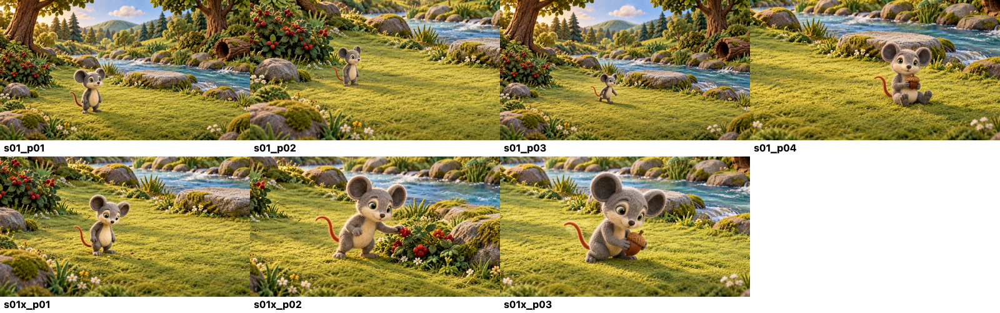

| Frame | Audio lines / visual unit | View and action | Full-size image |
|---|---|---|---|
| `s01_p01` | S01-L001 · v01a | `wide` — Milo explores the continuous foreground grass lane beneath the trees; keep him small within the wide landscape. | [PNG](../../character/characters/lion_and_mouse_v6/interactions/keyframes/s01_p01_r02_candidate.png) |
| `s01_p02` | S01-L002 · v01a | `medium_solo` — Milo pauses beside the far-left berry bush and hollow log, curious but standing on the grass lane. | [PNG](../../character/characters/lion_and_mouse_v6/interactions/keyframes/s01_p02_r02_candidate.png) |
| `s01_p03` | S01-L003 · v01a | `wide` — Milo follows the winding bank path a little farther from the stream-side stone. | [PNG](../../character/characters/lion_and_mouse_v6/interactions/keyframes/s01_p03_r02_candidate.png) |
| `s01_p04` | S01-L004 · v01b | `medium_solo` — Milo sits safely on the grass beside the path, holding and nibbling a single acorn; keep the stream behind him. | [PNG](../../character/characters/lion_and_mouse_v6/interactions/keyframes/s01_p04_r02_candidate.png) |
| `s01x_p01` | S01-L004 · v01b | `medium_solo` — Seeds in grass at Milo’s feet. | [PNG](../../character/characters/lion_and_mouse_v6/interactions/keyframes/s01x_p01_r02_candidate.png) |
| `s01x_p02` | S01-L004 · v01b | `medium_solo` — Berries beside the stream, with Milo on the bank. | [PNG](../../character/characters/lion_and_mouse_v6/interactions/keyframes/s01x_p02_r01_candidate.png) |
| `s01x_p03` | S01-L004 · v01b | `medium_solo` — Milo enjoys the acorn on the grass. | [PNG](../../character/characters/lion_and_mouse_v6/interactions/keyframes/s01x_p03_r01_candidate.png) |

## Scene 02 — It’s getting late

3 keyframes · approved location: `stream_sunset` · [open contact sheet](../../character/characters/lion_and_mouse_v6/interactions/keyframes/.review/contact_sheets/scene02_keyframes.png)

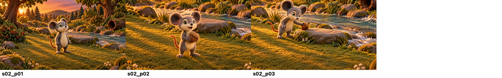

| Frame | Audio lines / visual unit | View and action | Full-size image |
|---|---|---|---|
| `s02_p01` | S02-L001–S02-L002 · v02a | `wide` — Milo looks up as warm afternoon light fades and long soft shadows stretch across the bank. | [PNG](../../character/characters/lion_and_mouse_v6/interactions/keyframes/s02_p01_r01_candidate.png) |
| `s02_p02` | S02-L003 · v02a | `medium_solo` — Milo stands on the grass lane, ears raised and mouth open for his brief spoken exclamation; the acorn stays in his paws. | [PNG](../../character/characters/lion_and_mouse_v6/interactions/keyframes/s02_p02_r01_candidate.png) |
| `s02_p03` | S02-L004 · v02a | `medium_solo` — Milo sets the acorn beside the flat stone, with both feet on the bank and the water clearly separate. | [PNG](../../character/characters/lion_and_mouse_v6/interactions/keyframes/s02_p03_r01_candidate.png) |

## Scene 03 — Two ways home

4 keyframes · approved location: `fork_sunset` · [open contact sheet](../../character/characters/lion_and_mouse_v6/interactions/keyframes/.review/contact_sheets/scene03_keyframes.png)

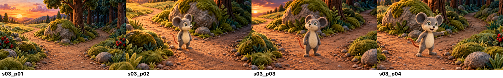

| Frame | Audio lines / visual unit | View and action | Full-size image |
|---|---|---|---|
| `s03_p01` | S03-L001–S03-L002 · v03a | `wide` — Wide establishing view of the fork around the central mossy boulder; both dirt branches are visible. | [PNG](../../character/characters/lion_and_mouse_v6/interactions/keyframes/s03_p01_r01_candidate.png) |
| `s03_p02` | S03-L003–S03-L005 · v03a | `medium_solo` — Milo looks from the safe left meadow route toward the darker right shortcut, standing on the path. | [PNG](../../character/characters/lion_and_mouse_v6/interactions/keyframes/s03_p02_r01_candidate.png) |
| `s03_p03` | S03-L006–S03-L008 · v03a | `medium_solo` — Milo pauses on the path and looks toward the darkening sky; show one still moment with the long safe path and shortcut visible behind him. | [PNG](../../character/characters/lion_and_mouse_v6/interactions/keyframes/s03_p03_r01_candidate.png) |
| `s03_p04` | S03-L009–S03-L010 · v03b | `medium_solo` — Milo points his body toward the shortcut and speaks with a determined open mouth, still grounded on the path. | [PNG](../../character/characters/lion_and_mouse_v6/interactions/keyframes/s03_p04_r01_candidate.png) |

## Scene 04 — The shortcut

7 keyframes · approved location: `shortcut_dusk` · [open contact sheet](../../character/characters/lion_and_mouse_v6/interactions/keyframes/.review/contact_sheets/scene04_keyframes.png)

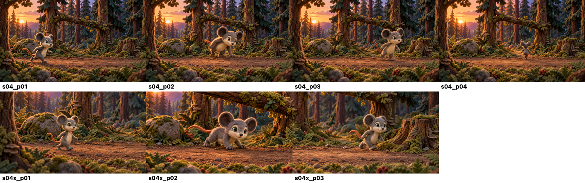

| Frame | Audio lines / visual unit | View and action | Full-size image |
|---|---|---|---|
| `s04_p01` | S04-L001–S04-L002 · v04a, v04b | `wide` — Milo hurries past the left mossy stone along the uninterrupted foreground running lane. | [PNG](../../character/characters/lion_and_mouse_v6/interactions/keyframes/s04_p01_r01_candidate.png) |
| `s04_p02` | S04-L003 · v04c | `wide` — Milo ducks beneath the raised fallen branch while remaining on the path; branch stays overhead. | [PNG](../../character/characters/lion_and_mouse_v6/interactions/keyframes/s04_p02_r01_candidate.png) |
| `s04_p03` | S04-L004 · v04d | `wide` — Milo curves around the right stump on the clear lane; no stepping on stump or foliage. | [PNG](../../character/characters/lion_and_mouse_v6/interactions/keyframes/s04_p03_r01_candidate.png) |
| `s04_p04` | S04-L005 · v04e | `wide` — Side view: Milo runs faster toward the distant opening, planted foot action readable and tail trailing naturally. | [PNG](../../character/characters/lion_and_mouse_v6/interactions/keyframes/s04_p04_r02_candidate.png) |
| `s04x_p01` | S04-L002 · v04b | `medium_solo` — Pass the mossy stone. | [PNG](../../character/characters/lion_and_mouse_v6/interactions/keyframes/s04x_p01_r01_candidate.png) |
| `s04x_p02` | S04-L003 · v04c | `medium_solo` — Duck under the fallen branch. | [PNG](../../character/characters/lion_and_mouse_v6/interactions/keyframes/s04x_p02_r02_candidate.png) |
| `s04x_p03` | S04-L004 · v04d | `medium_solo` — Curve around the old stump. | [PNG](../../character/characters/lion_and_mouse_v6/interactions/keyframes/s04x_p03_r01_candidate.png) |

## Scene 05 — The sleeping lion

8 keyframes · approved location: `tree_dusk` · [open contact sheet](../../character/characters/lion_and_mouse_v6/interactions/keyframes/.review/contact_sheets/scene05_keyframes.png)

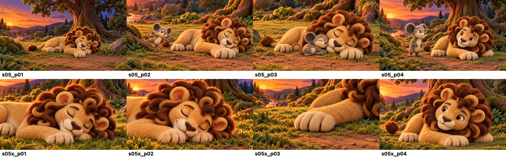

| Frame | Audio lines / visual unit | View and action | Full-size image |
|---|---|---|---|
| `s05_p01` | S05-L001–S05-L004 · v05a | `wide` — Leo sleeps on his side beneath the great oak, all four paws/body supported by the clearing; one large paw rests across the path. | [PNG](../../character/characters/lion_and_mouse_v6/interactions/keyframes/s05_p01_r01_candidate.png) |
| `s05_p02` | S05-L005–S05-L007 · v05b | `medium_two` — Milo rounds a visible root, catches his balance, and exclaims in a startled open-mouth beat before tumbling beside the paw. | [PNG](../../character/characters/lion_and_mouse_v6/interactions/keyframes/s05_p02_r01_candidate.png) |
| `s05_p03` | S05-L008–S05-L009 · v05c | `close_two` — Milo completes one small roll and lands safely against Leo’s nose; maintain gentle contact and keep Leo asleep. | [PNG](../../character/characters/lion_and_mouse_v6/interactions/keyframes/s05_p03_r01_candidate.png) |
| `s05_p04` | S05-L010–S05-L011 · v05d | `medium_two` — Leo opens his eyes and lifts his head; in the last beat he asks what happened with a speaking mouth, Milo remains silent. | [PNG](../../character/characters/lion_and_mouse_v6/interactions/keyframes/s05_p04_r02_candidate.png) |
| `s05x_p01` | S05-L002 · v05a | `detail_insert` — Leo’s mane rests against grass. | [PNG](../../character/characters/lion_and_mouse_v6/interactions/keyframes/s05x_p01_r02_candidate.png) |
| `s05x_p02` | S05-L003 · v05a | `detail_insert` — Leo’s closed eyes, with the same tree visible. | [PNG](../../character/characters/lion_and_mouse_v6/interactions/keyframes/s05x_p02_r02_candidate.png) |
| `s05x_p03` | S05-L004 · v05a | `detail_insert` — Leo’s grounded paw across the path. | [PNG](../../character/characters/lion_and_mouse_v6/interactions/keyframes/s05x_p03_r02_candidate.png) |
| `s05x_p04` | S05-L010–S05-L011 · v05d | `close_solo` — Leo wakes and speaks in a close view. | [PNG](../../character/characters/lion_and_mouse_v6/interactions/keyframes/s05x_p04_r02_candidate.png) |

## Scene 06 — A paw across the path

3 keyframes · approved location: `tree_dusk` · [open contact sheet](../../character/characters/lion_and_mouse_v6/interactions/keyframes/.review/contact_sheets/scene06_keyframes.png)

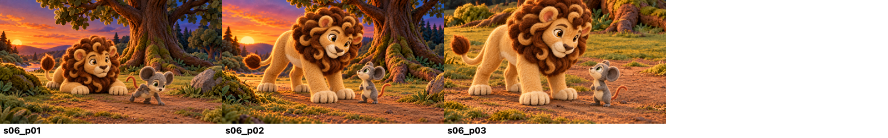

| Frame | Audio lines / visual unit | View and action | Full-size image |
|---|---|---|---|
| `s06_p01` | S06-L001 · v06a | `wide` — Leo lifts his head in surprise while Milo scrambles down to the clear dirt-and-grass path. | [PNG](../../character/characters/lion_and_mouse_v6/interactions/keyframes/s06_p01_r02_candidate.png) |
| `s06_p02` | S06-L002 · v06a | `medium_two` — Leo places a paw beside Milo on the path, blocking the exit without pinning or touching him. | [PNG](../../character/characters/lion_and_mouse_v6/interactions/keyframes/s06_p02_r02_candidate.png) |
| `s06_p03` | S06-L003–S06-L005 · v06b | `close_two` — Milo freezes beneath Leo’s calm but imposing presence; keep visible ground under both characters and emphasize the scale difference. | [PNG](../../character/characters/lion_and_mouse_v6/interactions/keyframes/s06_p03_r01_candidate.png) |

## Scene 07 — Milo explains

4 keyframes · approved location: `tree_dusk` · [open contact sheet](../../character/characters/lion_and_mouse_v6/interactions/keyframes/.review/contact_sheets/scene07_keyframes.png)

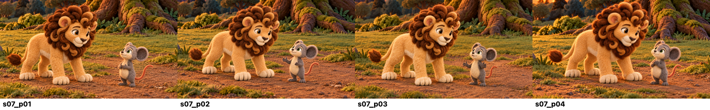

| Frame | Audio lines / visual unit | View and action | Full-size image |
|---|---|---|---|
| `s07_p01` | S07-L001–S07-L002 · v07a | `medium_two` — Leo asks why Milo raced through, mouth open only for Leo’s dialogue; Milo looks up from the path. | [PNG](../../character/characters/lion_and_mouse_v6/interactions/keyframes/s07_p01_r01_candidate.png) |
| `s07_p02` | S07-L003 · v07b | `medium_two` — Milo apologizes and explains he was eating by the stream; Milo mouth open for his dialogue, Leo listens silently. | [PNG](../../character/characters/lion_and_mouse_v6/interactions/keyframes/s07_p02_r01_candidate.png) |
| `s07_p03` | S07-L004 · v07b | `medium_two` — Milo explains he took a shortcut to get home before dark; keep his feet planted. | [PNG](../../character/characters/lion_and_mouse_v6/interactions/keyframes/s07_p03_r01_candidate.png) |
| `s07_p04` | S07-L005 · v07b | `medium_two` — Milo promises he did not mean to disturb Leo; Leo’s paw remains beside, not on, Milo. | [PNG](../../character/characters/lion_and_mouse_v6/interactions/keyframes/s07_p04_r01_candidate.png) |

## Scene 08 — The lion chooses kindness

6 keyframes · approved location: `tree_dusk` · [open contact sheet](../../character/characters/lion_and_mouse_v6/interactions/keyframes/.review/contact_sheets/scene08_keyframes.png)

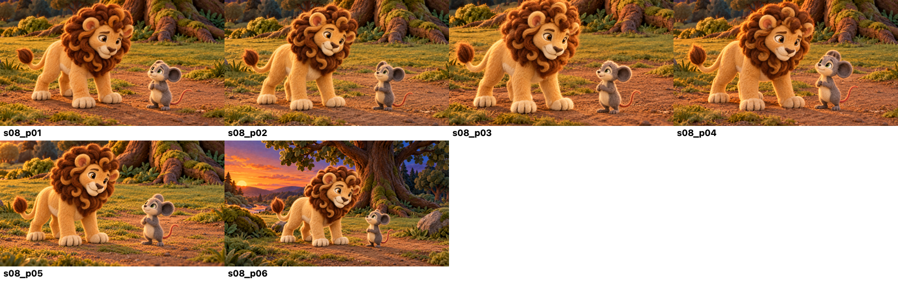

| Frame | Audio lines / visual unit | View and action | Full-size image |
|---|---|---|---|
| `s08_p01` | S08-L001–S08-L007 · v08a | `medium_two` — Milo trembles on the path as Leo looks down; Leo’s expression gradually softens, no narrator-driven mouth movement. | [PNG](../../character/characters/lion_and_mouse_v6/interactions/keyframes/s08_p01_r01_candidate.png) |
| `s08_p02` | S08-L008–S08-L011 · v08b | `medium_two` — Leo speaks gently and gives Milo permission to go; open mouth only on Leo’s dialogue beat. | [PNG](../../character/characters/lion_and_mouse_v6/interactions/keyframes/s08_p02_r01_candidate.png) |
| `s08_p03` | S08-L012 · v08c | `close_two` — Milo looks up in surprised relief and asks if Leo is letting him go; open mouth only on Milo’s line. | [PNG](../../character/characters/lion_and_mouse_v6/interactions/keyframes/s08_p03_r01_candidate.png) |
| `s08_p04` | S08-L013–S08-L018 · v08d | `medium_two` — Leo reassures him, then Milo’s expression shifts from fear to gratitude; dialogue mouths stay silent during narration. | [PNG](../../character/characters/lion_and_mouse_v6/interactions/keyframes/s08_p04_r01_candidate.png) |
| `s08_p05` | S08-L019–S08-L021 · v08e | `medium_two` — Milo thanks Leo and promises to pass kindness on; Milo speaks, Leo listens. | [PNG](../../character/characters/lion_and_mouse_v6/interactions/keyframes/s08_p05_r01_candidate.png) |
| `s08_p06` | S08-L022–S08-L024 · v08f | `wide` — Leo answers, then gently sends Milo home before the stars; show the open path and evening sky. | [PNG](../../character/characters/lion_and_mouse_v6/interactions/keyframes/s08_p06_r01_candidate.png) |

## Scene 09 — Days pass

4 keyframes · approved location: `multi` · [open contact sheet](../../character/characters/lion_and_mouse_v6/interactions/keyframes/.review/contact_sheets/scene09_keyframes.png)

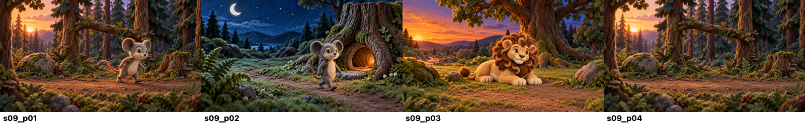

| Frame | Audio lines / visual unit | View and action | Full-size image |
|---|---|---|---|
| `s09_p01` | S09-L001–S09-L003 · v09a | `wide` — Milo hurries toward home but now chooses careful steps along a grounded path. | [PNG](../../character/characters/lion_and_mouse_v6/interactions/keyframes/s09_p01_r01_candidate.png) |
| `s09_p02` | S09-L004–S09-L005 · v09b | `wide` — A gentle passage-of-days visual: same forest route in changing light, Milo resumes ordinary routines. | [PNG](../../character/characters/lion_and_mouse_v6/interactions/keyframes/s09_p02_r01_candidate.png) |
| `s09_p03` | S09-L006 · v09c | `wide` — Leo rests beneath the same great tree, four paws supported by ground. | [PNG](../../character/characters/lion_and_mouse_v6/interactions/keyframes/s09_p03_r01_candidate.png) |
| `s09_p04` | S09-L007 · v09d | `wide` — Empty established shortcut path recedes into the dim opening, foreshadowing the friends meeting again; no new forest location or characters. | [PNG](../../character/characters/lion_and_mouse_v6/interactions/keyframes/s09_p04_r01_candidate.png) |

## Scene 10 — A hidden trap

3 keyframes · approved location: `trap_morning` · [open contact sheet](../../character/characters/lion_and_mouse_v6/interactions/keyframes/.review/contact_sheets/scene10_keyframes.png)

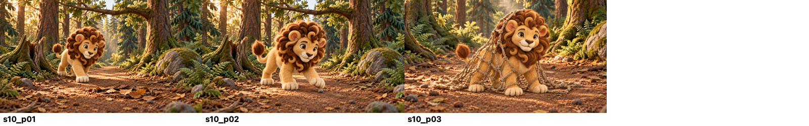

| Frame | Audio lines / visual unit | View and action | Full-size image |
|---|---|---|---|
| `s10_p01` | S10-L001 · v10a | `wide` — Leo walks along the trap path; a subtle leaf-covered trigger sits on the path ahead, not floating. | [PNG](../../character/characters/lion_and_mouse_v6/interactions/keyframes/s10_p01_r01_candidate.png) |
| `s10_p02` | S10-L002 · v10a | `wide` — Leo steps closer, one paw approaches the trigger on the ground. | [PNG](../../character/characters/lion_and_mouse_v6/interactions/keyframes/s10_p02_r01_candidate.png) |
| `s10_p03` | S10-L003–S10-L004 · v10b | `medium_solo` — The net drops from the overhead branch and settles loosely around Leo’s back, shoulders, flanks and legs; preserve a clear opening around his entire face and keep all four paws on the path. | [PNG](../../character/characters/lion_and_mouse_v6/interactions/keyframes/s10_p03_r01_candidate.png) |

## Scene 11 — Strength cannot break the ropes

4 keyframes · approved location: `trap_morning` · [open contact sheet](../../character/characters/lion_and_mouse_v6/interactions/keyframes/.review/contact_sheets/scene11_keyframes.png)

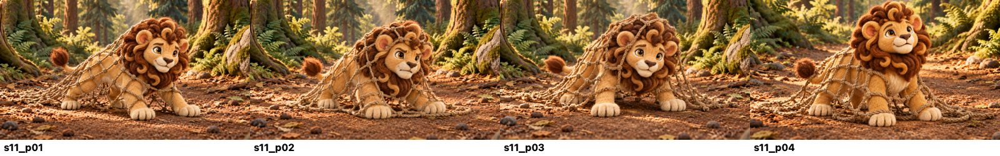

| Frame | Audio lines / visual unit | View and action | Full-size image |
|---|---|---|---|
| `s11_p01` | S11-L001–S11-L002 · v11a | `medium_solo` — Leo makes one careful tug against the net; open diamond mesh supports around his body but leaves his face entirely clear and all paws on the path. | [PNG](../../character/characters/lion_and_mouse_v6/interactions/keyframes/s11_p01_r01_candidate.png) |
| `s11_p02` | S11-L003–S11-L005 · v11a | `medium_solo` — Leo speaks in frustration while trying once more; his face is unobstructed, mouth opens only for his dialogue, and the net stays intact around his body. | [PNG](../../character/characters/lion_and_mouse_v6/interactions/keyframes/s11_p02_r01_candidate.png) |
| `s11_p03` | S11-L006–S11-L007 · v11a | `medium_solo` — Leo pauses, breathing heavily beneath the loose body net; face and four grounded paws remain clear. | [PNG](../../character/characters/lion_and_mouse_v6/interactions/keyframes/s11_p03_r01_candidate.png) |
| `s11_p04` | S11-L008–S11-L009 · v11b | `close_solo` — Leo raises his head and calls for help; his face stays completely outside the net mesh, four paws grounded, no ropes across eyes or muzzle. | [PNG](../../character/characters/lion_and_mouse_v6/interactions/keyframes/s11_p04_r01_candidate.png) |

## Scene 12 — Milo hears the call

7 keyframes · approved location: `run_morning` · [open contact sheet](../../character/characters/lion_and_mouse_v6/interactions/keyframes/.review/contact_sheets/scene12_keyframes.png)

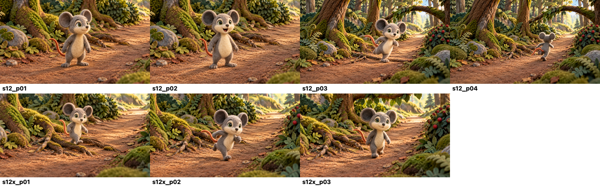

| Frame | Audio lines / visual unit | View and action | Full-size image |
|---|---|---|---|
| `s12_p01` | S12-L001–S12-L002 · v12a | `medium_solo` — Milo’s ears lift at the distant call; he recognizes it and turns toward the sound. | [PNG](../../character/characters/lion_and_mouse_v6/interactions/keyframes/s12_p01_r01_candidate.png) |
| `s12_p02` | S12-L003 · v12a | `medium_solo` — Milo calls “The lion!” with an open mouth for his line, standing on the path. | [PNG](../../character/characters/lion_and_mouse_v6/interactions/keyframes/s12_p02_r01_candidate.png) |
| `s12_p03` | S12-L004–S12-L007 · v12b | `wide` — Milo runs along the continuous lane, stepping over a low root and passing between bushes without leaving the path. | [PNG](../../character/characters/lion_and_mouse_v6/interactions/keyframes/s12_p03_r01_candidate.png) |
| `s12_p04` | S12-L008–S12-L010 · v12c | `wide` — Milo runs with purpose toward the bright opening; show stable scale progression into depth. | [PNG](../../character/characters/lion_and_mouse_v6/interactions/keyframes/s12_p04_r01_candidate.png) |
| `s12x_p01` | S12-L005 · v12b | `medium_solo` — Milo steps over low roots. | [PNG](../../character/characters/lion_and_mouse_v6/interactions/keyframes/s12x_p01_r01_candidate.png) |
| `s12x_p02` | S12-L006 · v12b | `medium_solo` — Milo runs between bushes. | [PNG](../../character/characters/lion_and_mouse_v6/interactions/keyframes/s12x_p02_r01_candidate.png) |
| `s12x_p03` | S12-L007 · v12b | `medium_solo` — Milo passes under the overhead branch. | [PNG](../../character/characters/lion_and_mouse_v6/interactions/keyframes/s12x_p03_r01_candidate.png) |

## Scene 13 — A small plan

6 keyframes · approved location: `trap_morning` · [open contact sheet](../../character/characters/lion_and_mouse_v6/interactions/keyframes/.review/contact_sheets/scene13_keyframes.png)

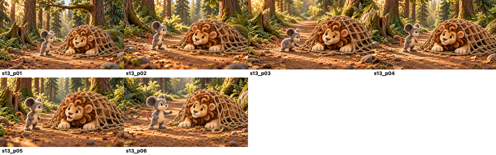

| Frame | Audio lines / visual unit | View and action | Full-size image |
|---|---|---|---|
| `s13_p01` | S13-L001–S13-L002 · v13a | `wide` — Milo arrives on the clear path and sees Leo beneath the net; keep net and all landmarks readable. | [PNG](../../character/characters/lion_and_mouse_v6/interactions/keyframes/s13_p01_r01_candidate.png) |
| `s13_p02` | S13-L003–S13-L005 · v13b | `medium_two` — Leo warns Milo to stay back and says the ropes are too strong; mouth open for Leo, all paws still supported. | [PNG](../../character/characters/lion_and_mouse_v6/interactions/keyframes/s13_p02_r02_candidate.png) |
| `s13_p03` | S13-L006–S13-L009 · v13c | `medium_two` — Milo carefully studies the mesh and steps toward the single closure loop; he stays outside tangled strands. | [PNG](../../character/characters/lion_and_mouse_v6/interactions/keyframes/s13_p03_r02_candidate.png) |
| `s13_p04` | S13-L010–S13-L011 · v13d | `medium_two` — Milo explains that his teeth may help; his mouth opens for his own dialogue, paws reach the net edge. | [PNG](../../character/characters/lion_and_mouse_v6/interactions/keyframes/s13_p04_r02_candidate.png) |
| `s13_p05` | S13-L012 · v13e | `medium_two` — Leo reacts with surprise and asks about Milo’s teeth; open mouth for Leo only. | [PNG](../../character/characters/lion_and_mouse_v6/interactions/keyframes/s13_p05_r02_candidate.png) |
| `s13_p06` | S13-L013–S13-L014 · v13f | `medium_two` — Milo answers playfully; his teeth remain small and natural, and no rope has been cut yet. | [PNG](../../character/characters/lion_and_mouse_v6/interactions/keyframes/s13_p06_r01_candidate.png) |

## Scene 14 — One bite at a time

6 keyframes · approved location: `trap_morning` · [open contact sheet](../../character/characters/lion_and_mouse_v6/interactions/keyframes/.review/contact_sheets/scene14_keyframes.png)

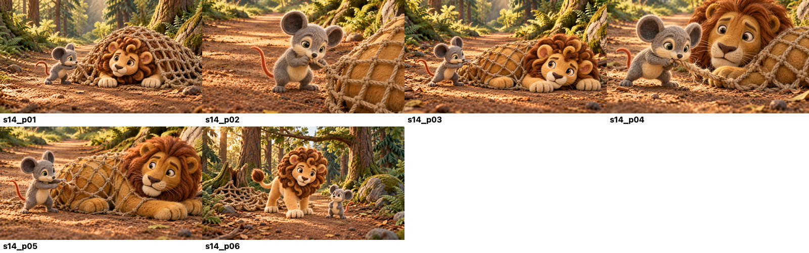

| Frame | Audio lines / visual unit | View and action | Full-size image |
|---|---|---|---|
| `s14_p01` | S14-L001 · v14a | `medium_two` — Milo steadies a single net closure strand at Leo’s flank and begins to gnaw; keep all rope entirely behind Leo’s shoulder and body, with a completely clear head and muzzle. | [PNG](../../character/characters/lion_and_mouse_v6/interactions/keyframes/s14_p01_r02_candidate.png) |
| `s14_p02` | S14-L002–S14-L004 · v14a | `detail_insert` — Close detail of Milo holding the closure strand with both paws and taking small bites; show only Milo and rope, not Leo’s face. | [PNG](../../character/characters/lion_and_mouse_v6/interactions/keyframes/s14_p02_r01_candidate.png) |
| `s14_p03` | S14-L005–S14-L008 · v14a | `medium_two` — Wider view: Milo bites the same closure loop beside Leo’s flank; Leo watches with his entire face free of every strand and all four paws grounded. | [PNG](../../character/characters/lion_and_mouse_v6/interactions/keyframes/s14_p03_r02_candidate.png) |
| `s14_p04` | S14-L009 · v14b | `detail_insert` — Extreme close detail of fibers fraying on the exact strand at Milo’s teeth; do not show rope crossing Leo’s head. | [PNG](../../character/characters/lion_and_mouse_v6/interactions/keyframes/s14_p04_r01_candidate.png) |
| `s14_p05` | S14-L010 · v14b | `detail_insert` — The same closure strand parts at its frayed point; the rest of the net remains intact and no rope touches Leo’s face. | [PNG](../../character/characters/lion_and_mouse_v6/interactions/keyframes/s14_p05_r01_candidate.png) |
| `s14_p06` | S14-L011–S14-L014 · v14c | `wide` — Milo steps clear, the opening widens, and Leo carefully steps out; net slips behind his body and stays off his face, paws touch the path. | [PNG](../../character/characters/lion_and_mouse_v6/interactions/keyframes/s14_p06_r02_candidate.png) |

## Scene 15 — Kindness is not a debt

12 keyframes · approved location: `trap_morning` · [open contact sheet](../../character/characters/lion_and_mouse_v6/interactions/keyframes/.review/contact_sheets/scene15_keyframes.png)

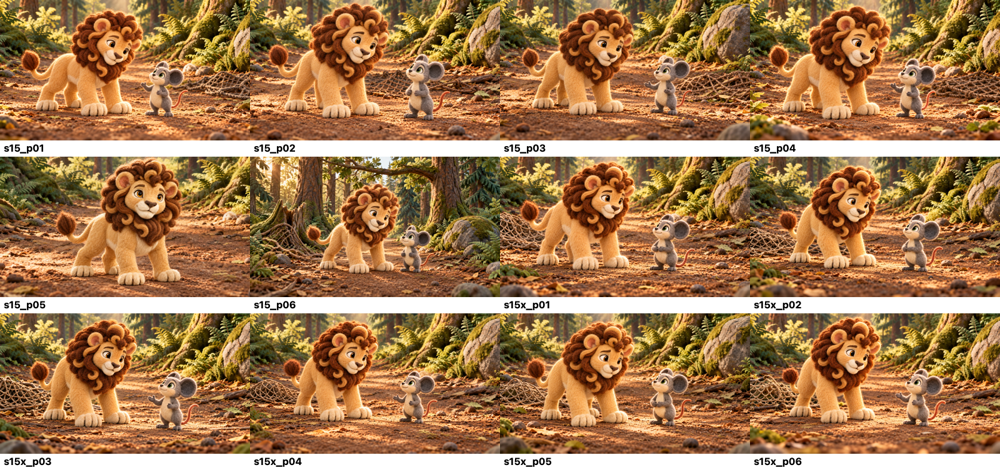

| Frame | Audio lines / visual unit | View and action | Full-size image |
|---|---|---|---|
| `s15_p01` | S15-L001–S15-L005 · v15a | `medium_two` — Leo thanks Milo; Milo answers playfully; a two-shot shows the great lion looking at the tiny mouse with gratitude. | [PNG](../../character/characters/lion_and_mouse_v6/interactions/keyframes/s15_p01_r01_candidate.png) |
| `s15_p02` | S15-L006–S15-L008 · v15b | `medium_two` — Leo asks about repaying kindness and Milo replies; alternate speaking mouth only for the named line speaker. | [PNG](../../character/characters/lion_and_mouse_v6/interactions/keyframes/s15_p02_r01_candidate.png) |
| `s15_p03` | S15-L009–S15-L012 · v15c, v15d | `medium_two` — Milo explains that kindness is not a debt; Leo listens, then asks what Milo means. | [PNG](../../character/characters/lion_and_mouse_v6/interactions/keyframes/s15_p03_r01_candidate.png) |
| `s15_p04` | S15-L013–S15-L015 · v15d | `medium_two` — Milo says he helped someone in need and hopes kindness will pass on; use a warm medium two-shot. | [PNG](../../character/characters/lion_and_mouse_v6/interactions/keyframes/s15_p04_r01_candidate.png) |
| `s15_p05` | S15-L016–S15-L019 · v15e | `close_solo` — Leo falls quiet as he reconsiders strength; close on his reflective face with mouth closed during narration. | [PNG](../../character/characters/lion_and_mouse_v6/interactions/keyframes/s15_p05_r01_candidate.png) |
| `s15_p06` | S15-L020–S15-L023 · v15e | `wide` — Leo understands gentleness as strength and smiles; Milo remains beside him, both supported on the path. | [PNG](../../character/characters/lion_and_mouse_v6/interactions/keyframes/s15_p06_r01_candidate.png) |
| `s15x_p01` | S15-L006 · v15b | `medium_two` — Leo speaks; Milo listens. | [PNG](../../character/characters/lion_and_mouse_v6/interactions/keyframes/s15x_p01_r01_candidate.png) |
| `s15x_p02` | S15-L007 · v15b | `medium_two` — Milo replies; Leo listens. | [PNG](../../character/characters/lion_and_mouse_v6/interactions/keyframes/s15x_p02_r01_candidate.png) |
| `s15x_p03` | S15-L008 · v15b | `medium_two` — Leo suggests repayment. | [PNG](../../character/characters/lion_and_mouse_v6/interactions/keyframes/s15x_p03_r01_candidate.png) |
| `s15x_p04` | S15-L009 · v15c | `medium_two` — Milo says kindness is not a debt. | [PNG](../../character/characters/lion_and_mouse_v6/interactions/keyframes/s15x_p04_r01_candidate.png) |
| `s15x_p05` | S15-L010 · v15c | `medium_two` — Leo asks what Milo means. | [PNG](../../character/characters/lion_and_mouse_v6/interactions/keyframes/s15x_p05_r01_candidate.png) |
| `s15x_p06` | S15-L011–S15-L015 · v15d | `medium_two` — Milo explains and hopes the kindness continues. | [PNG](../../character/characters/lion_and_mouse_v6/interactions/keyframes/s15x_p06_r01_candidate.png) |

## Scene 16 — Friends beneath the great tree

8 keyframes · approved location: `tree_day` · [open contact sheet](../../character/characters/lion_and_mouse_v6/interactions/keyframes/.review/contact_sheets/scene16_keyframes.png)

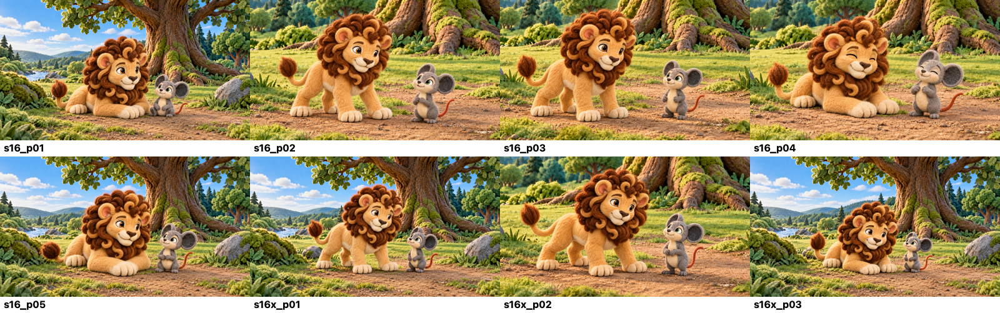

| Frame | Audio lines / visual unit | View and action | Full-size image |
|---|---|---|---|
| `s16_p01` | S16-L001 · v16a | `wide` — Later in daylight, Leo and Milo rest together on the open ground beneath the great oak. | [PNG](../../character/characters/lion_and_mouse_v6/interactions/keyframes/s16_p01_r01_candidate.png) |
| `s16_p02` | S16-L002–S16-L003 · v16a | `medium_two` — Leo jokes warmly that Milo has large ideas; open mouth only on Leo’s spoken line. | [PNG](../../character/characters/lion_and_mouse_v6/interactions/keyframes/s16_p02_r01_candidate.png) |
| `s16_p03` | S16-L004 · v16a | `medium_two` — Milo replies that he has useful teeth; open mouth only on Milo’s line. | [PNG](../../character/characters/lion_and_mouse_v6/interactions/keyframes/s16_p03_r01_candidate.png) |
| `s16_p04` | S16-L005–S16-L006 · v16a | `medium_two` — The friends laugh together; laughter is a visible action, not narrator lip-sync. | [PNG](../../character/characters/lion_and_mouse_v6/interactions/keyframes/s16_p04_r01_candidate.png) |
| `s16_p05` | S16-L007–S16-L012 · v16b, v16c | `wide` — A peaceful closing sequence beneath the tree: two friends share the lesson of passing kindness on; keep both characters silent during narrator voice-over. | [PNG](../../character/characters/lion_and_mouse_v6/interactions/keyframes/s16_p05_r01_candidate.png) |
| `s16x_p01` | S16-L007–S16-L008 · v16b | `wide` — Friends together beneath the same tree as narration recalls the earlier events. | [PNG](../../character/characters/lion_and_mouse_v6/interactions/keyframes/s16x_p01_r01_candidate.png) |
| `s16x_p02` | S16-L009–S16-L010 · v16b | `medium_two` — Quiet shared view of their bond on the clearing. | [PNG](../../character/characters/lion_and_mouse_v6/interactions/keyframes/s16x_p02_r01_candidate.png) |
| `s16x_p03` | S16-L011–S16-L012 · v16c | `wide` — Wide final view of Leo and Milo beneath the great tree. | [PNG](../../character/characters/lion_and_mouse_v6/interactions/keyframes/s16x_p03_r01_candidate.png) |

## Review points

- Compare Milo’s proportions and fully visible ears with his canonical pose; compare Leo’s tawny body, brown mane and quadrupedal posture with his canonical pose.
- Check continuity at the stream, fork, shortcut, great tree, run path and trap path, including supported paws and changing depth.
- Scene 05 holds Leo asleep through its detail inserts; he wakes while lying down and rises during Scene 06.
- Scene 13 and most of Scene 14 hold the same net over Leo. `s14_p06` is the first frame in which he is fully clear; the net then remains discarded behind the pair.
- Dialogue mouth shapes are a later character-only lip-sync pass. A still with a slightly open mouth is a pose reference, not narrator lip-sync or a final mouth-calibration asset.

