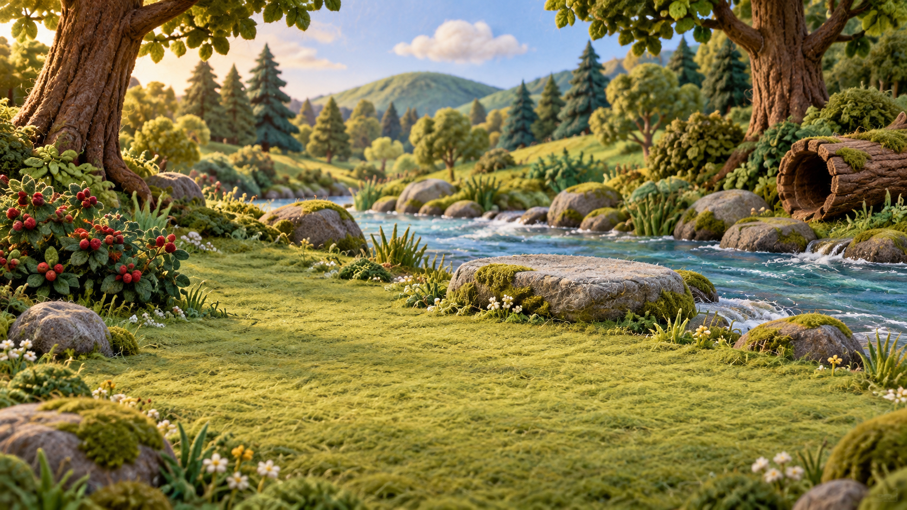
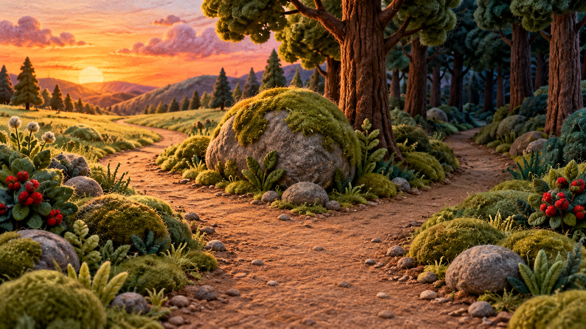
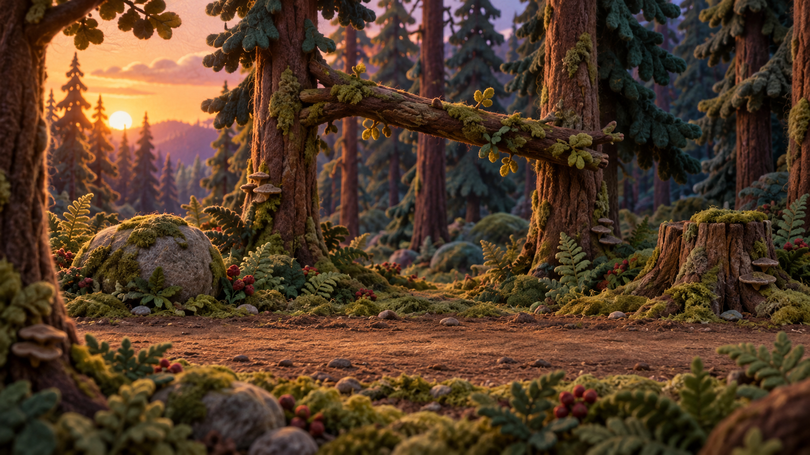
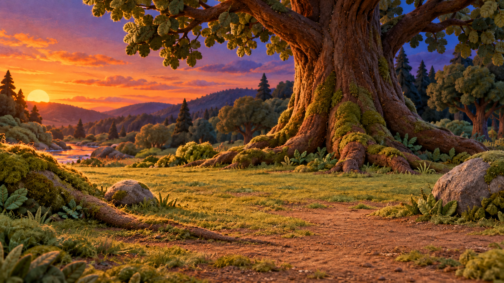
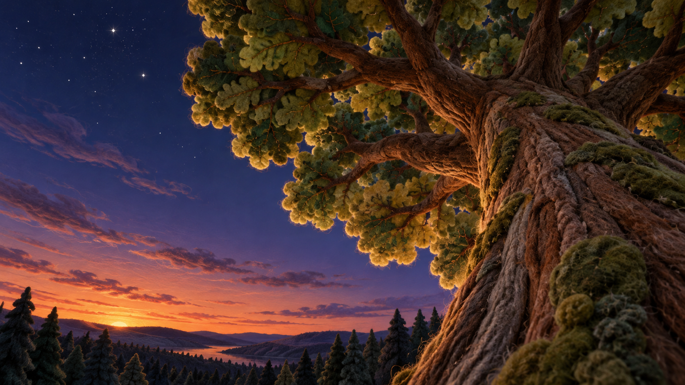
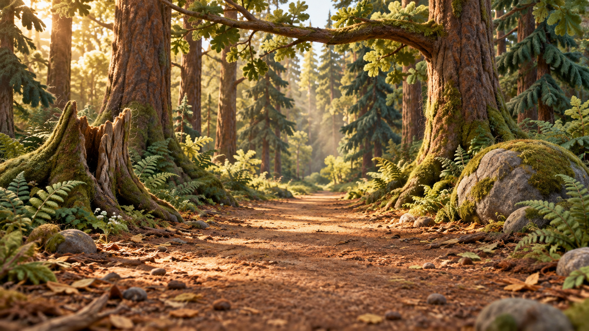
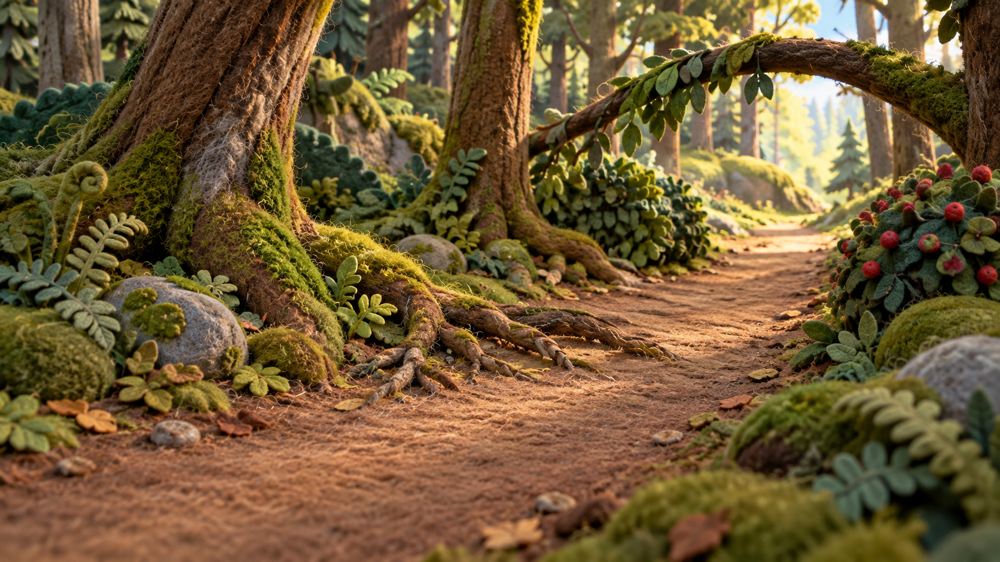
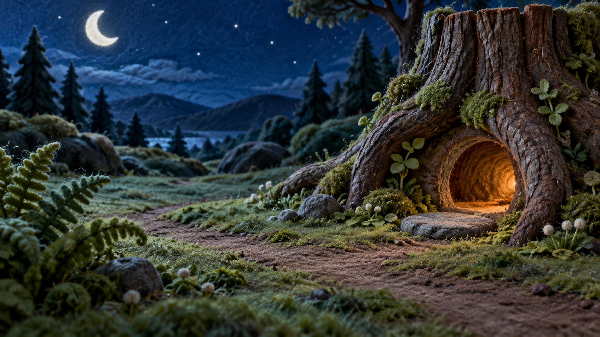
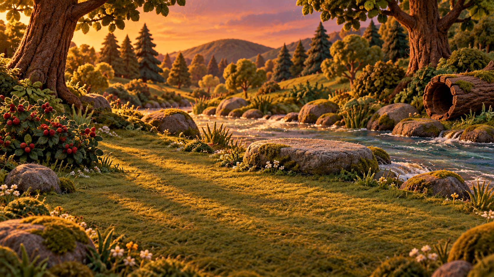
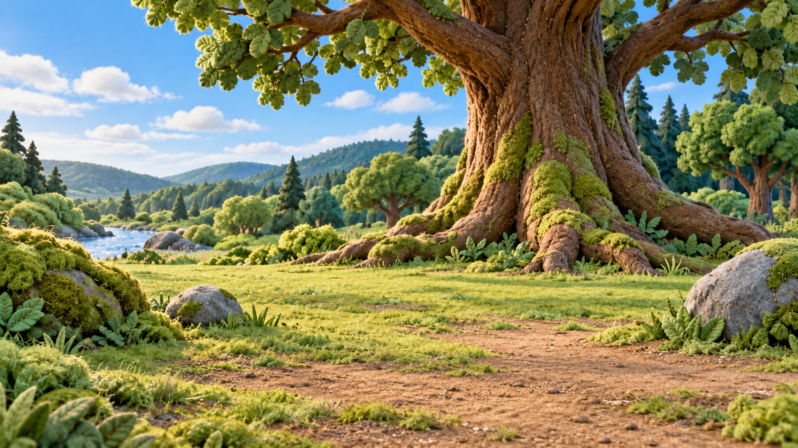

# v6 location plates and lighting variants

**Status: eight empty composition seeds are accepted as v6 masters.** They are environment plates, not scene frames, and each was generated without a location-image reference. The stream sunset and great-tree daytime lighting variants are accepted as well. Spatial walkability, invalid support, anchors, depth, scale, occlusion and contact rules are recorded in [`visual_bible.json`](visual_bible.json) under the adopted [spatial staging policy](../../docs/spatial-staging-consistency.md).

The shared style is handcrafted wool-felt stop-motion: matte felt surfaces, visible fibers and stitches, handmade irregularity, edge-to-edge environments, and soft storybook lighting. No character, acorn, net, or trap hardware appears in these location seeds.

Each accepted seed is registered as its location/camera composition master. The sunset and daytime variants were derived directly from their corresponding masters; they change illumination only and are accepted composition variants.

## Stream bank — afternoon

Fixed anchors: stream across the middle/right, flat stone beside the foreground lane, hollow log on the right bank, berry bush at far left, framing trunks, and distant hills. This accepted composition master is the source for the sunset-light accepted variant below.

## Path fork — sunset

Fixed anchors: central mossy boulder, left safe branch toward a bright meadow, right shortcut into darker trees, center-right trunk, and berry bushes at the edges.

## Shortcut lane — dusk

Fixed anchors: left mossy boulder, raised branch across the middle distance, right-side stump, framing trunks, and a level foreground running lane.

## Great tree clearing — dusk

Fixed anchors: massive center-right oak and root fan, broad clear foreground path, left mossy mound, center-left stone, right rock, and stream glimpse at far left.

**Owner-selected root continuity master (2026-10-14):** The r02 plate adds the low diagonal foreground root that Milo rounds in Scene 05 while retaining the oak, sunset, stream glimpse, stone, right rock and clearing layout. It is the location authority for the continuous Scene 05–08 encounter. The prior [r01 master](../../character/locations/lion_and_mouse_v6/great_tree/tree_dusk_r01.png) remains intact as history. Existing keyframes derived from r01 remain candidates until their backgrounds have been checked against r02; changing the plate alone does not approve those images.

## Great tree canopy — upward camera

A distinct camera setup for the stars passage: trunk rising at right, canopy in the upper-right, open dusk sky at left, and distant pines along the bottom.

## Trap path — morning

Fixed anchors: straight open path, two framing trunks, overhead branch, split-root stump at left, mossy boulder at right, and fern borders. The branch supports a later prop design; the seed has no net or mechanism.

## Forest run — morning

Fixed anchors: leaning trunk at left, exposed roots by the path, low arched branch, berry bush at right, and bright distant opening. The route stays continuous and passable.

## Milo’s home — night

Fixed anchors: stump and round burrow at right, two arching roots, stepping stone, low fern at left, and moonlit distant hills.

## Lighting variants — accepted

### Stream bank — sunset

Derived directly from `PL_stream_afternoon`. The camera, bank, stream, landmarks and path remain fixed; only the sunset illumination changes.

### Great tree clearing — daytime

Derived directly from `PL_tree_dusk`. The camera, oak, root fan, path and rocks remain fixed; only the time-of-day illumination changes.

The [daytime r02 candidate](../../character/locations/lion_and_mouse_v6/great_tree/tree_day_r02_candidate.png)
uses the accepted daytime color and illumination with the low diagonal foreground
root from the current [dusk r02 master](../../character/locations/lion_and_mouse_v6/great_tree/tree_dusk_r02.png).
It is pending visual review; `tree_day_r01.png` remains the active accepted
daytime plate. Compare the root's path from the left mossy mound and verify
that the trunk, stream, rocks, camera, and daylight remain aligned before
promoting this variant.

Review both variants against their master plates for unchanged geometry, landmarks, crop and perspective, then check walkable support and depth metadata.
