# v6 scene boards — owner review

**Audio basis:** 161 line WAVs, 16 scene tracks, 11:23.7; every voice line is assigned exactly once across 70 chronological overview panels. Twenty-two supplemental views add narration and dialogue coverage. See [`audio_manifest.json`](audio_manifest.json), [`SCRIPT.md`](SCRIPT.md), [`scene_plan.json`](scene_plan.json), and [`VISUAL_SEQUENCE_PLAN.md`](VISUAL_SEQUENCE_PLAN.md).

**Background continuity:** see [`BACKGROUND_CONTINUITY.md`](BACKGROUND_CONTINUITY.md) for which scenes reuse the same place, where lighting changes, and the intentional montage/transition scenes.

**Character staging:** see [`CHARACTER_STAGING.md`](CHARACTER_STAGING.md) for the cast ratio, positions and depth rule. These boards guided the individual images; the approved plates and staging records remain the geometry authority. Scene 09's corrected four-panel board uses only approved places.

**Review boundary:** these are multi-panel layout candidates. The 92 individual 1920×1080 video-source candidates are indexed in [`KEYFRAME_REVIEW.md`](KEYFRAME_REVIEW.md). They are pending owner review; no video clips, mouth-calibration assets, or assembled edit exist. Acorn and net prop designs are candidates. Narration is voice-over only; only the visible character assigned a spoken line receives lip-sync.

## Scene 01 — The little explorer

Location: stream_afternoon. Panels: 4.

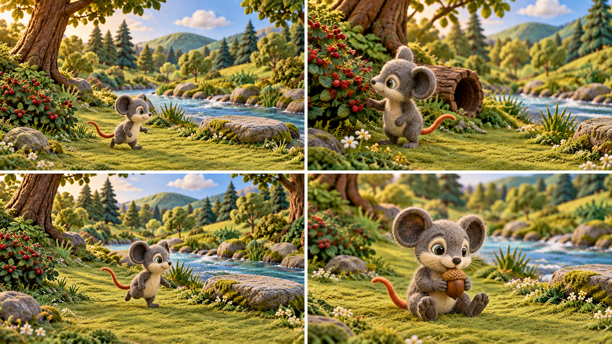

## Scene 02 — It’s getting late

Location: stream_sunset. Panels: 3.

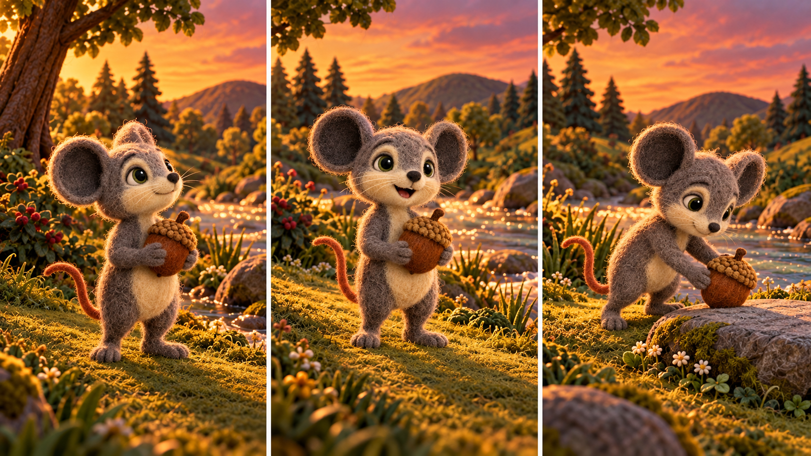

## Scene 03 — Two ways home

Location: fork_sunset. Panels: 4.

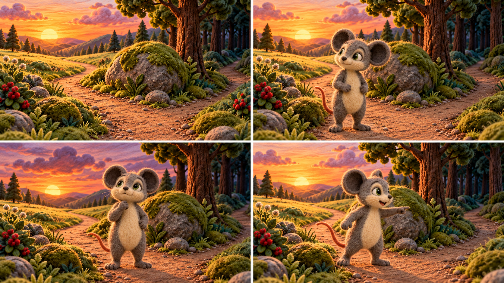

## Scene 04 — The shortcut

Location: shortcut_dusk. Panels: 4.

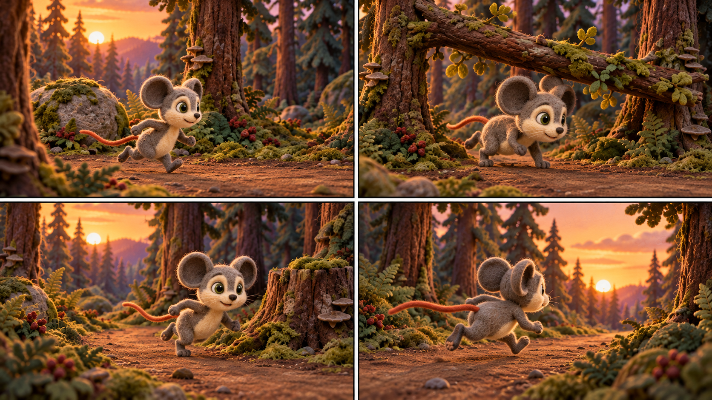

## Scene 05 — The sleeping lion

Location: tree_dusk. Panels: 4.

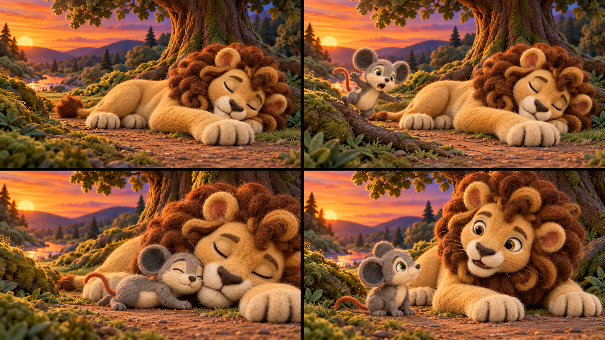

## Scene 06 — A paw across the path

Location: tree_dusk. Panels: 3.

## Scene 07 — Milo explains

Location: tree_dusk. Panels: 4.

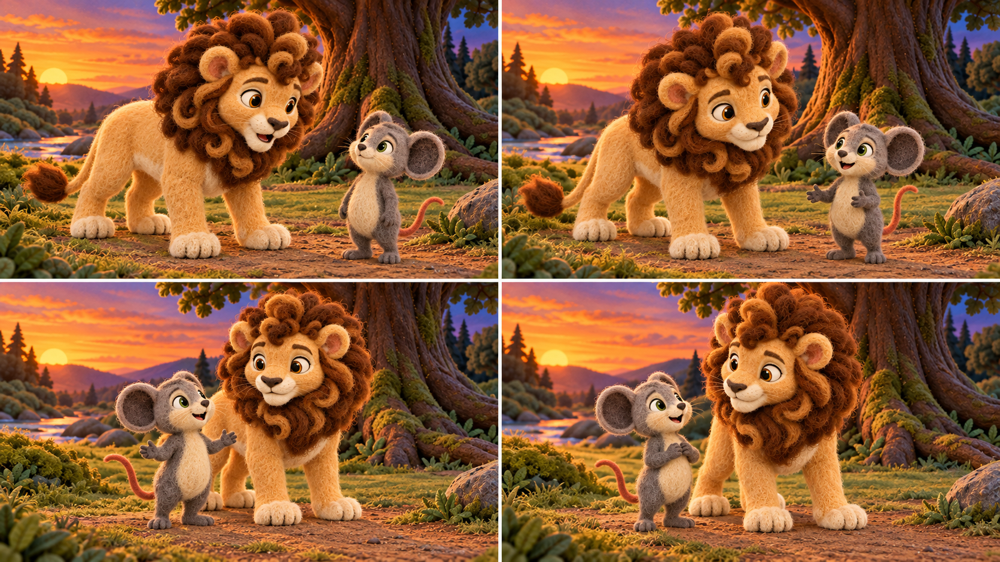

## Scene 08 — The lion chooses kindness

Location: tree_dusk. Panels: 6.

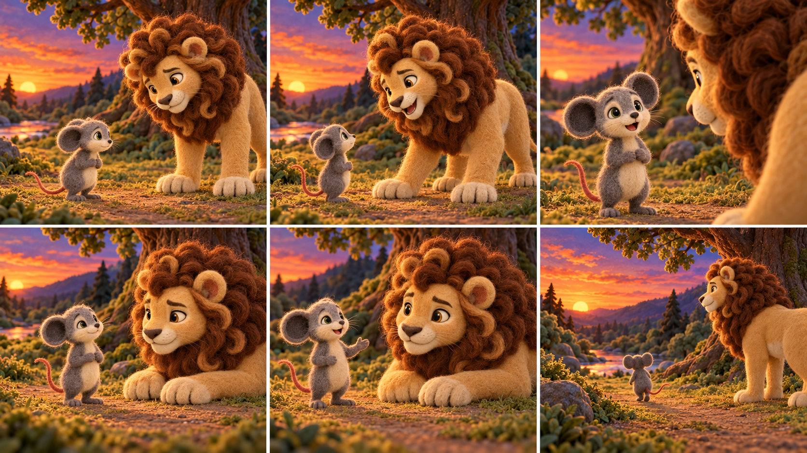

## Scene 09 — Days pass

Location: multi. Panels: 4.

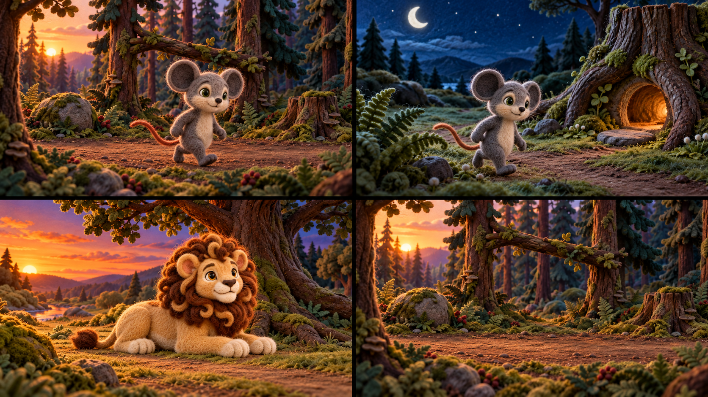

## Scene 10 — A hidden trap

Location: trap_morning. Panels: 3.

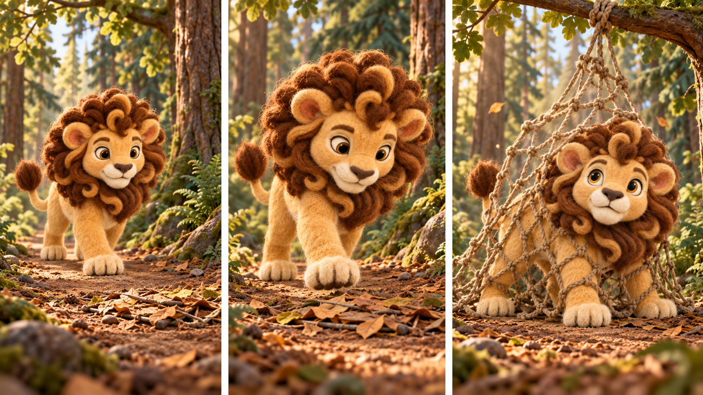

## Scene 11 — Strength cannot break the ropes

Location: trap_morning. Panels: 4.

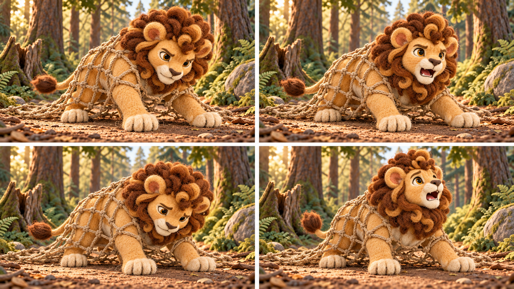

## Scene 12 — Milo hears the call

Location: run_morning. Panels: 4.

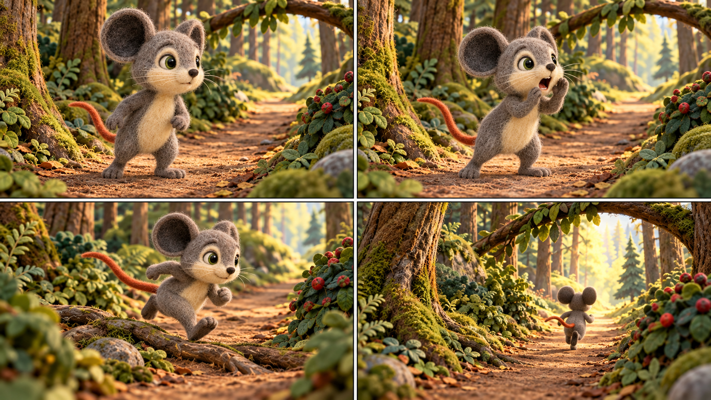

## Scene 13 — A small plan

Location: trap_morning. Panels: 6.

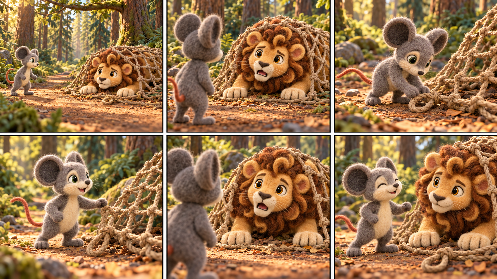

## Scene 14 — One bite at a time

Location: trap_morning. Panels: 6.

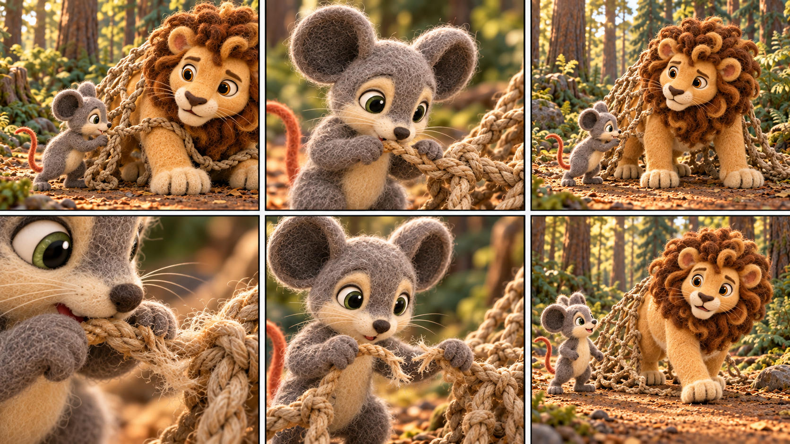

## Scene 15 — Kindness is not a debt

Location: trap_morning. Panels: 6.

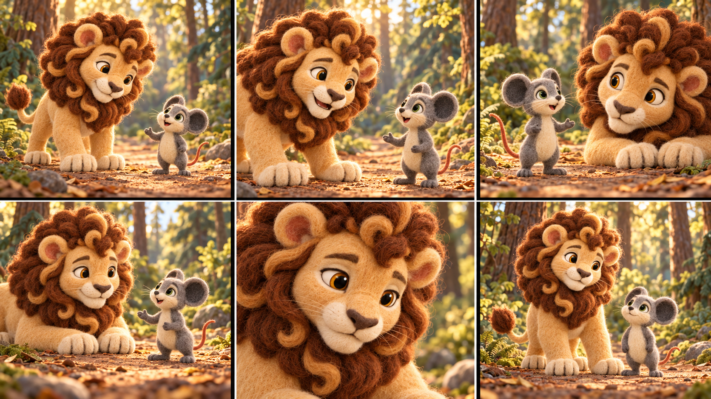

## Scene 16 — Friends beneath the great tree

Location: tree_day. Panels: 5.

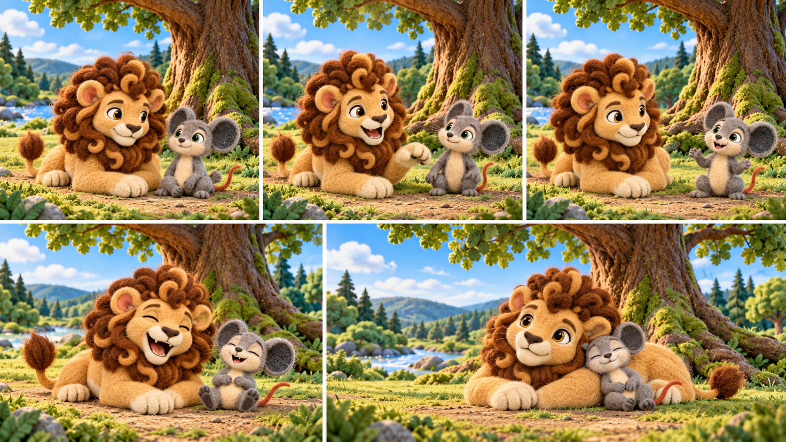

## Supplemental overview boards

These expand detail coverage while retaining the same approved locations and audio tracks. Their individual frames are part of [`KEYFRAME_REVIEW.md`](KEYFRAME_REVIEW.md).

- [Scene 01 foods and acorn](../../character/characters/lion_and_mouse_v6/interactions/keyframes/.review/s01_food_details_r01_candidate.png)
- [Scene 04 stone, branch and stump](../../character/characters/lion_and_mouse_v6/interactions/keyframes/.review/s04_obstacle_views_r01_candidate.png)
- [Scene 05 sleeping and waking details](../../character/characters/lion_and_mouse_v6/interactions/keyframes/.review/s05_sleep_and_wake_details_r01_candidate.png)
- [Scene 12 running obstacles](../../character/characters/lion_and_mouse_v6/interactions/keyframes/.review/s12_run_obstacles_r01_candidate.png)
- [Scene 15 dialogue turns](../../character/characters/lion_and_mouse_v6/interactions/keyframes/.review/s15_dialogue_turns_r01_candidate.png)
- [Scene 16 closing narration](../../character/characters/lion_and_mouse_v6/interactions/keyframes/.review/s16_closing_narration_r01_candidate.png)

## Prop references pending review

### Acorn

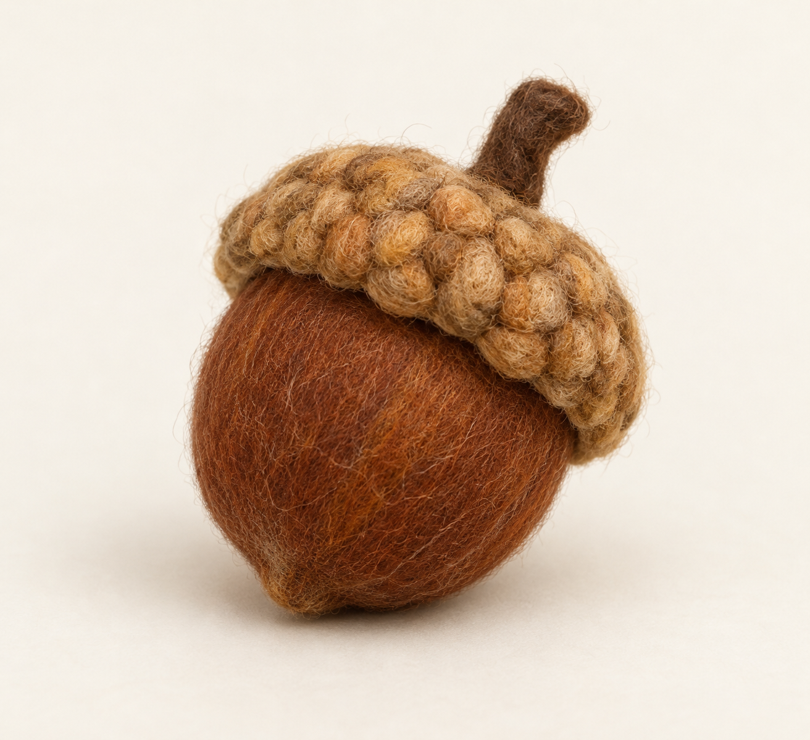

### Hunter net

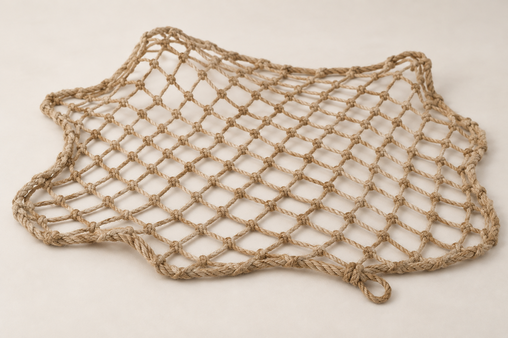

## Review checklist

- [ ] Character identity and proportions match approved v6 canonicals.
- [ ] Milo’s ears stay fully visible; Leo remains quadrupedal and grounded except when a lying pose is staged.
- [ ] Location camera, landmarks, time of day, and walkable ground remain consistent.
- [ ] Character support contact and relative scale look plausible.
- [ ] Acorn and net designs are acceptable and their scene states make sense.
- [ ] Narration shows silent character mouths; only the assigned character speaks on dialogue lines.
- [ ] Audio lines are covered in order without gaps or duplicates.
